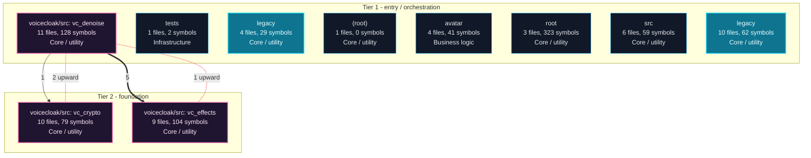
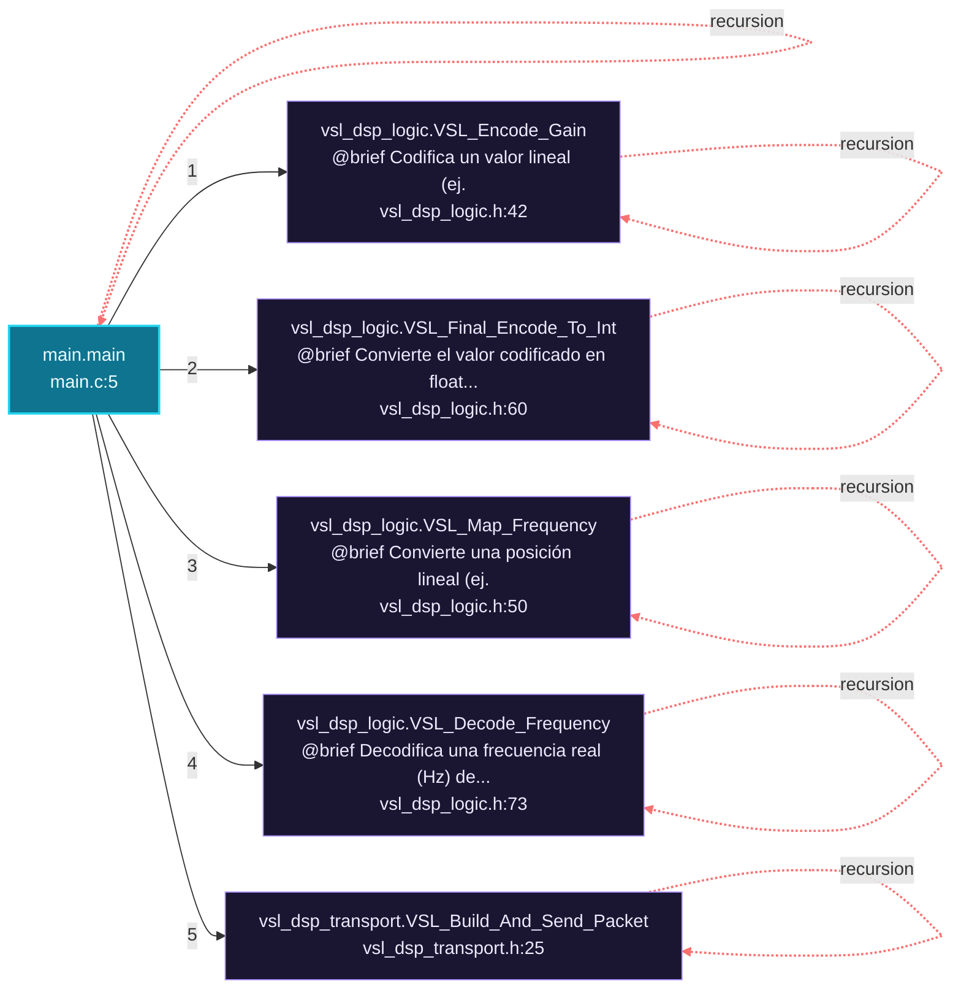
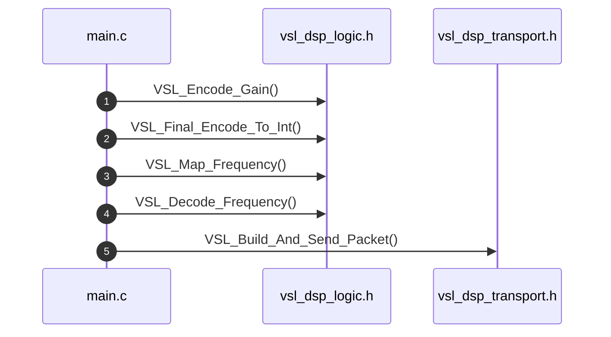
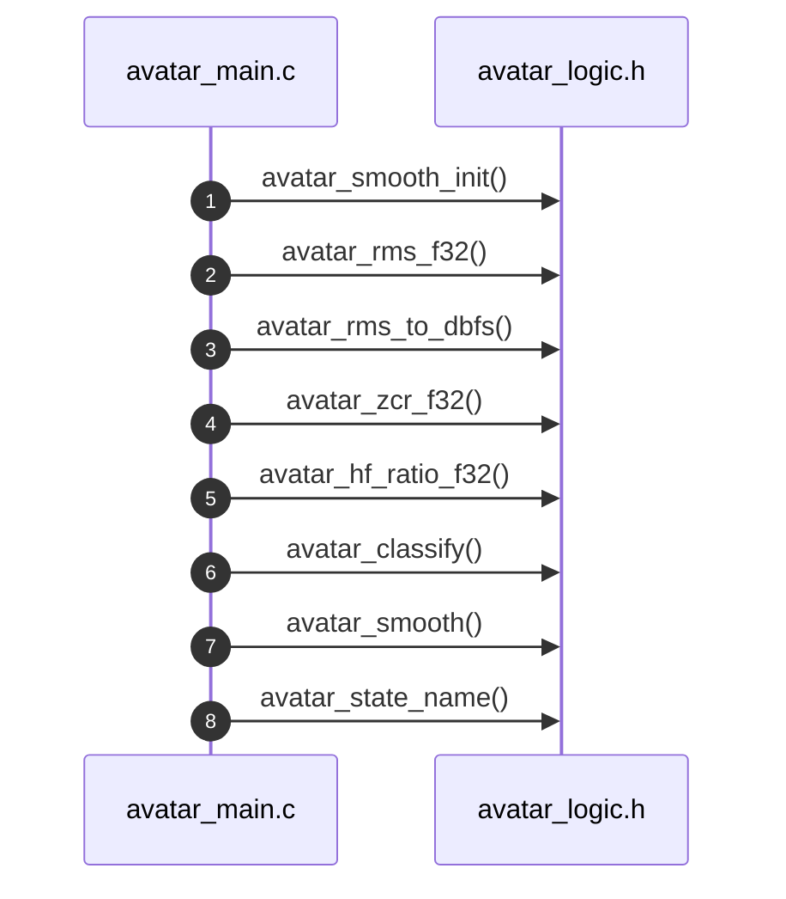
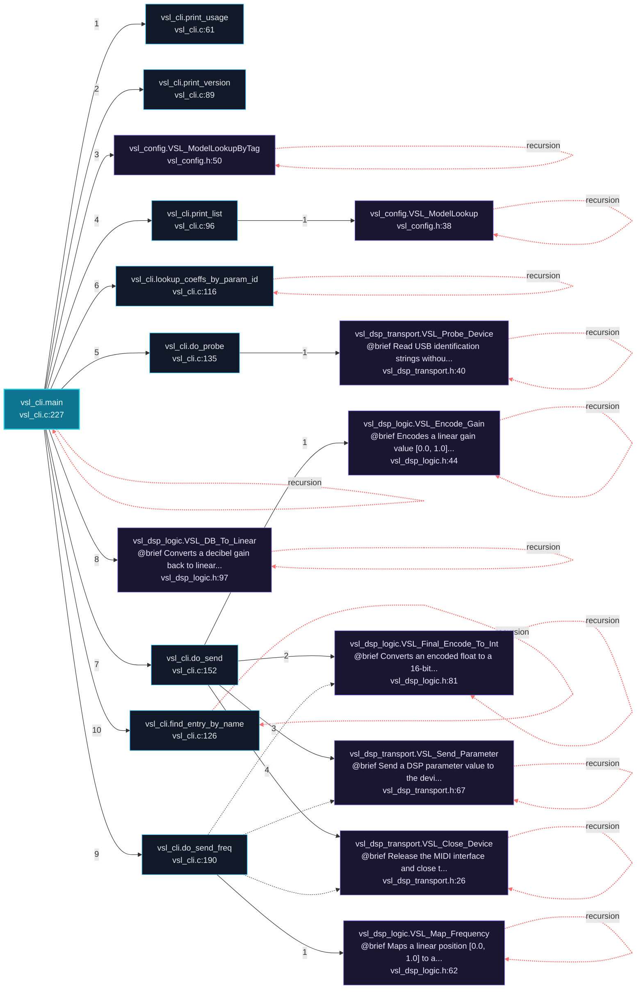
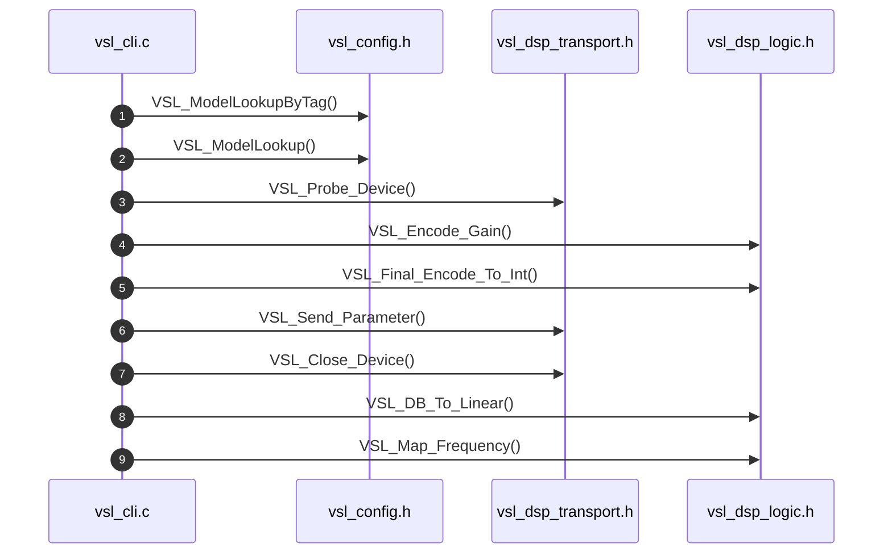

```mermaid
flowchart LR
    classDef default fill:#111827,stroke:#38bdf8,color:#e5e7eb;
    classDef entry fill:#0e7490,stroke:#22d3ee,color:#ecfeff,stroke-width:2px;
    classDef external fill:#1a1530,stroke:#a78bfa,color:#ede9fe;
    n_avatar_avatar_main_c__main["avatar_main.main<br/>avatar_main.c:191"]:::entry
    n_avatar_avatar_main_c__env_or["avatar_main.env_or<br/>avatar_main.c:79"]:::default
    n_avatar_avatar_main_c__list_pcms["avatar_main.list_pcms<br/>avatar_main.c:54"]:::default
    n_avatar_avatar_main_c__usage["avatar_main.usage<br/>avatar_main.c:30"]:::default
    n_avatar_avatar_main_c__open_capture["avatar_main.open_capture<br/>avatar_main.c:85"]:::default
    n_avatar_avatar_logic_h__avatar_smooth_init["avatar_logic.avatar_smooth_init<br/>@brief Init hysteresis holder.<br/>avatar_logic.h:85"]:::external
    n_avatar_avatar_main_c__to_mono_f32["avatar_main.to_mono_f32<br/>if (snd_pcm_hw_params(pcm, hw) #lt; 0) { fprintf...<br/>avatar_main.c:156"]:::default
    n_avatar_avatar_logic_h__avatar_rms_f32["avatar_logic.avatar_rms_f32<br/>@brief RMS of a mono float frame, 0..1.<br/>avatar_logic.h:45"]:::external
    n_avatar_avatar_logic_h__avatar_rms_to_dbfs["avatar_logic.avatar_rms_to_dbfs<br/>@brief Convert RMS to dBFS with -120 dB floor.<br/>avatar_logic.h:52"]:::external
    n_avatar_avatar_logic_h__avatar_zcr_f32["avatar_logic.avatar_zcr_f32<br/>@brief Zero-crossing rate 0..1.<br/>avatar_logic.h:60"]:::external
    n_avatar_avatar_logic_h__avatar_hf_ratio_f32["avatar_logic.avatar_hf_ratio_f32<br/>@brief High-frequency ratio RMS(diff)/RMS, cl...<br/>avatar_logic.h:68"]:::external
    n_avatar_avatar_logic_h__avatar_classify["avatar_logic.avatar_classify<br/>@brief Instantaneous state without hysteresis...<br/>avatar_logic.h:78"]:::external
    n_avatar_avatar_logic_h__avatar_smooth["avatar_logic.avatar_smooth<br/>@brief Hysteresis: instant attack, delayed re...<br/>avatar_logic.h:95"]:::external
    n_avatar_avatar_logic_h__avatar_state_name["avatar_logic.avatar_state_name<br/>@brief State label for window title and headl...<br/>avatar_logic.h:103"]:::external
    n_avatar_avatar_main_c__main -.->|"recursion"| n_avatar_avatar_main_c__main
    n_avatar_avatar_main_c__main -->|"1"| n_avatar_avatar_main_c__env_or
    n_avatar_avatar_main_c__main -->|"2"| n_avatar_avatar_main_c__list_pcms
    n_avatar_avatar_main_c__main -->|"3"| n_avatar_avatar_main_c__usage
    n_avatar_avatar_main_c__main -->|"4"| n_avatar_avatar_main_c__open_capture
    n_avatar_avatar_main_c__main -->|"5"| n_avatar_avatar_logic_h__avatar_smooth_init
    n_avatar_avatar_logic_h__avatar_smooth_init -.->|"recursion"| n_avatar_avatar_logic_h__avatar_smooth_init
    n_avatar_avatar_main_c__main -->|"6"| n_avatar_avatar_main_c__to_mono_f32
    n_avatar_avatar_main_c__main -->|"7"| n_avatar_avatar_logic_h__avatar_rms_f32
    n_avatar_avatar_logic_h__avatar_rms_f32 -.->|"recursion"| n_avatar_avatar_logic_h__avatar_rms_f32
    n_avatar_avatar_main_c__main -->|"8"| n_avatar_avatar_logic_h__avatar_rms_to_dbfs
    n_avatar_avatar_logic_h__avatar_rms_to_dbfs -.->|"recursion"| n_avatar_avatar_logic_h__avatar_rms_to_dbfs
    n_avatar_avatar_main_c__main -->|"9"| n_avatar_avatar_logic_h__avatar_zcr_f32
    n_avatar_avatar_logic_h__avatar_zcr_f32 -.->|"recursion"| n_avatar_avatar_logic_h__avatar_zcr_f32
    n_avatar_avatar_main_c__main -->|"10"| n_avatar_avatar_logic_h__avatar_hf_ratio_f32
    n_avatar_avatar_logic_h__avatar_hf_ratio_f32 -.->|"recursion"| n_avatar_avatar_logic_h__avatar_hf_ratio_f32
    n_avatar_avatar_main_c__main -->|"11"| n_avatar_avatar_logic_h__avatar_classify
    n_avatar_avatar_logic_h__avatar_classify -.->|"recursion"| n_avatar_avatar_logic_h__avatar_classify
    n_avatar_avatar_main_c__main -->|"12"| n_avatar_avatar_logic_h__avatar_smooth
    n_avatar_avatar_logic_h__avatar_smooth -.->|"recursion"| n_avatar_avatar_logic_h__avatar_smooth
    n_avatar_avatar_main_c__main -->|"13"| n_avatar_avatar_logic_h__avatar_state_name
    n_avatar_avatar_logic_h__avatar_state_name -.->|"recursion"| n_avatar_avatar_logic_h__avatar_state_name
    linkStyle 0,6,9,11,13,15,17,19,21 stroke:#f87171,stroke-width:2px;
```

# VSL-DSP Architecture and Execution Flows

[Back to index](index.md)

## Architecture Overview

10 components stacked in 2 dependency tiers (weighted Eades-Lin-Smyth ordering: arrows point from dependent to dependency, top to bottom). Labels are import counts, thick arrows the top quartile; 0 transitively implied edges are omitted. Dashed red arrows are upward dependencies: the smallest set of imports that closes every cycle and breaks the layering. Cyan components hold entry points. Interactive version: `readmenator-apidocs/index.html#/flows`.

Upward dependencies to fix first: `voicecloak/src: vc_crypto` -> `voicecloak/src: vc_denoise` (2 imports); `voicecloak/src: vc_effects` -> `voicecloak/src: vc_denoise` (1 imports)

---

## Execution Flows

Entry points are scored from `__main__` guards, `main` functions, entry-style names and files, and call-graph sources. Each flow walks resolved calls in call-site order (depth <= 4, <= 40 steps); numbers give the call order, dashed arrows revisit an already expanded callee, red arrows are recursion. Interactive version with zoom and per-node docs: `readmenator-apidocs/index.html#/flows`.

### `main.main`

`legacy/main.c:5`, score 13: `main` in a compiled-language file; entry-style name `main`; defined in entry file `main.c`.

Call tree:

Cross-file sequence:

### `avatar_main.main`

`avatar/avatar_main.c:191`, score 11: `main` in a compiled-language file; entry-style name `main`.

Call tree:

Cross-file sequence:

### `vsl_cli.main`

`src/vsl_cli.c:227`, score 11: `main` in a compiled-language file; entry-style name `main`.

Call tree:

Cross-file sequence:

---
