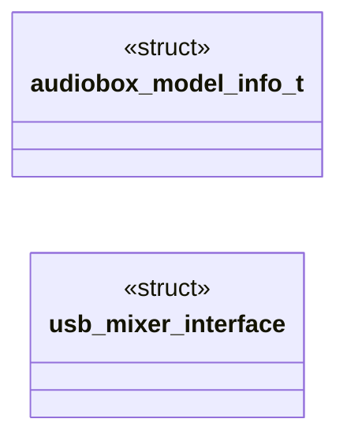

# `audiobox_vsl.h`

> Source: [audiobox_vsl.h:1](../../audiobox_vsl.h#L1) | language `h` | coverage 50.0% | [API index](../index.md)

SPDX-License-Identifier: GPL-2.0-or-later

## Contents

- **Structs:** [`audiobox_model_info_t`](#audiobox_model_info_t), [`usb_mixer_interface`](#usb_mixer_interface)
- **Functions:** [`audiobox_lookup_model`](#audiobox_lookup_model), [`audiobox_is_primary_interface`](#audiobox_is_primary_interface), [`snd_audiobox_vsl_init`](#snd_audiobox_vsl_init)
- **Macros:** [`AUDIOBOX_VENDOR_ID`](#audiobox_vendor_id), [`AUDIOBOX_VERSION_STRING`](#audiobox_version_string)
- **Variables:** [`audiobox_model_pid_t`](#audiobox_model_pid_t)

## Type Diagram



## Structs

<a id="audiobox_model_info_t"></a>

### `audiobox_model_info_t`

`struct` | [audiobox_vsl.h:64](../../audiobox_vsl.h#L64)

```c
typedef struct
```

Pair of product ID and canonical human readable model name. The product_name field is a pointer to a static string literal that lives for the lifetime of the kernel. Callers must not free it.

---

<a id="usb_mixer_interface"></a>

### `usb_mixer_interface`

`struct` | [audiobox_vsl.h:141](../../audiobox_vsl.h#L141)

```c
struct usb_mixer_interface;
```

---

## Functions

<a id="audiobox_lookup_model"></a>

### `audiobox_lookup_model`

`function` | [audiobox_vsl.h:107](../../audiobox_vsl.h#L107)

```c
static inline const audiobox_model_info_t * audiobox_lookup_model(uint16_t pid)
```

**Parameters**

| Name | Type | Default | Description |
|---|---|---|---|
| `pid` | `uint16_t` |  |  |

**Returns:** `audiobox_model_info_t *`

---

<a id="audiobox_is_primary_interface"></a>

### `audiobox_is_primary_interface`

`function` | [audiobox_vsl.h:131](../../audiobox_vsl.h#L131)

```c
static inline int audiobox_is_primary_interface(unsigned int ifnum)
```

**Parameters**

| Name | Type | Default | Description |
|---|---|---|---|
| `ifnum` | `unsigned int` |  |  |

**Returns:** `int`

---

<a id="snd_audiobox_vsl_init"></a>

### `snd_audiobox_vsl_init`

`function` | [audiobox_vsl.h:150](../../audiobox_vsl.h#L150)

```c
int snd_audiobox_vsl_init(struct usb_mixer_interface *mixer);
```

ALSA mixer init hook for AudioBox VSL devices. Optional entry point used by the upstream sound/usb/mixer_quirks.c dispatch table. Not invoked by the detector itself. Returns 0 on success, a negative errno on failure.

**Parameters**

| Name | Type | Default | Description |
|---|---|---|---|
| `mixer` | `struct usb_mixer_interface *` |  |  |

**Returns:** `int`

*Called by:* [`verify_mixer_quirks`](legacy.build-dkms.sh.md#verify_mixer_quirks), [`snd_usb_mixer_apply_create_quirk`](legacy.mixer_quirks.c.md#snd_usb_mixer_apply_create_quirk)

---

## Macros

<a id="audiobox_vendor_id"></a>

### `AUDIOBOX_VENDOR_ID`

`macro` | [audiobox_vsl.h:32](../../audiobox_vsl.h#L32)

```c
#define AUDIOBOX_VENDOR_ID
```

PreSonus USB vendor ID shared by every AudioBox VSL model.

---

<a id="audiobox_version_string"></a>

### `AUDIOBOX_VERSION_STRING`

`macro` | [audiobox_vsl.h:55](../../audiobox_vsl.h#L55)

```c
#define AUDIOBOX_VERSION_STRING
```

---

## Variables

<a id="audiobox_model_pid_t"></a>

### `audiobox_model_pid_t`

`variable` `extern` | [audiobox_vsl.h:26](../../audiobox_vsl.h#L26)

```c
extern "C" { #endif /** * @brief PreSonus USB vendor ID shared by every AudioBox VSL model. */ #define AUDIOBOX_VENDOR_ID 0x194fU /** * @brief Product IDs of the AudioBox VSL family. * * The enumerato
```

ifdef __cplusplus

---
