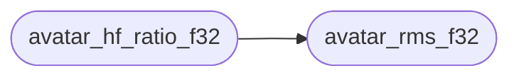

# `avatar/avatar_logic.c`

> Source: [avatar/avatar_logic.c:1](../../avatar/avatar_logic.c#L1) | language `c` | coverage 88.9% | [API index](../index.md)

## Contents

- **Functions:** [`avatar_rms_f32`](#avatar_rms_f32), [`avatar_rms_to_dbfs`](#avatar_rms_to_dbfs), [`avatar_zcr_f32`](#avatar_zcr_f32), [`avatar_hf_ratio_f32`](#avatar_hf_ratio_f32), [`avatar_classify`](#avatar_classify), [`avatar_smooth_init`](#avatar_smooth_init), [`avatar_smooth`](#avatar_smooth), [`avatar_state_name`](#avatar_state_name)

## Call Graph

Solid arrows stay in this module, dashed arrows leave it.



## Functions

<a id="avatar_rms_f32"></a>

### `avatar_rms_f32`

`function` | [avatar/avatar_logic.c:5](../../avatar/avatar_logic.c#L5)

```c
float avatar_rms_f32(const float *x, size_t n)
```

RMS of a mono float frame, 0..1.

**Parameters**

| Name | Type | Default | Description |
|---|---|---|---|
| `x` | `float *` |  | frame or NULL. |
| `n` | `size_t` |  | frame length. |

**Returns:** `float` - RMS, 0 on NULL/empty/non-finite.

> **Inherited:** Documentation from [`avatar_rms_f32`](#avatar_rms_f32) (avatar/avatar_logic.h:45).

*Called by:* [`avatar_hf_ratio_f32`](#avatar_hf_ratio_f32)

---

<a id="avatar_rms_to_dbfs"></a>

### `avatar_rms_to_dbfs`

`function` | [avatar/avatar_logic.c:27](../../avatar/avatar_logic.c#L27)

```c
float avatar_rms_to_dbfs(float rms)
```

Convert RMS to dBFS with -120 dB floor.

**Parameters**

| Name | Type | Default | Description |
|---|---|---|---|
| `rms` | `float` |  | linear RMS. |

**Returns:** `float` - dBFS value.

> **Inherited:** Documentation from [`avatar_rms_to_dbfs`](#avatar_rms_to_dbfs) (avatar/avatar_logic.h:52).

---

<a id="avatar_zcr_f32"></a>

### `avatar_zcr_f32`

`function` | [avatar/avatar_logic.c:41](../../avatar/avatar_logic.c#L41)

```c
float avatar_zcr_f32(const float *x, size_t n)
```

Zero-crossing rate 0..1.

**Parameters**

| Name | Type | Default | Description |
|---|---|---|---|
| `x` | `float *` |  | frame or NULL. |
| `n` | `size_t` |  | frame length. |

**Returns:** `float` - crossing count / (n-1), 0 on NULL/n<2.

> **Inherited:** Documentation from [`avatar_zcr_f32`](#avatar_zcr_f32) (avatar/avatar_logic.h:60).

---

<a id="avatar_hf_ratio_f32"></a>

### `avatar_hf_ratio_f32`

`function` | [avatar/avatar_logic.c:68](../../avatar/avatar_logic.c#L68)

```c
float avatar_hf_ratio_f32(const float *x, size_t n)
```

High-frequency ratio RMS(diff)/RMS, clamped 0..2.

**Parameters**

| Name | Type | Default | Description |
|---|---|---|---|
| `x` | `float *` |  | frame or NULL. |
| `n` | `size_t` |  | frame length. |

**Returns:** `float` - ratio, 0 on NULL/n<2.

> **Inherited:** Documentation from [`avatar_hf_ratio_f32`](#avatar_hf_ratio_f32) (avatar/avatar_logic.h:68).

*Calls:* [`avatar_rms_f32`](#avatar_rms_f32)

---

<a id="avatar_classify"></a>

### `avatar_classify`

`function` | [avatar/avatar_logic.c:107](../../avatar/avatar_logic.c#L107)

```c
avatar_state_t avatar_classify(float rms_db, float zcr, float hf, const avatar_cfg_t *c)
```

Instantaneous state without hysteresis, fail-closed.

**Parameters**

| Name | Type | Default | Description |
|---|---|---|---|
| `rms_db` | `float` |  | frame level in dBFS. |
| `zcr` | `float` |  | zero-crossing rate. |
| `hf` | `float` |  | high-frequency ratio. |
| `c` | `avatar_cfg_t *` |  | thresholds or NULL (NULL yields CLOSED). |

**Returns:** `avatar_state_t` - CLOSED on silence, SIBILANT when both gates pass, else OPEN.

> **Inherited:** Documentation from [`avatar_classify`](#avatar_classify) (avatar/avatar_logic.h:78).

---

<a id="avatar_smooth_init"></a>

### `avatar_smooth_init`

`function` | [avatar/avatar_logic.c:125](../../avatar/avatar_logic.c#L125)

```c
void avatar_smooth_init(avatar_smooth_t *s, avatar_state_t init, uint64_t now_ms, unsigned int hold_ms)
```

Init hysteresis holder.

**Parameters**

| Name | Type | Default | Description |
|---|---|---|---|
| `s` | `avatar_smooth_t *` |  |  |
| `init` | `avatar_state_t` |  |  |
| `now_ms` | `uint64_t` |  |  |
| `hold_ms` | `unsigned int` |  | release delay for CLOSED in ms. |

> **Inherited:** Documentation from [`avatar_smooth_init`](#avatar_smooth_init) (avatar/avatar_logic.h:85).

---

<a id="avatar_smooth"></a>

### `avatar_smooth`

`function` | [avatar/avatar_logic.c:136](../../avatar/avatar_logic.c#L136)

```c
avatar_state_t avatar_smooth(avatar_smooth_t *s, avatar_state_t inst, uint64_t now_ms)
```

Hysteresis: instant attack, delayed release to CLOSED.

**Parameters**

| Name | Type | Default | Description |
|---|---|---|---|
| `s` | `avatar_smooth_t *` |  | holder or NULL (NULL yields CLOSED). |
| `inst` | `avatar_state_t` |  | instantaneous state from avatar_classify. |
| `now_ms` | `uint64_t` |  | monotonic clock in ms. |

**Returns:** `avatar_state_t` - state to display.

> **Inherited:** Documentation from [`avatar_smooth`](#avatar_smooth) (avatar/avatar_logic.h:95).

---

<a id="avatar_state_name"></a>

### `avatar_state_name`

`function` `const` | [avatar/avatar_logic.c:161](../../avatar/avatar_logic.c#L161)

```c
const char *avatar_state_name(avatar_state_t st)
```

State label for window title and headless output.

**Parameters**

| Name | Type | Default | Description |
|---|---|---|---|
| `st` | `avatar_state_t` |  | state value. |

**Returns:** `char *` - static string, never NULL.

> **Inherited:** Documentation from [`avatar_state_name`](#avatar_state_name) (avatar/avatar_logic.h:103).

---
