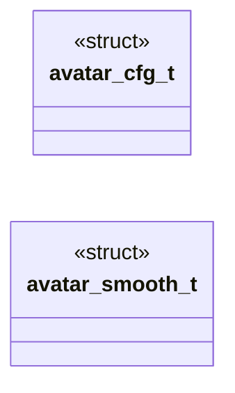

# `avatar/avatar_logic.h`

> Source: [avatar/avatar_logic.h:1](../../avatar/avatar_logic.h#L1) | language `h` | coverage 90.9% | [API index](../index.md)

## Contents

- **Structs:** [`avatar_cfg_t`](#avatar_cfg_t), [`avatar_smooth_t`](#avatar_smooth_t)
- **Functions:** [`avatar_rms_f32`](#avatar_rms_f32), [`avatar_rms_to_dbfs`](#avatar_rms_to_dbfs), [`avatar_zcr_f32`](#avatar_zcr_f32), [`avatar_hf_ratio_f32`](#avatar_hf_ratio_f32), [`avatar_classify`](#avatar_classify), [`avatar_smooth_init`](#avatar_smooth_init), [`avatar_smooth`](#avatar_smooth), [`avatar_state_name`](#avatar_state_name)
- **Variables:** [`avatar_state_t`](#avatar_state_t)

## Type Diagram



## Structs

<a id="avatar_cfg_t"></a>

### `avatar_cfg_t`

`struct` | [avatar/avatar_logic.h:23](../../avatar/avatar_logic.h#L23)

```c
typedef struct
```

Tunable classifier thresholds.

---

<a id="avatar_smooth_t"></a>

### `avatar_smooth_t`

`struct` | [avatar/avatar_logic.h:33](../../avatar/avatar_logic.h#L33)

```c
typedef struct
```

Hysteresis holder for flicker-free display.

---

## Functions

<a id="avatar_rms_f32"></a>

### `avatar_rms_f32`

`function` | [avatar/avatar_logic.h:45](../../avatar/avatar_logic.h#L45)

```c
float avatar_rms_f32(const float *x, size_t n);
```

RMS of a mono float frame, 0..1.

**Parameters**

| Name | Type | Default | Description |
|---|---|---|---|
| `x` | `float *` |  | frame or NULL. |
| `n` | `size_t` |  | frame length. |

**Returns:** `float` - RMS, 0 on NULL/empty/non-finite.

*Called by:* [`main`](avatar.avatar_main.c.md#main)

---

<a id="avatar_rms_to_dbfs"></a>

### `avatar_rms_to_dbfs`

`function` | [avatar/avatar_logic.h:52](../../avatar/avatar_logic.h#L52)

```c
float avatar_rms_to_dbfs(float rms);
```

Convert RMS to dBFS with -120 dB floor.

**Parameters**

| Name | Type | Default | Description |
|---|---|---|---|
| `rms` | `float` |  | linear RMS. |

**Returns:** `float` - dBFS value.

*Called by:* [`main`](avatar.avatar_main.c.md#main)

---

<a id="avatar_zcr_f32"></a>

### `avatar_zcr_f32`

`function` | [avatar/avatar_logic.h:60](../../avatar/avatar_logic.h#L60)

```c
float avatar_zcr_f32(const float *x, size_t n);
```

Zero-crossing rate 0..1.

**Parameters**

| Name | Type | Default | Description |
|---|---|---|---|
| `x` | `float *` |  | frame or NULL. |
| `n` | `size_t` |  | frame length. |

**Returns:** `float` - crossing count / (n-1), 0 on NULL/n<2.

*Called by:* [`main`](avatar.avatar_main.c.md#main)

---

<a id="avatar_hf_ratio_f32"></a>

### `avatar_hf_ratio_f32`

`function` | [avatar/avatar_logic.h:68](../../avatar/avatar_logic.h#L68)

```c
float avatar_hf_ratio_f32(const float *x, size_t n);
```

High-frequency ratio RMS(diff)/RMS, clamped 0..2.

**Parameters**

| Name | Type | Default | Description |
|---|---|---|---|
| `x` | `float *` |  | frame or NULL. |
| `n` | `size_t` |  | frame length. |

**Returns:** `float` - ratio, 0 on NULL/n<2.

*Called by:* [`main`](avatar.avatar_main.c.md#main)

---

<a id="avatar_classify"></a>

### `avatar_classify`

`function` | [avatar/avatar_logic.h:78](../../avatar/avatar_logic.h#L78)

```c
avatar_state_t avatar_classify(float rms_db, float zcr, float hf, const avatar_cfg_t *c);
```

Instantaneous state without hysteresis, fail-closed.

**Parameters**

| Name | Type | Default | Description |
|---|---|---|---|
| `rms_db` | `float` |  | frame level in dBFS. |
| `zcr` | `float` |  | zero-crossing rate. |
| `hf` | `float` |  | high-frequency ratio. |
| `c` | `avatar_cfg_t *` |  | thresholds or NULL (NULL yields CLOSED). |

**Returns:** `avatar_state_t` - CLOSED on silence, SIBILANT when both gates pass, else OPEN.

*Called by:* [`main`](avatar.avatar_main.c.md#main)

---

<a id="avatar_smooth_init"></a>

### `avatar_smooth_init`

`function` | [avatar/avatar_logic.h:85](../../avatar/avatar_logic.h#L85)

```c
void avatar_smooth_init(avatar_smooth_t *s, avatar_state_t init, uint64_t now_ms, unsigned int hold_ms);
```

Init hysteresis holder.

**Parameters**

| Name | Type | Default | Description |
|---|---|---|---|
| `s` | `avatar_smooth_t *` |  |  |
| `init` | `avatar_state_t` |  |  |
| `now_ms` | `uint64_t` |  |  |
| `hold_ms` | `unsigned int` |  | release delay for CLOSED in ms. |

*Called by:* [`main`](avatar.avatar_main.c.md#main)

---

<a id="avatar_smooth"></a>

### `avatar_smooth`

`function` | [avatar/avatar_logic.h:95](../../avatar/avatar_logic.h#L95)

```c
avatar_state_t avatar_smooth(avatar_smooth_t *s, avatar_state_t inst, uint64_t now_ms);
```

Hysteresis: instant attack, delayed release to CLOSED.

**Parameters**

| Name | Type | Default | Description |
|---|---|---|---|
| `s` | `avatar_smooth_t *` |  | holder or NULL (NULL yields CLOSED). |
| `inst` | `avatar_state_t` |  | instantaneous state from avatar_classify. |
| `now_ms` | `uint64_t` |  | monotonic clock in ms. |

**Returns:** `avatar_state_t` - state to display.

*Called by:* [`main`](avatar.avatar_main.c.md#main)

---

<a id="avatar_state_name"></a>

### `avatar_state_name`

`function` `const` | [avatar/avatar_logic.h:103](../../avatar/avatar_logic.h#L103)

```c
const char *avatar_state_name(avatar_state_t st);
```

State label for window title and headless output.

**Parameters**

| Name | Type | Default | Description |
|---|---|---|---|
| `st` | `avatar_state_t` |  | state value. |

**Returns:** `char *` - static string, never NULL.

*Called by:* [`main`](avatar.avatar_main.c.md#main)

---

## Variables

<a id="avatar_state_t"></a>

### `avatar_state_t`

`variable` `extern` | [avatar/avatar_logic.h:8](../../avatar/avatar_logic.h#L8)

```c
extern "C" { #endif /** * @brief Visible mouth state. */ typedef enum { AVATAR_CLOSED = 0, AVATAR_OPEN = 1, AVATAR_SIBILANT = 2 } avatar_state_t;
```

ifdef __cplusplus

---
