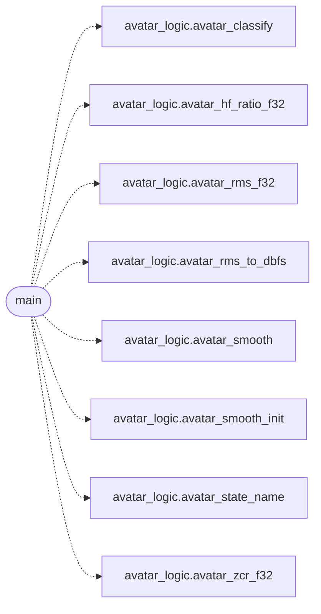

# `avatar/avatar_main.c`

> Source: [avatar/avatar_main.c:1](../../avatar/avatar_main.c#L1) | language `c` | coverage 0.0% | [API index](../index.md)

## Contents

- **Functions:** [`main`](#main)

## Call Graph

Solid arrows stay in this module, dashed arrows leave it.



## Functions

<a id="main"></a>

### `main`

`function` | [avatar/avatar_main.c:191](../../avatar/avatar_main.c#L191)

```c
int main(int argc, char **argv)
```

**Parameters**

| Name | Type | Default | Description |
|---|---|---|---|
| `argc` | `int` |  |  |
| `argv` | `char **` |  |  |

**Returns:** `int`

*Calls:* [`avatar_classify`](avatar.avatar_logic.h.md#avatar_classify), [`avatar_hf_ratio_f32`](avatar.avatar_logic.h.md#avatar_hf_ratio_f32), [`avatar_rms_f32`](avatar.avatar_logic.h.md#avatar_rms_f32), [`avatar_rms_to_dbfs`](avatar.avatar_logic.h.md#avatar_rms_to_dbfs), [`avatar_smooth`](avatar.avatar_logic.h.md#avatar_smooth), [`avatar_smooth_init`](avatar.avatar_logic.h.md#avatar_smooth_init), [`avatar_state_name`](avatar.avatar_logic.h.md#avatar_state_name), [`avatar_zcr_f32`](avatar.avatar_logic.h.md#avatar_zcr_f32)

---
