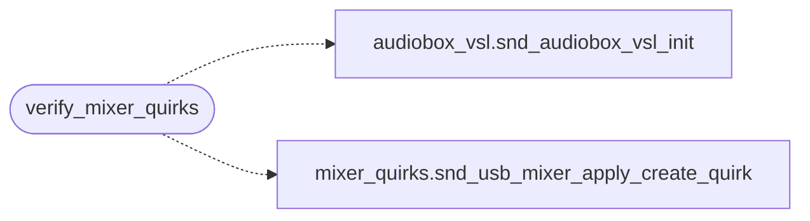

# `legacy/build-dkms.sh`

> Source: [legacy/build-dkms.sh:1](../../legacy/build-dkms.sh#L1) | language `sh` | coverage 5.0% | [API index](../index.md)

AudioBox 22 VSL Enhanced Driver - Installation Script Copyright (c) 2025 grisuno (LazyOwn Project) License: GPL-2.0-or-later  This script installs enhanced ALSA controls for PreSonus AudioBox 22 VSL using DKMS (Dynamic Kernel Module Support) for automatic kernel updates.

## Contents

- **Functions:** [`print_header`](#print_header), [`print_success`](#print_success), [`print_error`](#print_error), [`print_warning`](#print_warning), [`print_info`](#print_info), [`check_root`](#check_root), [`check_dependencies`](#check_dependencies), [`detect_audiobox`](#detect_audiobox), [`create_source_structure`](#create_source_structure), [`copy_source_files`](#copy_source_files), [`create_dkms_conf`](#create_dkms_conf), [`create_makefile`](#create_makefile), [`verify_mixer_quirks`](#verify_mixer_quirks), [`build_with_dkms`](#build_with_dkms), [`install_module`](#install_module), [`reload_module`](#reload_module), [`verify_installation`](#verify_installation), [`show_usage_info`](#show_usage_info), [`main`](#main)

## Call Graph

Solid arrows stay in this module, dashed arrows leave it.



## Functions

<a id="print_header"></a>

### `print_header`

`function` | [legacy/build-dkms.sh:40](../../legacy/build-dkms.sh#L40)

```bash
print_header()
```

---

<a id="print_success"></a>

### `print_success`

`function` | [legacy/build-dkms.sh:48](../../legacy/build-dkms.sh#L48)

```bash
print_success()
```

---

<a id="print_error"></a>

### `print_error`

`function` | [legacy/build-dkms.sh:52](../../legacy/build-dkms.sh#L52)

```bash
print_error()
```

---

<a id="print_warning"></a>

### `print_warning`

`function` | [legacy/build-dkms.sh:56](../../legacy/build-dkms.sh#L56)

```bash
print_warning()
```

---

<a id="print_info"></a>

### `print_info`

`function` | [legacy/build-dkms.sh:60](../../legacy/build-dkms.sh#L60)

```bash
print_info()
```

---

<a id="check_root"></a>

### `check_root`

`function` | [legacy/build-dkms.sh:64](../../legacy/build-dkms.sh#L64)

```bash
check_root()
```

---

<a id="check_dependencies"></a>

### `check_dependencies`

`function` | [legacy/build-dkms.sh:72](../../legacy/build-dkms.sh#L72)

```bash
check_dependencies()
```

---

<a id="detect_audiobox"></a>

### `detect_audiobox`

`function` | [legacy/build-dkms.sh:101](../../legacy/build-dkms.sh#L101)

```bash
detect_audiobox()
```

---

<a id="create_source_structure"></a>

### `create_source_structure`

`function` | [legacy/build-dkms.sh:123](../../legacy/build-dkms.sh#L123)

```bash
create_source_structure()
```

---

<a id="copy_source_files"></a>

### `copy_source_files`

`function` | [legacy/build-dkms.sh:138](../../legacy/build-dkms.sh#L138)

```bash
copy_source_files()
```

---

<a id="create_dkms_conf"></a>

### `create_dkms_conf`

`function` | [legacy/build-dkms.sh:174](../../legacy/build-dkms.sh#L174)

```bash
create_dkms_conf()
```

---

<a id="create_makefile"></a>

### `create_makefile`

`function` | [legacy/build-dkms.sh:193](../../legacy/build-dkms.sh#L193)

```bash
create_makefile()
```

---

<a id="verify_mixer_quirks"></a>

### `verify_mixer_quirks`

`function` | [legacy/build-dkms.sh:252](../../legacy/build-dkms.sh#L252)

```bash
verify_mixer_quirks()
```

*Calls:* [`snd_audiobox_vsl_init`](audiobox_vsl.h.md#snd_audiobox_vsl_init), [`snd_usb_mixer_apply_create_quirk`](legacy.mixer_quirks.c.md#snd_usb_mixer_apply_create_quirk)

---

<a id="build_with_dkms"></a>

### `build_with_dkms`

`function` | [legacy/build-dkms.sh:295](../../legacy/build-dkms.sh#L295)

```bash
build_with_dkms()
```

---

<a id="install_module"></a>

### `install_module`

`function` | [legacy/build-dkms.sh:309](../../legacy/build-dkms.sh#L309)

```bash
install_module()
```

---

<a id="reload_module"></a>

### `reload_module`

`function` | [legacy/build-dkms.sh:323](../../legacy/build-dkms.sh#L323)

```bash
reload_module()
```

---

<a id="verify_installation"></a>

### `verify_installation`

`function` | [legacy/build-dkms.sh:344](../../legacy/build-dkms.sh#L344)

```bash
verify_installation()
```

---

<a id="show_usage_info"></a>

### `show_usage_info`

`function` | [legacy/build-dkms.sh:394](../../legacy/build-dkms.sh#L394)

```bash
show_usage_info()
```

---

<a id="main"></a>

### `main`

`function` | [legacy/build-dkms.sh:452](../../legacy/build-dkms.sh#L452)

```bash
main()
```

---
