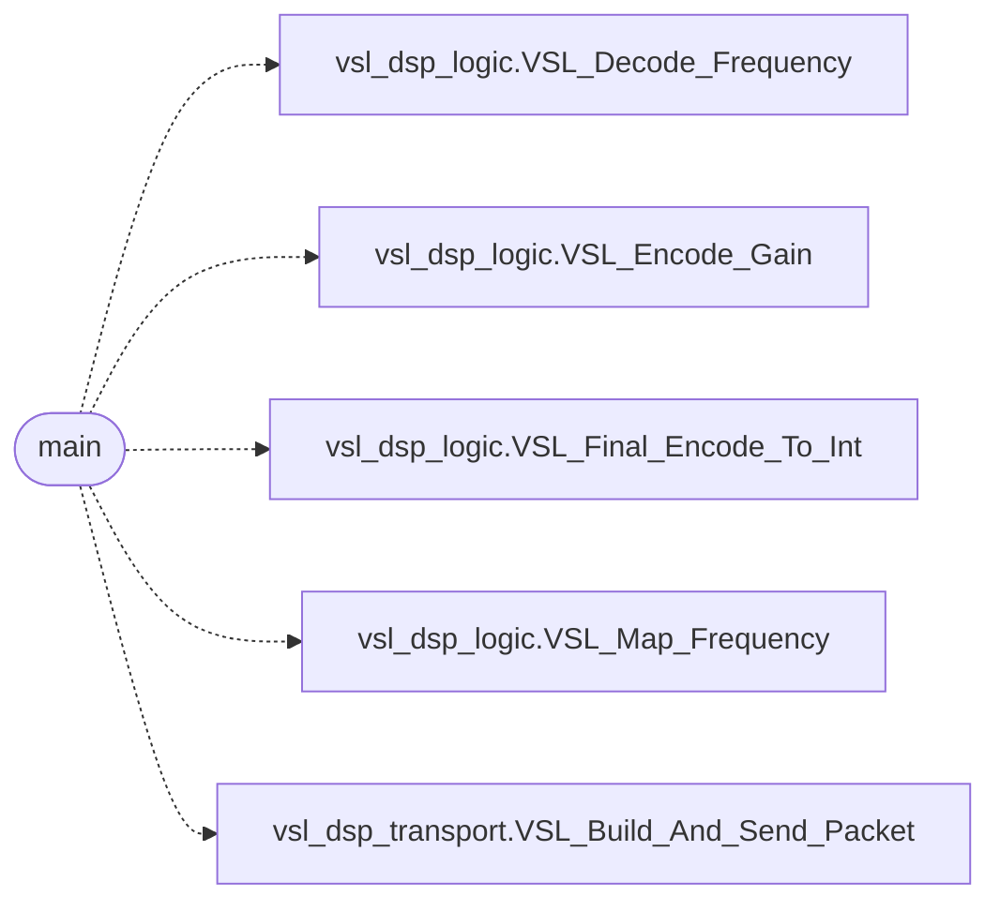

# `legacy/main.c`

> Source: [legacy/main.c:1](../../legacy/main.c#L1) | language `c` | coverage 0.0% | [API index](../index.md)

## Contents

- **Functions:** [`main`](#main)

## Call Graph

Solid arrows stay in this module, dashed arrows leave it.



## Functions

<a id="main"></a>

### `main`

`function` | [legacy/main.c:5](../../legacy/main.c#L5)

```c
int main()
```

**Returns:** `int`

*Calls:* [`VSL_Decode_Frequency`](legacy.vsl_dsp_logic.h.md#vsl_decode_frequency), [`VSL_Encode_Gain`](legacy.vsl_dsp_logic.h.md#vsl_encode_gain), [`VSL_Final_Encode_To_Int`](legacy.vsl_dsp_logic.h.md#vsl_final_encode_to_int), [`VSL_Map_Frequency`](legacy.vsl_dsp_logic.h.md#vsl_map_frequency), [`VSL_Build_And_Send_Packet`](legacy.vsl_dsp_transport.h.md#vsl_build_and_send_packet)

---
