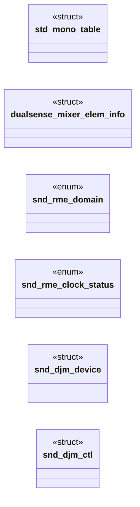

# `legacy/mixer_quirks.c`

> Source: [legacy/mixer_quirks.c:1](../../legacy/mixer_quirks.c#L1) | language `c` | coverage 5.4% | [API index](../index.md)

SPDX-License-Identifier: GPL-2.0-or-later

## Contents

- **Structs:** [`std_mono_table`](#std_mono_table), [`dualsense_mixer_elem_info`](#dualsense_mixer_elem_info), [`snd_djm_device`](#snd_djm_device), [`snd_djm_ctl`](#snd_djm_ctl)
- **Enums:** [`snd_rme_domain`](#snd_rme_domain), [`snd_rme_clock_status`](#snd_rme_clock_status)
- **Functions:** [`snd_emuusb_set_samplerate`](#snd_emuusb_set_samplerate), [`list_for_each_entry`](#list_for_each_entry), [`snd_usb_mixer_apply_create_quirk`](#snd_usb_mixer_apply_create_quirk), [`snd_usb_mixer_resume_quirk`](#snd_usb_mixer_resume_quirk), [`snd_usb_mixer_rc_memory_change`](#snd_usb_mixer_rc_memory_change), [`snd_usb_mixer_fu_apply_quirk`](#snd_usb_mixer_fu_apply_quirk)
- **Macros:** [`snd_audigy2nx_led_info`](#snd_audigy2nx_led_info), [`SND_DUALSENSE_JACK_OUT_TERM_ID`](#snd_dualsense_jack_out_term_id), [`SND_DUALSENSE_JACK_IN_TERM_ID`](#snd_dualsense_jack_in_term_id), [`_MAKE_NI_CONTROL`](#_make_ni_control), [`HDA_VERB_CMD`](#hda_verb_cmd), [`REALTEK_HDA_VALUE`](#realtek_hda_value), [`REALTEK_HDA_SET`](#realtek_hda_set), [`REALTEK_MANUAL_MODE`](#realtek_manual_mode), [`REALTEK_HDA_GET_OUT`](#realtek_hda_get_out), [`REALTEK_HDA_GET_IN`](#realtek_hda_get_in), [`REALTEK_AUDIO_FUNCTION_GROUP`](#realtek_audio_function_group), [`REALTEK_LINE1`](#realtek_line1), [`REALTEK_VENDOR_REGISTERS`](#realtek_vendor_registers), [`REALTEK_HP_OUT`](#realtek_hp_out), [`REALTEK_CBJ_CTRL2`](#realtek_cbj_ctrl2), [`REALTEK_JACK_INTERRUPT_NODE`](#realtek_jack_interrupt_node), [`REALTEK_MIC_FLAG`](#realtek_mic_flag), [`SND_RME_GET_STATUS1`](#snd_rme_get_status1), [`SND_RME_GET_CURRENT_FREQ`](#snd_rme_get_current_freq), [`SND_RME_CLK_SYSTEM_SHIFT`](#snd_rme_clk_system_shift), [`SND_RME_CLK_SYSTEM_MASK`](#snd_rme_clk_system_mask), [`SND_RME_CLK_AES_SHIFT`](#snd_rme_clk_aes_shift), [`SND_RME_CLK_SPDIF_SHIFT`](#snd_rme_clk_spdif_shift), [`SND_RME_CLK_AES_SPDIF_MASK`](#snd_rme_clk_aes_spdif_mask), [`SND_RME_CLK_SYNC_SHIFT`](#snd_rme_clk_sync_shift), [`SND_RME_CLK_SYNC_MASK`](#snd_rme_clk_sync_mask), [`SND_RME_CLK_FREQMUL_SHIFT`](#snd_rme_clk_freqmul_shift), [`SND_RME_CLK_FREQMUL_MASK`](#snd_rme_clk_freqmul_mask), [`SND_RME_CLK_SYSTEM`](#snd_rme_clk_system), [`SND_RME_CLK_AES`](#snd_rme_clk_aes), [`SND_RME_CLK_SPDIF`](#snd_rme_clk_spdif), [`SND_RME_CLK_SYNC`](#snd_rme_clk_sync), [`SND_RME_CLK_FREQMUL`](#snd_rme_clk_freqmul), [`SND_RME_CLK_AES_LOCK`](#snd_rme_clk_aes_lock), [`SND_RME_CLK_AES_SYNC`](#snd_rme_clk_aes_sync), [`SND_RME_CLK_SPDIF_LOCK`](#snd_rme_clk_spdif_lock), [`SND_RME_CLK_SPDIF_SYNC`](#snd_rme_clk_spdif_sync), [`SND_RME_SPDIF_IF_SHIFT`](#snd_rme_spdif_if_shift), [`SND_RME_SPDIF_FORMAT_SHIFT`](#snd_rme_spdif_format_shift), [`SND_RME_BINARY_MASK`](#snd_rme_binary_mask), [`SND_RME_SPDIF_IF`](#snd_rme_spdif_if), [`SND_RME_SPDIF_FORMAT`](#snd_rme_spdif_format), [`SND_RME_RATE_IDX_AES_SPDIF_NUM`](#snd_rme_rate_idx_aes_spdif_num), [`SND_BBFPRO_CTL_REG_MASK`](#snd_bbfpro_ctl_reg_mask), [`SND_BBFPRO_CTL_IDX_MASK`](#snd_bbfpro_ctl_idx_mask), [`SND_BBFPRO_CTL_IDX_SHIFT`](#snd_bbfpro_ctl_idx_shift), [`SND_BBFPRO_CTL_VAL_MASK`](#snd_bbfpro_ctl_val_mask), [`SND_BBFPRO_CTL_VAL_SHIFT`](#snd_bbfpro_ctl_val_shift), [`SND_BBFPRO_CTL_REG1_CLK_MASTER`](#snd_bbfpro_ctl_reg1_clk_master), [`SND_BBFPRO_CTL_REG1_CLK_OPTICAL`](#snd_bbfpro_ctl_reg1_clk_optical), [`SND_BBFPRO_CTL_REG1_SPDIF_PRO`](#snd_bbfpro_ctl_reg1_spdif_pro), [`SND_BBFPRO_CTL_REG1_SPDIF_EMPH`](#snd_bbfpro_ctl_reg1_spdif_emph), [`SND_BBFPRO_CTL_REG1_SPDIF_OPTICAL`](#snd_bbfpro_ctl_reg1_spdif_optical), [`SND_BBFPRO_CTL_REG2_48V_AN1`](#snd_bbfpro_ctl_reg2_48v_an1), [`SND_BBFPRO_CTL_REG2_48V_AN2`](#snd_bbfpro_ctl_reg2_48v_an2), [`SND_BBFPRO_CTL_REG2_SENS_IN3`](#snd_bbfpro_ctl_reg2_sens_in3), [`SND_BBFPRO_CTL_REG2_SENS_IN4`](#snd_bbfpro_ctl_reg2_sens_in4), [`SND_BBFPRO_CTL_REG2_PAD_AN1`](#snd_bbfpro_ctl_reg2_pad_an1), [`SND_BBFPRO_CTL_REG2_PAD_AN2`](#snd_bbfpro_ctl_reg2_pad_an2), [`SND_BBFPRO_MIXER_MAIN_OUT_CH_OFFSET`](#snd_bbfpro_mixer_main_out_ch_offset), [`SND_BBFPRO_MIXER_IDX_MASK`](#snd_bbfpro_mixer_idx_mask), [`SND_BBFPRO_MIXER_VAL_MASK`](#snd_bbfpro_mixer_val_mask), [`SND_BBFPRO_MIXER_VAL_SHIFT`](#snd_bbfpro_mixer_val_shift), [`SND_BBFPRO_MIXER_VAL_MIN`](#snd_bbfpro_mixer_val_min), [`SND_BBFPRO_MIXER_VAL_MAX`](#snd_bbfpro_mixer_val_max), [`SND_BBFPRO_GAIN_CHANNEL_MASK`](#snd_bbfpro_gain_channel_mask), [`SND_BBFPRO_GAIN_CHANNEL_SHIFT`](#snd_bbfpro_gain_channel_shift), [`SND_BBFPRO_GAIN_VAL_MASK`](#snd_bbfpro_gain_val_mask), [`SND_BBFPRO_GAIN_VAL_MIN`](#snd_bbfpro_gain_val_min), [`SND_BBFPRO_GAIN_VAL_MIC_MAX`](#snd_bbfpro_gain_val_mic_max), [`SND_BBFPRO_GAIN_VAL_LINE_MAX`](#snd_bbfpro_gain_val_line_max), [`SND_BBFPRO_USBREQ_CTL_REG1`](#snd_bbfpro_usbreq_ctl_reg1), [`SND_BBFPRO_USBREQ_CTL_REG2`](#snd_bbfpro_usbreq_ctl_reg2), [`SND_BBFPRO_USBREQ_GAIN`](#snd_bbfpro_usbreq_gain), [`SND_BBFPRO_USBREQ_MIXER`](#snd_bbfpro_usbreq_mixer), [`RME_DIGIFACE_READ_STATUS`](#rme_digiface_read_status), [`RME_DIGIFACE_STATUS_REG0L`](#rme_digiface_status_reg0l), [`RME_DIGIFACE_STATUS_REG0H`](#rme_digiface_status_reg0h), [`RME_DIGIFACE_STATUS_REG1L`](#rme_digiface_status_reg1l), [`RME_DIGIFACE_STATUS_REG1H`](#rme_digiface_status_reg1h), [`RME_DIGIFACE_STATUS_REG2L`](#rme_digiface_status_reg2l), [`RME_DIGIFACE_STATUS_REG2H`](#rme_digiface_status_reg2h), [`RME_DIGIFACE_STATUS_REG3L`](#rme_digiface_status_reg3l), [`RME_DIGIFACE_STATUS_REG3H`](#rme_digiface_status_reg3h), [`RME_DIGIFACE_CTL_REG1`](#rme_digiface_ctl_reg1), [`RME_DIGIFACE_CTL_REG2`](#rme_digiface_ctl_reg2), [`RME_DIGIFACE_REGISTER`](#rme_digiface_register), [`RME_DIGIFACE_INVERT`](#rme_digiface_invert), [`field_get`](#field_get), [`field_prep`](#field_prep), [`SND_DJM_CAP_LINE`](#snd_djm_cap_line), [`SND_DJM_CAP_CDLINE`](#snd_djm_cap_cdline), [`SND_DJM_CAP_DIGITAL`](#snd_djm_cap_digital), [`SND_DJM_CAP_PHONO`](#snd_djm_cap_phono), [`SND_DJM_CAP_PREFADER`](#snd_djm_cap_prefader), [`SND_DJM_CAP_PFADER`](#snd_djm_cap_pfader), [`SND_DJM_CAP_XFADERA`](#snd_djm_cap_xfadera), [`SND_DJM_CAP_XFADERB`](#snd_djm_cap_xfaderb), [`SND_DJM_CAP_MIC`](#snd_djm_cap_mic), [`SND_DJM_CAP_AUX`](#snd_djm_cap_aux), [`SND_DJM_CAP_RECOUT`](#snd_djm_cap_recout), [`SND_DJM_CAP_RECOUT_NOMIC`](#snd_djm_cap_recout_nomic), [`SND_DJM_CAP_NONE`](#snd_djm_cap_none), [`SND_DJM_CAP_FXSEND`](#snd_djm_cap_fxsend), [`SND_DJM_CAP_CH1PFADER`](#snd_djm_cap_ch1pfader), [`SND_DJM_CAP_CH2PFADER`](#snd_djm_cap_ch2pfader), [`SND_DJM_CAP_CH3PFADER`](#snd_djm_cap_ch3pfader), [`SND_DJM_CAP_CH4PFADER`](#snd_djm_cap_ch4pfader), [`SND_DJM_CAP_EXT1SEND`](#snd_djm_cap_ext1send), [`SND_DJM_CAP_EXT2SEND`](#snd_djm_cap_ext2send), [`SND_DJM_CAP_CH1PREFADER`](#snd_djm_cap_ch1prefader), [`SND_DJM_CAP_CH2PREFADER`](#snd_djm_cap_ch2prefader), [`SND_DJM_CAP_CH3PREFADER`](#snd_djm_cap_ch3prefader), [`SND_DJM_CAP_CH4PREFADER`](#snd_djm_cap_ch4prefader), [`SND_DJM_PB_CH1`](#snd_djm_pb_ch1), [`SND_DJM_PB_CH2`](#snd_djm_pb_ch2), [`SND_DJM_PB_AUX`](#snd_djm_pb_aux), [`SND_DJM_WINDEX_CAP`](#snd_djm_windex_cap), [`SND_DJM_WINDEX_CAPLVL`](#snd_djm_windex_caplvl), [`SND_DJM_WINDEX_PB`](#snd_djm_windex_pb), [`SND_DJM_VALUE_MASK`](#snd_djm_value_mask), [`SND_DJM_GROUP_MASK`](#snd_djm_group_mask), [`SND_DJM_DEVICE_MASK`](#snd_djm_device_mask), [`SND_DJM_GROUP_SHIFT`](#snd_djm_group_shift), [`SND_DJM_DEVICE_SHIFT`](#snd_djm_device_shift), [`SND_DJM_250MK2_IDX`](#snd_djm_250mk2_idx), [`SND_DJM_750_IDX`](#snd_djm_750_idx), [`SND_DJM_850_IDX`](#snd_djm_850_idx), [`SND_DJM_900NXS2_IDX`](#snd_djm_900nxs2_idx), [`SND_DJM_750MK2_IDX`](#snd_djm_750mk2_idx), [`SND_DJM_450_IDX`](#snd_djm_450_idx), [`SND_DJM_A9_IDX`](#snd_djm_a9_idx), [`SND_DJM_V10_IDX`](#snd_djm_v10_idx), [`SND_DJM_CTL`](#snd_djm_ctl), [`SND_DJM_DEVICE`](#snd_djm_device)

## Type Diagram



## Call Graph

Solid arrows stay in this module, dashed arrows leave it.


## Structs

<a id="std_mono_table"></a>

### `std_mono_table`

`struct` | [legacy/mixer_quirks.c:45](../../legacy/mixer_quirks.c#L45)

```c
struct std_mono_table
```

---

<a id="dualsense_mixer_elem_info"></a>

### `dualsense_mixer_elem_info`

`struct` | [legacy/mixer_quirks.c:543](../../legacy/mixer_quirks.c#L543)

```c
struct dualsense_mixer_elem_info
```

---

<a id="snd_djm_device"></a>

### `snd_djm_device`

`struct` | [legacy/mixer_quirks.c:3778](../../legacy/mixer_quirks.c#L3778)

```c
struct snd_djm_device
```

---

<a id="snd_djm_ctl"></a>

### `snd_djm_ctl`

`struct` | [legacy/mixer_quirks.c:3784](../../legacy/mixer_quirks.c#L3784)

```c
struct snd_djm_ctl
```

---

## Enums

<a id="snd_rme_domain"></a>

### `snd_rme_domain`

`enum` | [legacy/mixer_quirks.c:2407](../../legacy/mixer_quirks.c#L2407)

```c
enum snd_rme_domain
```

---

<a id="snd_rme_clock_status"></a>

### `snd_rme_clock_status`

`enum` | [legacy/mixer_quirks.c:2413](../../legacy/mixer_quirks.c#L2413)

```c
enum snd_rme_clock_status
```

---

## Functions

<a id="snd_emuusb_set_samplerate"></a>

### `snd_emuusb_set_samplerate`

`function` | [legacy/mixer_quirks.c:1542](../../legacy/mixer_quirks.c#L1542)

```c
void snd_emuusb_set_samplerate(struct snd_usb_audio *chip, unsigned char samplerate_id)
```

**Parameters**

| Name | Type | Default | Description |
|---|---|---|---|
| `chip` | `struct snd_usb_audio *` |  |  |
| `samplerate_id` | `unsigned char` |  |  |

---

<a id="list_for_each_entry"></a>

### `list_for_each_entry`

`function` | [legacy/mixer_quirks.c:1549](../../legacy/mixer_quirks.c#L1549)

```c
list_for_each_entry(mixer, &chip->mixer_list, list)
```

**Parameters**

| Name | Type | Default | Description |
|---|---|---|---|
| `mixer_list` | `&chip->` |  |  |

---

<a id="snd_usb_mixer_apply_create_quirk"></a>

### `snd_usb_mixer_apply_create_quirk`

`function` | [legacy/mixer_quirks.c:4239](../../legacy/mixer_quirks.c#L4239)

```c
int snd_usb_mixer_apply_create_quirk(struct usb_mixer_interface *mixer)
```

**Parameters**

| Name | Type | Default | Description |
|---|---|---|---|
| `mixer` | `struct usb_mixer_interface *` |  |  |

**Returns:** `int`

*Calls:* [`snd_audiobox_vsl_init`](audiobox_vsl.h.md#snd_audiobox_vsl_init)

*Called by:* [`verify_mixer_quirks`](legacy.build-dkms.sh.md#verify_mixer_quirks)

---

<a id="snd_usb_mixer_resume_quirk"></a>

### `snd_usb_mixer_resume_quirk`

`function` | [legacy/mixer_quirks.c:4421](../../legacy/mixer_quirks.c#L4421)

```c
void snd_usb_mixer_resume_quirk(struct usb_mixer_interface *mixer)
```

**Parameters**

| Name | Type | Default | Description |
|---|---|---|---|
| `mixer` | `struct usb_mixer_interface *` |  |  |

---

<a id="snd_usb_mixer_rc_memory_change"></a>

### `snd_usb_mixer_rc_memory_change`

`function` | [legacy/mixer_quirks.c:4430](../../legacy/mixer_quirks.c#L4430)

```c
void snd_usb_mixer_rc_memory_change(struct usb_mixer_interface *mixer, int unitid)
```

**Parameters**

| Name | Type | Default | Description |
|---|---|---|---|
| `mixer` | `struct usb_mixer_interface *` |  |  |
| `unitid` | `int` |  |  |

---

<a id="snd_usb_mixer_fu_apply_quirk"></a>

### `snd_usb_mixer_fu_apply_quirk`

`function` | [legacy/mixer_quirks.c:4539](../../legacy/mixer_quirks.c#L4539)

```c
void snd_usb_mixer_fu_apply_quirk(struct usb_mixer_interface *mixer, struct usb_mixer_elem_info *cval, int unitid, struct snd_kcontrol *kctl)
```

**Parameters**

| Name | Type | Default | Description |
|---|---|---|---|
| `mixer` | `struct usb_mixer_interface *` |  |  |
| `cval` | `struct usb_mixer_elem_info *` |  |  |
| `unitid` | `int` |  |  |
| `kctl` | `struct snd_kcontrol *` |  |  |

---

## Macros

<a id="snd_audigy2nx_led_info"></a>

### `snd_audigy2nx_led_info`

`macro` | [legacy/mixer_quirks.c:297](../../legacy/mixer_quirks.c#L297)

```c
#define snd_audigy2nx_led_info
```

---

<a id="snd_dualsense_jack_out_term_id"></a>

### `SND_DUALSENSE_JACK_OUT_TERM_ID`

`macro` | [legacy/mixer_quirks.c:540](../../legacy/mixer_quirks.c#L540)

```c
#define SND_DUALSENSE_JACK_OUT_TERM_ID
```

---

<a id="snd_dualsense_jack_in_term_id"></a>

### `SND_DUALSENSE_JACK_IN_TERM_ID`

`macro` | [legacy/mixer_quirks.c:541](../../legacy/mixer_quirks.c#L541)

```c
#define SND_DUALSENSE_JACK_IN_TERM_ID
```

---

<a id="_make_ni_control"></a>

### `_MAKE_NI_CONTROL`

`macro` | [legacy/mixer_quirks.c:1119](../../legacy/mixer_quirks.c#L1119)

```c
#define _MAKE_NI_CONTROL(bRequest, wIndex)
```

---

<a id="hda_verb_cmd"></a>

### `HDA_VERB_CMD`

`macro` | [legacy/mixer_quirks.c:2172](../../legacy/mixer_quirks.c#L2172)

```c
#define HDA_VERB_CMD(V, N, D)
```

---

<a id="realtek_hda_value"></a>

### `REALTEK_HDA_VALUE`

`macro` | [legacy/mixer_quirks.c:2174](../../legacy/mixer_quirks.c#L2174)

```c
#define REALTEK_HDA_VALUE
```

---

<a id="realtek_hda_set"></a>

### `REALTEK_HDA_SET`

`macro` | [legacy/mixer_quirks.c:2176](../../legacy/mixer_quirks.c#L2176)

```c
#define REALTEK_HDA_SET
```

---

<a id="realtek_manual_mode"></a>

### `REALTEK_MANUAL_MODE`

`macro` | [legacy/mixer_quirks.c:2177](../../legacy/mixer_quirks.c#L2177)

```c
#define REALTEK_MANUAL_MODE
```

---

<a id="realtek_hda_get_out"></a>

### `REALTEK_HDA_GET_OUT`

`macro` | [legacy/mixer_quirks.c:2178](../../legacy/mixer_quirks.c#L2178)

```c
#define REALTEK_HDA_GET_OUT
```

---

<a id="realtek_hda_get_in"></a>

### `REALTEK_HDA_GET_IN`

`macro` | [legacy/mixer_quirks.c:2179](../../legacy/mixer_quirks.c#L2179)

```c
#define REALTEK_HDA_GET_IN
```

---

<a id="realtek_audio_function_group"></a>

### `REALTEK_AUDIO_FUNCTION_GROUP`

`macro` | [legacy/mixer_quirks.c:2181](../../legacy/mixer_quirks.c#L2181)

```c
#define REALTEK_AUDIO_FUNCTION_GROUP
```

---

<a id="realtek_line1"></a>

### `REALTEK_LINE1`

`macro` | [legacy/mixer_quirks.c:2182](../../legacy/mixer_quirks.c#L2182)

```c
#define REALTEK_LINE1
```

---

<a id="realtek_vendor_registers"></a>

### `REALTEK_VENDOR_REGISTERS`

`macro` | [legacy/mixer_quirks.c:2183](../../legacy/mixer_quirks.c#L2183)

```c
#define REALTEK_VENDOR_REGISTERS
```

---

<a id="realtek_hp_out"></a>

### `REALTEK_HP_OUT`

`macro` | [legacy/mixer_quirks.c:2184](../../legacy/mixer_quirks.c#L2184)

```c
#define REALTEK_HP_OUT
```

---

<a id="realtek_cbj_ctrl2"></a>

### `REALTEK_CBJ_CTRL2`

`macro` | [legacy/mixer_quirks.c:2186](../../legacy/mixer_quirks.c#L2186)

```c
#define REALTEK_CBJ_CTRL2
```

---

<a id="realtek_jack_interrupt_node"></a>

### `REALTEK_JACK_INTERRUPT_NODE`

`macro` | [legacy/mixer_quirks.c:2188](../../legacy/mixer_quirks.c#L2188)

```c
#define REALTEK_JACK_INTERRUPT_NODE
```

---

<a id="realtek_mic_flag"></a>

### `REALTEK_MIC_FLAG`

`macro` | [legacy/mixer_quirks.c:2190](../../legacy/mixer_quirks.c#L2190)

```c
#define REALTEK_MIC_FLAG
```

---

<a id="snd_rme_get_status1"></a>

### `SND_RME_GET_STATUS1`

`macro` | [legacy/mixer_quirks.c:2363](../../legacy/mixer_quirks.c#L2363)

```c
#define SND_RME_GET_STATUS1
```

---

<a id="snd_rme_get_current_freq"></a>

### `SND_RME_GET_CURRENT_FREQ`

`macro` | [legacy/mixer_quirks.c:2364](../../legacy/mixer_quirks.c#L2364)

```c
#define SND_RME_GET_CURRENT_FREQ
```

---

<a id="snd_rme_clk_system_shift"></a>

### `SND_RME_CLK_SYSTEM_SHIFT`

`macro` | [legacy/mixer_quirks.c:2365](../../legacy/mixer_quirks.c#L2365)

```c
#define SND_RME_CLK_SYSTEM_SHIFT
```

---

<a id="snd_rme_clk_system_mask"></a>

### `SND_RME_CLK_SYSTEM_MASK`

`macro` | [legacy/mixer_quirks.c:2366](../../legacy/mixer_quirks.c#L2366)

```c
#define SND_RME_CLK_SYSTEM_MASK
```

---

<a id="snd_rme_clk_aes_shift"></a>

### `SND_RME_CLK_AES_SHIFT`

`macro` | [legacy/mixer_quirks.c:2367](../../legacy/mixer_quirks.c#L2367)

```c
#define SND_RME_CLK_AES_SHIFT
```

---

<a id="snd_rme_clk_spdif_shift"></a>

### `SND_RME_CLK_SPDIF_SHIFT`

`macro` | [legacy/mixer_quirks.c:2368](../../legacy/mixer_quirks.c#L2368)

```c
#define SND_RME_CLK_SPDIF_SHIFT
```

---

<a id="snd_rme_clk_aes_spdif_mask"></a>

### `SND_RME_CLK_AES_SPDIF_MASK`

`macro` | [legacy/mixer_quirks.c:2369](../../legacy/mixer_quirks.c#L2369)

```c
#define SND_RME_CLK_AES_SPDIF_MASK
```

---

<a id="snd_rme_clk_sync_shift"></a>

### `SND_RME_CLK_SYNC_SHIFT`

`macro` | [legacy/mixer_quirks.c:2370](../../legacy/mixer_quirks.c#L2370)

```c
#define SND_RME_CLK_SYNC_SHIFT
```

---

<a id="snd_rme_clk_sync_mask"></a>

### `SND_RME_CLK_SYNC_MASK`

`macro` | [legacy/mixer_quirks.c:2371](../../legacy/mixer_quirks.c#L2371)

```c
#define SND_RME_CLK_SYNC_MASK
```

---

<a id="snd_rme_clk_freqmul_shift"></a>

### `SND_RME_CLK_FREQMUL_SHIFT`

`macro` | [legacy/mixer_quirks.c:2372](../../legacy/mixer_quirks.c#L2372)

```c
#define SND_RME_CLK_FREQMUL_SHIFT
```

---

<a id="snd_rme_clk_freqmul_mask"></a>

### `SND_RME_CLK_FREQMUL_MASK`

`macro` | [legacy/mixer_quirks.c:2373](../../legacy/mixer_quirks.c#L2373)

```c
#define SND_RME_CLK_FREQMUL_MASK
```

---

<a id="snd_rme_clk_system"></a>

### `SND_RME_CLK_SYSTEM`

`macro` | [legacy/mixer_quirks.c:2374](../../legacy/mixer_quirks.c#L2374)

```c
#define SND_RME_CLK_SYSTEM(x)
```

---

<a id="snd_rme_clk_aes"></a>

### `SND_RME_CLK_AES`

`macro` | [legacy/mixer_quirks.c:2376](../../legacy/mixer_quirks.c#L2376)

```c
#define SND_RME_CLK_AES(x)
```

---

<a id="snd_rme_clk_spdif"></a>

### `SND_RME_CLK_SPDIF`

`macro` | [legacy/mixer_quirks.c:2378](../../legacy/mixer_quirks.c#L2378)

```c
#define SND_RME_CLK_SPDIF(x)
```

---

<a id="snd_rme_clk_sync"></a>

### `SND_RME_CLK_SYNC`

`macro` | [legacy/mixer_quirks.c:2380](../../legacy/mixer_quirks.c#L2380)

```c
#define SND_RME_CLK_SYNC(x)
```

---

<a id="snd_rme_clk_freqmul"></a>

### `SND_RME_CLK_FREQMUL`

`macro` | [legacy/mixer_quirks.c:2382](../../legacy/mixer_quirks.c#L2382)

```c
#define SND_RME_CLK_FREQMUL(x)
```

---

<a id="snd_rme_clk_aes_lock"></a>

### `SND_RME_CLK_AES_LOCK`

`macro` | [legacy/mixer_quirks.c:2384](../../legacy/mixer_quirks.c#L2384)

```c
#define SND_RME_CLK_AES_LOCK
```

---

<a id="snd_rme_clk_aes_sync"></a>

### `SND_RME_CLK_AES_SYNC`

`macro` | [legacy/mixer_quirks.c:2385](../../legacy/mixer_quirks.c#L2385)

```c
#define SND_RME_CLK_AES_SYNC
```

---

<a id="snd_rme_clk_spdif_lock"></a>

### `SND_RME_CLK_SPDIF_LOCK`

`macro` | [legacy/mixer_quirks.c:2386](../../legacy/mixer_quirks.c#L2386)

```c
#define SND_RME_CLK_SPDIF_LOCK
```

---

<a id="snd_rme_clk_spdif_sync"></a>

### `SND_RME_CLK_SPDIF_SYNC`

`macro` | [legacy/mixer_quirks.c:2387](../../legacy/mixer_quirks.c#L2387)

```c
#define SND_RME_CLK_SPDIF_SYNC
```

---

<a id="snd_rme_spdif_if_shift"></a>

### `SND_RME_SPDIF_IF_SHIFT`

`macro` | [legacy/mixer_quirks.c:2388](../../legacy/mixer_quirks.c#L2388)

```c
#define SND_RME_SPDIF_IF_SHIFT
```

---

<a id="snd_rme_spdif_format_shift"></a>

### `SND_RME_SPDIF_FORMAT_SHIFT`

`macro` | [legacy/mixer_quirks.c:2389](../../legacy/mixer_quirks.c#L2389)

```c
#define SND_RME_SPDIF_FORMAT_SHIFT
```

---

<a id="snd_rme_binary_mask"></a>

### `SND_RME_BINARY_MASK`

`macro` | [legacy/mixer_quirks.c:2390](../../legacy/mixer_quirks.c#L2390)

```c
#define SND_RME_BINARY_MASK
```

---

<a id="snd_rme_spdif_if"></a>

### `SND_RME_SPDIF_IF`

`macro` | [legacy/mixer_quirks.c:2391](../../legacy/mixer_quirks.c#L2391)

```c
#define SND_RME_SPDIF_IF(x)
```

---

<a id="snd_rme_spdif_format"></a>

### `SND_RME_SPDIF_FORMAT`

`macro` | [legacy/mixer_quirks.c:2393](../../legacy/mixer_quirks.c#L2393)

```c
#define SND_RME_SPDIF_FORMAT(x)
```

---

<a id="snd_rme_rate_idx_aes_spdif_num"></a>

### `SND_RME_RATE_IDX_AES_SPDIF_NUM`

`macro` | [legacy/mixer_quirks.c:2405](../../legacy/mixer_quirks.c#L2405)

```c
#define SND_RME_RATE_IDX_AES_SPDIF_NUM
```

maximum number of items for AES and S/PDIF rates for above table

---

<a id="snd_bbfpro_ctl_reg_mask"></a>

### `SND_BBFPRO_CTL_REG_MASK`

`macro` | [legacy/mixer_quirks.c:2744](../../legacy/mixer_quirks.c#L2744)

```c
#define SND_BBFPRO_CTL_REG_MASK
```

---

<a id="snd_bbfpro_ctl_idx_mask"></a>

### `SND_BBFPRO_CTL_IDX_MASK`

`macro` | [legacy/mixer_quirks.c:2745](../../legacy/mixer_quirks.c#L2745)

```c
#define SND_BBFPRO_CTL_IDX_MASK
```

---

<a id="snd_bbfpro_ctl_idx_shift"></a>

### `SND_BBFPRO_CTL_IDX_SHIFT`

`macro` | [legacy/mixer_quirks.c:2746](../../legacy/mixer_quirks.c#L2746)

```c
#define SND_BBFPRO_CTL_IDX_SHIFT
```

---

<a id="snd_bbfpro_ctl_val_mask"></a>

### `SND_BBFPRO_CTL_VAL_MASK`

`macro` | [legacy/mixer_quirks.c:2747](../../legacy/mixer_quirks.c#L2747)

```c
#define SND_BBFPRO_CTL_VAL_MASK
```

---

<a id="snd_bbfpro_ctl_val_shift"></a>

### `SND_BBFPRO_CTL_VAL_SHIFT`

`macro` | [legacy/mixer_quirks.c:2748](../../legacy/mixer_quirks.c#L2748)

```c
#define SND_BBFPRO_CTL_VAL_SHIFT
```

---

<a id="snd_bbfpro_ctl_reg1_clk_master"></a>

### `SND_BBFPRO_CTL_REG1_CLK_MASTER`

`macro` | [legacy/mixer_quirks.c:2749](../../legacy/mixer_quirks.c#L2749)

```c
#define SND_BBFPRO_CTL_REG1_CLK_MASTER
```

---

<a id="snd_bbfpro_ctl_reg1_clk_optical"></a>

### `SND_BBFPRO_CTL_REG1_CLK_OPTICAL`

`macro` | [legacy/mixer_quirks.c:2750](../../legacy/mixer_quirks.c#L2750)

```c
#define SND_BBFPRO_CTL_REG1_CLK_OPTICAL
```

---

<a id="snd_bbfpro_ctl_reg1_spdif_pro"></a>

### `SND_BBFPRO_CTL_REG1_SPDIF_PRO`

`macro` | [legacy/mixer_quirks.c:2751](../../legacy/mixer_quirks.c#L2751)

```c
#define SND_BBFPRO_CTL_REG1_SPDIF_PRO
```

---

<a id="snd_bbfpro_ctl_reg1_spdif_emph"></a>

### `SND_BBFPRO_CTL_REG1_SPDIF_EMPH`

`macro` | [legacy/mixer_quirks.c:2752](../../legacy/mixer_quirks.c#L2752)

```c
#define SND_BBFPRO_CTL_REG1_SPDIF_EMPH
```

---

<a id="snd_bbfpro_ctl_reg1_spdif_optical"></a>

### `SND_BBFPRO_CTL_REG1_SPDIF_OPTICAL`

`macro` | [legacy/mixer_quirks.c:2753](../../legacy/mixer_quirks.c#L2753)

```c
#define SND_BBFPRO_CTL_REG1_SPDIF_OPTICAL
```

---

<a id="snd_bbfpro_ctl_reg2_48v_an1"></a>

### `SND_BBFPRO_CTL_REG2_48V_AN1`

`macro` | [legacy/mixer_quirks.c:2754](../../legacy/mixer_quirks.c#L2754)

```c
#define SND_BBFPRO_CTL_REG2_48V_AN1
```

---

<a id="snd_bbfpro_ctl_reg2_48v_an2"></a>

### `SND_BBFPRO_CTL_REG2_48V_AN2`

`macro` | [legacy/mixer_quirks.c:2755](../../legacy/mixer_quirks.c#L2755)

```c
#define SND_BBFPRO_CTL_REG2_48V_AN2
```

---

<a id="snd_bbfpro_ctl_reg2_sens_in3"></a>

### `SND_BBFPRO_CTL_REG2_SENS_IN3`

`macro` | [legacy/mixer_quirks.c:2756](../../legacy/mixer_quirks.c#L2756)

```c
#define SND_BBFPRO_CTL_REG2_SENS_IN3
```

---

<a id="snd_bbfpro_ctl_reg2_sens_in4"></a>

### `SND_BBFPRO_CTL_REG2_SENS_IN4`

`macro` | [legacy/mixer_quirks.c:2757](../../legacy/mixer_quirks.c#L2757)

```c
#define SND_BBFPRO_CTL_REG2_SENS_IN4
```

---

<a id="snd_bbfpro_ctl_reg2_pad_an1"></a>

### `SND_BBFPRO_CTL_REG2_PAD_AN1`

`macro` | [legacy/mixer_quirks.c:2758](../../legacy/mixer_quirks.c#L2758)

```c
#define SND_BBFPRO_CTL_REG2_PAD_AN1
```

---

<a id="snd_bbfpro_ctl_reg2_pad_an2"></a>

### `SND_BBFPRO_CTL_REG2_PAD_AN2`

`macro` | [legacy/mixer_quirks.c:2759](../../legacy/mixer_quirks.c#L2759)

```c
#define SND_BBFPRO_CTL_REG2_PAD_AN2
```

---

<a id="snd_bbfpro_mixer_main_out_ch_offset"></a>

### `SND_BBFPRO_MIXER_MAIN_OUT_CH_OFFSET`

`macro` | [legacy/mixer_quirks.c:2761](../../legacy/mixer_quirks.c#L2761)

```c
#define SND_BBFPRO_MIXER_MAIN_OUT_CH_OFFSET
```

---

<a id="snd_bbfpro_mixer_idx_mask"></a>

### `SND_BBFPRO_MIXER_IDX_MASK`

`macro` | [legacy/mixer_quirks.c:2762](../../legacy/mixer_quirks.c#L2762)

```c
#define SND_BBFPRO_MIXER_IDX_MASK
```

---

<a id="snd_bbfpro_mixer_val_mask"></a>

### `SND_BBFPRO_MIXER_VAL_MASK`

`macro` | [legacy/mixer_quirks.c:2763](../../legacy/mixer_quirks.c#L2763)

```c
#define SND_BBFPRO_MIXER_VAL_MASK
```

---

<a id="snd_bbfpro_mixer_val_shift"></a>

### `SND_BBFPRO_MIXER_VAL_SHIFT`

`macro` | [legacy/mixer_quirks.c:2764](../../legacy/mixer_quirks.c#L2764)

```c
#define SND_BBFPRO_MIXER_VAL_SHIFT
```

---

<a id="snd_bbfpro_mixer_val_min"></a>

### `SND_BBFPRO_MIXER_VAL_MIN`

`macro` | [legacy/mixer_quirks.c:2765](../../legacy/mixer_quirks.c#L2765)

```c
#define SND_BBFPRO_MIXER_VAL_MIN
```

---

<a id="snd_bbfpro_mixer_val_max"></a>

### `SND_BBFPRO_MIXER_VAL_MAX`

`macro` | [legacy/mixer_quirks.c:2766](../../legacy/mixer_quirks.c#L2766)

```c
#define SND_BBFPRO_MIXER_VAL_MAX
```

---

<a id="snd_bbfpro_gain_channel_mask"></a>

### `SND_BBFPRO_GAIN_CHANNEL_MASK`

`macro` | [legacy/mixer_quirks.c:2768](../../legacy/mixer_quirks.c#L2768)

```c
#define SND_BBFPRO_GAIN_CHANNEL_MASK
```

---

<a id="snd_bbfpro_gain_channel_shift"></a>

### `SND_BBFPRO_GAIN_CHANNEL_SHIFT`

`macro` | [legacy/mixer_quirks.c:2769](../../legacy/mixer_quirks.c#L2769)

```c
#define SND_BBFPRO_GAIN_CHANNEL_SHIFT
```

---

<a id="snd_bbfpro_gain_val_mask"></a>

### `SND_BBFPRO_GAIN_VAL_MASK`

`macro` | [legacy/mixer_quirks.c:2770](../../legacy/mixer_quirks.c#L2770)

```c
#define SND_BBFPRO_GAIN_VAL_MASK
```

---

<a id="snd_bbfpro_gain_val_min"></a>

### `SND_BBFPRO_GAIN_VAL_MIN`

`macro` | [legacy/mixer_quirks.c:2771](../../legacy/mixer_quirks.c#L2771)

```c
#define SND_BBFPRO_GAIN_VAL_MIN
```

---

<a id="snd_bbfpro_gain_val_mic_max"></a>

### `SND_BBFPRO_GAIN_VAL_MIC_MAX`

`macro` | [legacy/mixer_quirks.c:2772](../../legacy/mixer_quirks.c#L2772)

```c
#define SND_BBFPRO_GAIN_VAL_MIC_MAX
```

---

<a id="snd_bbfpro_gain_val_line_max"></a>

### `SND_BBFPRO_GAIN_VAL_LINE_MAX`

`macro` | [legacy/mixer_quirks.c:2773](../../legacy/mixer_quirks.c#L2773)

```c
#define SND_BBFPRO_GAIN_VAL_LINE_MAX
```

---

<a id="snd_bbfpro_usbreq_ctl_reg1"></a>

### `SND_BBFPRO_USBREQ_CTL_REG1`

`macro` | [legacy/mixer_quirks.c:2775](../../legacy/mixer_quirks.c#L2775)

```c
#define SND_BBFPRO_USBREQ_CTL_REG1
```

---

<a id="snd_bbfpro_usbreq_ctl_reg2"></a>

### `SND_BBFPRO_USBREQ_CTL_REG2`

`macro` | [legacy/mixer_quirks.c:2776](../../legacy/mixer_quirks.c#L2776)

```c
#define SND_BBFPRO_USBREQ_CTL_REG2
```

---

<a id="snd_bbfpro_usbreq_gain"></a>

### `SND_BBFPRO_USBREQ_GAIN`

`macro` | [legacy/mixer_quirks.c:2777](../../legacy/mixer_quirks.c#L2777)

```c
#define SND_BBFPRO_USBREQ_GAIN
```

---

<a id="snd_bbfpro_usbreq_mixer"></a>

### `SND_BBFPRO_USBREQ_MIXER`

`macro` | [legacy/mixer_quirks.c:2778](../../legacy/mixer_quirks.c#L2778)

```c
#define SND_BBFPRO_USBREQ_MIXER
```

---

<a id="rme_digiface_read_status"></a>

### `RME_DIGIFACE_READ_STATUS`

`macro` | [legacy/mixer_quirks.c:3298](../../legacy/mixer_quirks.c#L3298)

```c
#define RME_DIGIFACE_READ_STATUS
```

---

<a id="rme_digiface_status_reg0l"></a>

### `RME_DIGIFACE_STATUS_REG0L`

`macro` | [legacy/mixer_quirks.c:3299](../../legacy/mixer_quirks.c#L3299)

```c
#define RME_DIGIFACE_STATUS_REG0L
```

---

<a id="rme_digiface_status_reg0h"></a>

### `RME_DIGIFACE_STATUS_REG0H`

`macro` | [legacy/mixer_quirks.c:3300](../../legacy/mixer_quirks.c#L3300)

```c
#define RME_DIGIFACE_STATUS_REG0H
```

---

<a id="rme_digiface_status_reg1l"></a>

### `RME_DIGIFACE_STATUS_REG1L`

`macro` | [legacy/mixer_quirks.c:3301](../../legacy/mixer_quirks.c#L3301)

```c
#define RME_DIGIFACE_STATUS_REG1L
```

---

<a id="rme_digiface_status_reg1h"></a>

### `RME_DIGIFACE_STATUS_REG1H`

`macro` | [legacy/mixer_quirks.c:3302](../../legacy/mixer_quirks.c#L3302)

```c
#define RME_DIGIFACE_STATUS_REG1H
```

---

<a id="rme_digiface_status_reg2l"></a>

### `RME_DIGIFACE_STATUS_REG2L`

`macro` | [legacy/mixer_quirks.c:3303](../../legacy/mixer_quirks.c#L3303)

```c
#define RME_DIGIFACE_STATUS_REG2L
```

---

<a id="rme_digiface_status_reg2h"></a>

### `RME_DIGIFACE_STATUS_REG2H`

`macro` | [legacy/mixer_quirks.c:3304](../../legacy/mixer_quirks.c#L3304)

```c
#define RME_DIGIFACE_STATUS_REG2H
```

---

<a id="rme_digiface_status_reg3l"></a>

### `RME_DIGIFACE_STATUS_REG3L`

`macro` | [legacy/mixer_quirks.c:3305](../../legacy/mixer_quirks.c#L3305)

```c
#define RME_DIGIFACE_STATUS_REG3L
```

---

<a id="rme_digiface_status_reg3h"></a>

### `RME_DIGIFACE_STATUS_REG3H`

`macro` | [legacy/mixer_quirks.c:3306](../../legacy/mixer_quirks.c#L3306)

```c
#define RME_DIGIFACE_STATUS_REG3H
```

---

<a id="rme_digiface_ctl_reg1"></a>

### `RME_DIGIFACE_CTL_REG1`

`macro` | [legacy/mixer_quirks.c:3308](../../legacy/mixer_quirks.c#L3308)

```c
#define RME_DIGIFACE_CTL_REG1
```

---

<a id="rme_digiface_ctl_reg2"></a>

### `RME_DIGIFACE_CTL_REG2`

`macro` | [legacy/mixer_quirks.c:3309](../../legacy/mixer_quirks.c#L3309)

```c
#define RME_DIGIFACE_CTL_REG2
```

---

<a id="rme_digiface_register"></a>

### `RME_DIGIFACE_REGISTER`

`macro` | [legacy/mixer_quirks.c:3312](../../legacy/mixer_quirks.c#L3312)

```c
#define RME_DIGIFACE_REGISTER(reg, mask)
```

Reg is overloaded, 0-7 for status halfwords or 16 or 18 for control registers

---

<a id="rme_digiface_invert"></a>

### `RME_DIGIFACE_INVERT`

`macro` | [legacy/mixer_quirks.c:3313](../../legacy/mixer_quirks.c#L3313)

```c
#define RME_DIGIFACE_INVERT
```

---

<a id="field_get"></a>

### `field_get`

`macro` | [legacy/mixer_quirks.c:3316](../../legacy/mixer_quirks.c#L3316)

```c
#define field_get(_mask, _reg)
```

Nonconst helpers

---

<a id="field_prep"></a>

### `field_prep`

`macro` | [legacy/mixer_quirks.c:3317](../../legacy/mixer_quirks.c#L3317)

```c
#define field_prep(_mask, _val)
```

---

<a id="snd_djm_cap_line"></a>

### `SND_DJM_CAP_LINE`

`macro` | [legacy/mixer_quirks.c:3715](../../legacy/mixer_quirks.c#L3715)

```c
#define SND_DJM_CAP_LINE
```

Capture types

---

<a id="snd_djm_cap_cdline"></a>

### `SND_DJM_CAP_CDLINE`

`macro` | [legacy/mixer_quirks.c:3716](../../legacy/mixer_quirks.c#L3716)

```c
#define SND_DJM_CAP_CDLINE
```

---

<a id="snd_djm_cap_digital"></a>

### `SND_DJM_CAP_DIGITAL`

`macro` | [legacy/mixer_quirks.c:3717](../../legacy/mixer_quirks.c#L3717)

```c
#define SND_DJM_CAP_DIGITAL
```

---

<a id="snd_djm_cap_phono"></a>

### `SND_DJM_CAP_PHONO`

`macro` | [legacy/mixer_quirks.c:3718](../../legacy/mixer_quirks.c#L3718)

```c
#define SND_DJM_CAP_PHONO
```

---

<a id="snd_djm_cap_prefader"></a>

### `SND_DJM_CAP_PREFADER`

`macro` | [legacy/mixer_quirks.c:3719](../../legacy/mixer_quirks.c#L3719)

```c
#define SND_DJM_CAP_PREFADER
```

---

<a id="snd_djm_cap_pfader"></a>

### `SND_DJM_CAP_PFADER`

`macro` | [legacy/mixer_quirks.c:3720](../../legacy/mixer_quirks.c#L3720)

```c
#define SND_DJM_CAP_PFADER
```

---

<a id="snd_djm_cap_xfadera"></a>

### `SND_DJM_CAP_XFADERA`

`macro` | [legacy/mixer_quirks.c:3721](../../legacy/mixer_quirks.c#L3721)

```c
#define SND_DJM_CAP_XFADERA
```

---

<a id="snd_djm_cap_xfaderb"></a>

### `SND_DJM_CAP_XFADERB`

`macro` | [legacy/mixer_quirks.c:3722](../../legacy/mixer_quirks.c#L3722)

```c
#define SND_DJM_CAP_XFADERB
```

---

<a id="snd_djm_cap_mic"></a>

### `SND_DJM_CAP_MIC`

`macro` | [legacy/mixer_quirks.c:3723](../../legacy/mixer_quirks.c#L3723)

```c
#define SND_DJM_CAP_MIC
```

---

<a id="snd_djm_cap_aux"></a>

### `SND_DJM_CAP_AUX`

`macro` | [legacy/mixer_quirks.c:3724](../../legacy/mixer_quirks.c#L3724)

```c
#define SND_DJM_CAP_AUX
```

---

<a id="snd_djm_cap_recout"></a>

### `SND_DJM_CAP_RECOUT`

`macro` | [legacy/mixer_quirks.c:3725](../../legacy/mixer_quirks.c#L3725)

```c
#define SND_DJM_CAP_RECOUT
```

---

<a id="snd_djm_cap_recout_nomic"></a>

### `SND_DJM_CAP_RECOUT_NOMIC`

`macro` | [legacy/mixer_quirks.c:3726](../../legacy/mixer_quirks.c#L3726)

```c
#define SND_DJM_CAP_RECOUT_NOMIC
```

---

<a id="snd_djm_cap_none"></a>

### `SND_DJM_CAP_NONE`

`macro` | [legacy/mixer_quirks.c:3727](../../legacy/mixer_quirks.c#L3727)

```c
#define SND_DJM_CAP_NONE
```

---

<a id="snd_djm_cap_fxsend"></a>

### `SND_DJM_CAP_FXSEND`

`macro` | [legacy/mixer_quirks.c:3728](../../legacy/mixer_quirks.c#L3728)

```c
#define SND_DJM_CAP_FXSEND
```

---

<a id="snd_djm_cap_ch1pfader"></a>

### `SND_DJM_CAP_CH1PFADER`

`macro` | [legacy/mixer_quirks.c:3729](../../legacy/mixer_quirks.c#L3729)

```c
#define SND_DJM_CAP_CH1PFADER
```

---

<a id="snd_djm_cap_ch2pfader"></a>

### `SND_DJM_CAP_CH2PFADER`

`macro` | [legacy/mixer_quirks.c:3730](../../legacy/mixer_quirks.c#L3730)

```c
#define SND_DJM_CAP_CH2PFADER
```

---

<a id="snd_djm_cap_ch3pfader"></a>

### `SND_DJM_CAP_CH3PFADER`

`macro` | [legacy/mixer_quirks.c:3731](../../legacy/mixer_quirks.c#L3731)

```c
#define SND_DJM_CAP_CH3PFADER
```

---

<a id="snd_djm_cap_ch4pfader"></a>

### `SND_DJM_CAP_CH4PFADER`

`macro` | [legacy/mixer_quirks.c:3732](../../legacy/mixer_quirks.c#L3732)

```c
#define SND_DJM_CAP_CH4PFADER
```

---

<a id="snd_djm_cap_ext1send"></a>

### `SND_DJM_CAP_EXT1SEND`

`macro` | [legacy/mixer_quirks.c:3733](../../legacy/mixer_quirks.c#L3733)

```c
#define SND_DJM_CAP_EXT1SEND
```

---

<a id="snd_djm_cap_ext2send"></a>

### `SND_DJM_CAP_EXT2SEND`

`macro` | [legacy/mixer_quirks.c:3734](../../legacy/mixer_quirks.c#L3734)

```c
#define SND_DJM_CAP_EXT2SEND
```

---

<a id="snd_djm_cap_ch1prefader"></a>

### `SND_DJM_CAP_CH1PREFADER`

`macro` | [legacy/mixer_quirks.c:3735](../../legacy/mixer_quirks.c#L3735)

```c
#define SND_DJM_CAP_CH1PREFADER
```

---

<a id="snd_djm_cap_ch2prefader"></a>

### `SND_DJM_CAP_CH2PREFADER`

`macro` | [legacy/mixer_quirks.c:3736](../../legacy/mixer_quirks.c#L3736)

```c
#define SND_DJM_CAP_CH2PREFADER
```

---

<a id="snd_djm_cap_ch3prefader"></a>

### `SND_DJM_CAP_CH3PREFADER`

`macro` | [legacy/mixer_quirks.c:3737](../../legacy/mixer_quirks.c#L3737)

```c
#define SND_DJM_CAP_CH3PREFADER
```

---

<a id="snd_djm_cap_ch4prefader"></a>

### `SND_DJM_CAP_CH4PREFADER`

`macro` | [legacy/mixer_quirks.c:3738](../../legacy/mixer_quirks.c#L3738)

```c
#define SND_DJM_CAP_CH4PREFADER
```

---

<a id="snd_djm_pb_ch1"></a>

### `SND_DJM_PB_CH1`

`macro` | [legacy/mixer_quirks.c:3741](../../legacy/mixer_quirks.c#L3741)

```c
#define SND_DJM_PB_CH1
```

Playback types

---

<a id="snd_djm_pb_ch2"></a>

### `SND_DJM_PB_CH2`

`macro` | [legacy/mixer_quirks.c:3742](../../legacy/mixer_quirks.c#L3742)

```c
#define SND_DJM_PB_CH2
```

---

<a id="snd_djm_pb_aux"></a>

### `SND_DJM_PB_AUX`

`macro` | [legacy/mixer_quirks.c:3743](../../legacy/mixer_quirks.c#L3743)

```c
#define SND_DJM_PB_AUX
```

---

<a id="snd_djm_windex_cap"></a>

### `SND_DJM_WINDEX_CAP`

`macro` | [legacy/mixer_quirks.c:3745](../../legacy/mixer_quirks.c#L3745)

```c
#define SND_DJM_WINDEX_CAP
```

---

<a id="snd_djm_windex_caplvl"></a>

### `SND_DJM_WINDEX_CAPLVL`

`macro` | [legacy/mixer_quirks.c:3746](../../legacy/mixer_quirks.c#L3746)

```c
#define SND_DJM_WINDEX_CAPLVL
```

---

<a id="snd_djm_windex_pb"></a>

### `SND_DJM_WINDEX_PB`

`macro` | [legacy/mixer_quirks.c:3747](../../legacy/mixer_quirks.c#L3747)

```c
#define SND_DJM_WINDEX_PB
```

---

<a id="snd_djm_value_mask"></a>

### `SND_DJM_VALUE_MASK`

`macro` | [legacy/mixer_quirks.c:3750](../../legacy/mixer_quirks.c#L3750)

```c
#define SND_DJM_VALUE_MASK
```

kcontrol->private_value layout

---

<a id="snd_djm_group_mask"></a>

### `SND_DJM_GROUP_MASK`

`macro` | [legacy/mixer_quirks.c:3751](../../legacy/mixer_quirks.c#L3751)

```c
#define SND_DJM_GROUP_MASK
```

---

<a id="snd_djm_device_mask"></a>

### `SND_DJM_DEVICE_MASK`

`macro` | [legacy/mixer_quirks.c:3752](../../legacy/mixer_quirks.c#L3752)

```c
#define SND_DJM_DEVICE_MASK
```

---

<a id="snd_djm_group_shift"></a>

### `SND_DJM_GROUP_SHIFT`

`macro` | [legacy/mixer_quirks.c:3753](../../legacy/mixer_quirks.c#L3753)

```c
#define SND_DJM_GROUP_SHIFT
```

---

<a id="snd_djm_device_shift"></a>

### `SND_DJM_DEVICE_SHIFT`

`macro` | [legacy/mixer_quirks.c:3754](../../legacy/mixer_quirks.c#L3754)

```c
#define SND_DJM_DEVICE_SHIFT
```

---

<a id="snd_djm_250mk2_idx"></a>

### `SND_DJM_250MK2_IDX`

`macro` | [legacy/mixer_quirks.c:3758](../../legacy/mixer_quirks.c#L3758)

```c
#define SND_DJM_250MK2_IDX
```

device table index used for the snd_djm_devices table, so please update accordingly

---

<a id="snd_djm_750_idx"></a>

### `SND_DJM_750_IDX`

`macro` | [legacy/mixer_quirks.c:3759](../../legacy/mixer_quirks.c#L3759)

```c
#define SND_DJM_750_IDX
```

---

<a id="snd_djm_850_idx"></a>

### `SND_DJM_850_IDX`

`macro` | [legacy/mixer_quirks.c:3760](../../legacy/mixer_quirks.c#L3760)

```c
#define SND_DJM_850_IDX
```

---

<a id="snd_djm_900nxs2_idx"></a>

### `SND_DJM_900NXS2_IDX`

`macro` | [legacy/mixer_quirks.c:3761](../../legacy/mixer_quirks.c#L3761)

```c
#define SND_DJM_900NXS2_IDX
```

---

<a id="snd_djm_750mk2_idx"></a>

### `SND_DJM_750MK2_IDX`

`macro` | [legacy/mixer_quirks.c:3762](../../legacy/mixer_quirks.c#L3762)

```c
#define SND_DJM_750MK2_IDX
```

---

<a id="snd_djm_450_idx"></a>

### `SND_DJM_450_IDX`

`macro` | [legacy/mixer_quirks.c:3763](../../legacy/mixer_quirks.c#L3763)

```c
#define SND_DJM_450_IDX
```

---

<a id="snd_djm_a9_idx"></a>

### `SND_DJM_A9_IDX`

`macro` | [legacy/mixer_quirks.c:3764](../../legacy/mixer_quirks.c#L3764)

```c
#define SND_DJM_A9_IDX
```

---

<a id="snd_djm_v10_idx"></a>

### `SND_DJM_V10_IDX`

`macro` | [legacy/mixer_quirks.c:3765](../../legacy/mixer_quirks.c#L3765)

```c
#define SND_DJM_V10_IDX
```

---

<a id="snd_djm_ctl"></a>

### `SND_DJM_CTL`

`macro` | [legacy/mixer_quirks.c:3767](../../legacy/mixer_quirks.c#L3767)

```c
#define SND_DJM_CTL(_name, suffix, _default_value, _windex)
```

---

<a id="snd_djm_device"></a>

### `SND_DJM_DEVICE`

`macro` | [legacy/mixer_quirks.c:3774](../../legacy/mixer_quirks.c#L3774)

```c
#define SND_DJM_DEVICE(suffix)
```

---
