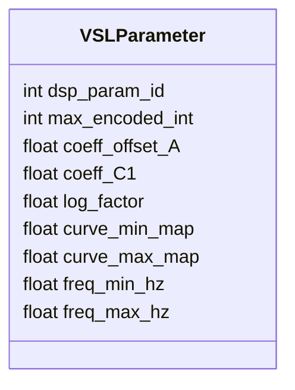
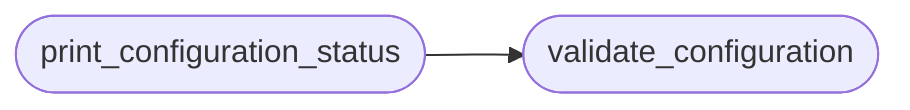

# `legacy.vsl_config`

> Source: [legacy/vsl_config.py:1](../../legacy/vsl_config.py#L1) | language `py` | coverage 100.0% | [API index](../index.md)

VSL-DSP Configuration Module Contiene todas las constantes y configuraciones del protocolo.

⚠️ BLOQUEADORES CRÍTICOS (Pendientes del desensamblado):
- VSL_VENDOR_ID
- VSL_PRODUCT_ID
- VSL_REPORT_ID

## Contents

- **Classes:** [`VSLParameter`](#vslparameter)
- **Functions:** [`validate_configuration`](#validate_configuration), [`print_configuration_status`](#print_configuration_status)
- **Constants:** [`VSL_VENDOR_ID`](#vsl_vendor_id), [`VSL_PRODUCT_ID`](#vsl_product_id), [`VSL_REPORT_ID`](#vsl_report_id), [`VSL_PACKET_SIZE`](#vsl_packet_size), [`VSL_MAX_ENCODED_FLOAT`](#vsl_max_encoded_float), [`VSL_MAX_ENCODED_INT`](#vsl_max_encoded_int), [`VSL_INV_LN2`](#vsl_inv_ln2), [`GAIN_CH1`](#gain_ch1), [`FREQ_HPF_CH1`](#freq_hpf_ch1)

## Type Diagram



## Call Graph

Solid arrows stay in this module, dashed arrows leave it.



## Classes

<a id="vslparameter"></a>

### `VSLParameter`

`class` | [legacy/vsl_config.py:40](../../legacy/vsl_config.py#L40)

```python
class VSLParameter(NamedTuple)
```

Bases: `NamedTuple`

Estructura que replica exactamente VSL_Parameter del código C.

Todos los campos están confirmados del desensamblado.

**Attributes**

| Name | Type | Default | Description |
|---|---|---|---|
| [`dsp_param_id`](#vslparameter-dsp_param_id) | `int` |  |  |
| [`max_encoded_int`](#vslparameter-max_encoded_int) | `int` |  |  |
| [`coeff_offset_A`](#vslparameter-coeff_offset_a) | `float` |  |  |
| [`coeff_C1`](#vslparameter-coeff_c1) | `float` |  |  |
| [`log_factor`](#vslparameter-log_factor) | `float` |  |  |
| [`curve_min_map`](#vslparameter-curve_min_map) | `float` |  |  |
| [`curve_max_map`](#vslparameter-curve_max_map) | `float` |  |  |
| [`freq_min_hz`](#vslparameter-freq_min_hz) | `float` |  |  |
| [`freq_max_hz`](#vslparameter-freq_max_hz) | `float` |  |  |

---

## Functions

<a id="validate_configuration"></a>

### `validate_configuration`

`function` | [legacy/vsl_config.py:92](../../legacy/vsl_config.py#L92)

```python
def validate_configuration() -> tuple[bool, str]
```

Valida que todos los valores críticos estén configurados.

**Returns:** `tuple[bool, str]` - (is_valid, error_message)

*Called by:* [`print_configuration_status`](#print_configuration_status), [`VSLDevice.__init__`](legacy.vsl_hid_io.py.md#vsldevice-__init__), [`print_summary`](legacy.vsl_poc_main.py.md#print_summary)

---

<a id="print_configuration_status"></a>

### `print_configuration_status`

`function` | [legacy/vsl_config.py:116](../../legacy/vsl_config.py#L116)

```python
def print_configuration_status()
```

Imprime el estado de la configuración con formato.

*Calls:* [`validate_configuration`](#validate_configuration)

*Called by:* [`main`](legacy.vsl_poc_main.py.md#main)

---

## Constants

<a id="vsl_vendor_id"></a>

### `VSL_VENDOR_ID`

`constant` | [legacy/vsl_config.py:19](../../legacy/vsl_config.py#L19)

```python
VSL_VENDOR_ID = None
```

---

<a id="vsl_product_id"></a>

### `VSL_PRODUCT_ID`

`constant` | [legacy/vsl_config.py:20](../../legacy/vsl_config.py#L20)

```python
VSL_PRODUCT_ID = None
```

---

<a id="vsl_report_id"></a>

### `VSL_REPORT_ID`

`constant` | [legacy/vsl_config.py:23](../../legacy/vsl_config.py#L23)

```python
VSL_REPORT_ID = None
```

---

<a id="vsl_packet_size"></a>

### `VSL_PACKET_SIZE`

`constant` | [legacy/vsl_config.py:26](../../legacy/vsl_config.py#L26)

```python
VSL_PACKET_SIZE = 64
```

---

<a id="vsl_max_encoded_float"></a>

### `VSL_MAX_ENCODED_FLOAT`

`constant` | [legacy/vsl_config.py:29](../../legacy/vsl_config.py#L29)

```python
VSL_MAX_ENCODED_FLOAT = 1000.0
```

---

<a id="vsl_max_encoded_int"></a>

### `VSL_MAX_ENCODED_INT`

`constant` | [legacy/vsl_config.py:30](../../legacy/vsl_config.py#L30)

```python
VSL_MAX_ENCODED_INT = 65535
```

---

<a id="vsl_inv_ln2"></a>

### `VSL_INV_LN2`

`constant` | [legacy/vsl_config.py:33](../../legacy/vsl_config.py#L33)

```python
VSL_INV_LN2 = 1.442695
```

---

<a id="gain_ch1"></a>

### `GAIN_CH1`

`constant` | [legacy/vsl_config.py:62](../../legacy/vsl_config.py#L62)

```python
GAIN_CH1
```

---

<a id="freq_hpf_ch1"></a>

### `FREQ_HPF_CH1`

`constant` | [legacy/vsl_config.py:75](../../legacy/vsl_config.py#L75)

```python
FREQ_HPF_CH1
```

---
