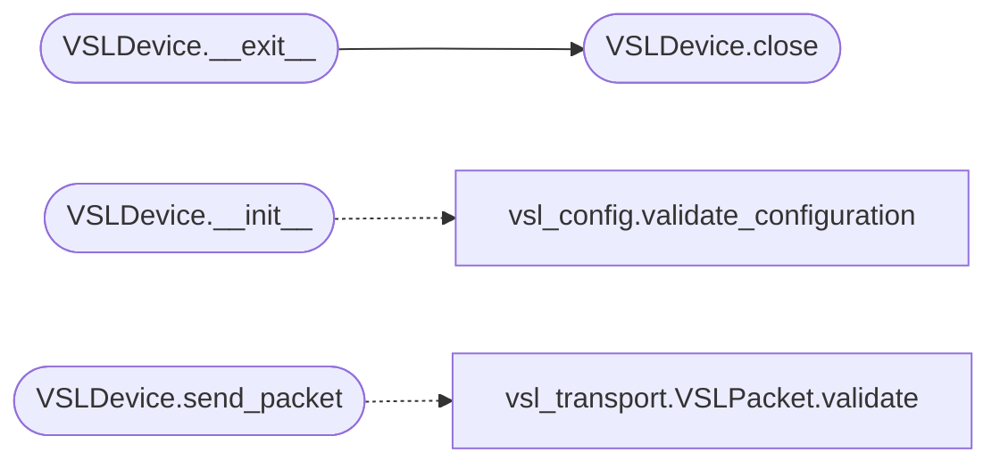

# `legacy.vsl_hid_io`

> Source: [legacy/vsl_hid_io.py:1](../../legacy/vsl_hid_io.py#L1) | language `py` | coverage 80.0% | [API index](../index.md)

VSL-DSP HID I/O Module (OPCIONAL) Comunicación real con hardware via hidapi.

Requiere: pip install hidapi

⚠️ Este módulo solo funcionará cuando los 3 bloqueadores estén resueltos:
   - VSL_VENDOR_ID
   - VSL_PRODUCT_ID
   - VSL_REPORT_ID

## Contents

- **Classes:** [`VSLDevice`](#vsldevice)
- **Functions:** [`enumerate_vsl_devices`](#enumerate_vsl_devices)

## Call Graph

Solid arrows stay in this module, dashed arrows leave it.



## Classes

<a id="vsldevice"></a>

### `VSLDevice`

`class` | [legacy/vsl_hid_io.py:31](../../legacy/vsl_hid_io.py#L31)

```python
class VSLDevice
```

Gestor de dispositivo VSL-DSP con patrón Singleton.

Maneja la conexión HID y envío de paquetes.

**Members**

| Member | Kind | Summary |
|---|---|---|
| [`__new__`](#vsldevice-__new__) | method |  |
| [`__init__`](#vsldevice-__init__) | constructor |  |
| [`open`](#vsldevice-open) | method | Abre la conexión con el dispositivo VSL. |
| [`close`](#vsldevice-close) | method | Cierra la conexión con el dispositivo. |
| [`send_packet`](#vsldevice-send_packet) | method | Envía un paquete VSL al dispositivo. |
| [`__enter__`](#vsldevice-__enter__) | method | Context manager entry. |
| [`__exit__`](#vsldevice-__exit__) | method | Context manager exit. |

<a id="vsldevice-__new__"></a>

#### `VSLDevice.__new__`

`method` | [legacy/vsl_hid_io.py:39](../../legacy/vsl_hid_io.py#L39)

```python
def __new__(cls)
```

<a id="vsldevice-__init__"></a>

#### `VSLDevice.__init__`

`constructor` | [legacy/vsl_hid_io.py:45](../../legacy/vsl_hid_io.py#L45)

```python
def __init__(self)
```

**Raises**

- `RuntimeError`: (raised in the body, not documented)

*Calls:* [`validate_configuration`](legacy.vsl_config.py.md#validate_configuration)

<a id="vsldevice-open"></a>

#### `VSLDevice.open`

`method` | [legacy/vsl_hid_io.py:59](../../legacy/vsl_hid_io.py#L59)

```python
def open(self) -> bool
```

Abre la conexión con el dispositivo VSL.

**Returns:** `bool` - True si la conexión fue exitosa, False en caso contrario

<a id="vsldevice-close"></a>

#### `VSLDevice.close`

`method` | [legacy/vsl_hid_io.py:90](../../legacy/vsl_hid_io.py#L90)

```python
def close(self)
```

Cierra la conexión con el dispositivo.

*Called by:* [`VSLDevice.__exit__`](#vsldevice-__exit__)

<a id="vsldevice-send_packet"></a>

#### `VSLDevice.send_packet`

`method` | [legacy/vsl_hid_io.py:101](../../legacy/vsl_hid_io.py#L101)

```python
def send_packet(self, packet: VSLPacket) -> bool
```

Envía un paquete VSL al dispositivo.

**Parameters**

| Name | Type | Default | Description |
|---|---|---|---|
| `packet` | `VSLPacket` |  | VSLPacket a enviar |

**Returns:** `bool` - True si el envío fue exitoso

*Calls:* [`VSLPacket.validate`](legacy.vsl_transport.py.md#vslpacket-validate)

<a id="vsldevice-__enter__"></a>

#### `VSLDevice.__enter__`

`method` | [legacy/vsl_hid_io.py:139](../../legacy/vsl_hid_io.py#L139)

```python
def __enter__(self)
```

Context manager entry.

<a id="vsldevice-__exit__"></a>

#### `VSLDevice.__exit__`

`method` | [legacy/vsl_hid_io.py:144](../../legacy/vsl_hid_io.py#L144)

```python
def __exit__(self, exc_type, exc_val, exc_tb)
```

Context manager exit.

**Parameters**

| Name | Type | Default | Description |
|---|---|---|---|
| `exc_type` |  |  |  |
| `exc_val` |  |  |  |
| `exc_tb` |  |  |  |

*Calls:* [`VSLDevice.close`](#vsldevice-close)

---

## Functions

<a id="enumerate_vsl_devices"></a>

### `enumerate_vsl_devices`

`function` | [legacy/vsl_hid_io.py:149](../../legacy/vsl_hid_io.py#L149)

```python
def enumerate_vsl_devices()
```

Enumera todos los dispositivos HID conectados. Útil para descubrir VID/PID del hardware.

---
