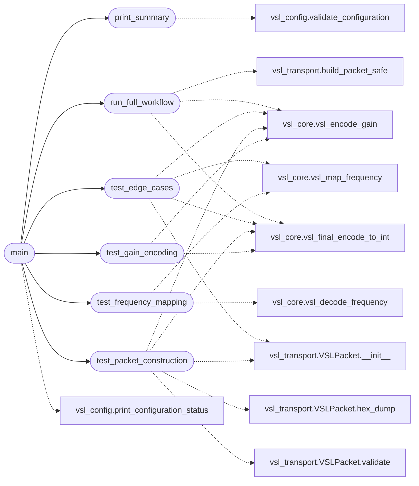

# `legacy.vsl_poc_main`

> Source: [legacy/vsl_poc_main.py:1](../../legacy/vsl_poc_main.py#L1) | language `py` | coverage 100.0% | [API index](../index.md)

VSL-DSP Proof of Concept - Main Program Programa principal de pruebas y validación.

## Contents

- **Functions:** [`test_gain_encoding`](#test_gain_encoding), [`test_frequency_mapping`](#test_frequency_mapping), [`test_packet_construction`](#test_packet_construction), [`test_edge_cases`](#test_edge_cases), [`run_full_workflow`](#run_full_workflow), [`print_summary`](#print_summary), [`main`](#main)
- **Constants:** [`GAIN_VALIDATION_TESTS`](#gain_validation_tests)

## Call Graph

Solid arrows stay in this module, dashed arrows leave it.



## Functions

<a id="test_gain_encoding"></a>

### `test_gain_encoding`

`function` | [legacy/vsl_poc_main.py:43](../../legacy/vsl_poc_main.py#L43)

```python
def test_gain_encoding()
```

Test de codificación de ganancia con tabla de validación.

*Calls:* [`vsl_encode_gain`](legacy.vsl_core.py.md#vsl_encode_gain), [`vsl_final_encode_to_int`](legacy.vsl_core.py.md#vsl_final_encode_to_int)

*Called by:* [`main`](#main)

---

<a id="test_frequency_mapping"></a>

### `test_frequency_mapping`

`function` | [legacy/vsl_poc_main.py:72](../../legacy/vsl_poc_main.py#L72)

```python
def test_frequency_mapping()
```

Test de mapeo logarítmico de frecuencias.

*Calls:* [`vsl_decode_frequency`](legacy.vsl_core.py.md#vsl_decode_frequency), [`vsl_map_frequency`](legacy.vsl_core.py.md#vsl_map_frequency)

*Called by:* [`main`](#main)

---

<a id="test_packet_construction"></a>

### `test_packet_construction`

`function` | [legacy/vsl_poc_main.py:92](../../legacy/vsl_poc_main.py#L92)

```python
def test_packet_construction()
```

Test de construcción de paquetes HID.

*Calls:* [`vsl_encode_gain`](legacy.vsl_core.py.md#vsl_encode_gain), [`vsl_final_encode_to_int`](legacy.vsl_core.py.md#vsl_final_encode_to_int), [`VSLPacket.__init__`](legacy.vsl_transport.py.md#vslpacket-__init__), [`VSLPacket.hex_dump`](legacy.vsl_transport.py.md#vslpacket-hex_dump), [`VSLPacket.validate`](legacy.vsl_transport.py.md#vslpacket-validate)

*Called by:* [`main`](#main)

---

<a id="test_edge_cases"></a>

### `test_edge_cases`

`function` | [legacy/vsl_poc_main.py:150](../../legacy/vsl_poc_main.py#L150)

```python
def test_edge_cases()
```

Test de casos extremos y validación de errores.

*Calls:* [`vsl_encode_gain`](legacy.vsl_core.py.md#vsl_encode_gain), [`vsl_final_encode_to_int`](legacy.vsl_core.py.md#vsl_final_encode_to_int), [`vsl_map_frequency`](legacy.vsl_core.py.md#vsl_map_frequency), [`VSLPacket.__init__`](legacy.vsl_transport.py.md#vslpacket-__init__)

*Called by:* [`main`](#main)

---

<a id="run_full_workflow"></a>

### `run_full_workflow`

`function` | [legacy/vsl_poc_main.py:197](../../legacy/vsl_poc_main.py#L197)

```python
def run_full_workflow()
```

Simula el flujo completo: Usuario → Encoding → Paquete.

*Calls:* [`vsl_encode_gain`](legacy.vsl_core.py.md#vsl_encode_gain), [`vsl_final_encode_to_int`](legacy.vsl_core.py.md#vsl_final_encode_to_int), [`build_packet_safe`](legacy.vsl_transport.py.md#build_packet_safe)

*Called by:* [`main`](#main)

---

<a id="print_summary"></a>

### `print_summary`

`function` | [legacy/vsl_poc_main.py:229](../../legacy/vsl_poc_main.py#L229)

```python
def print_summary()
```

Imprime resumen del estado del proyecto.

*Calls:* [`validate_configuration`](legacy.vsl_config.py.md#validate_configuration)

*Called by:* [`main`](#main)

---

<a id="main"></a>

### `main`

`function` | [legacy/vsl_poc_main.py:266](../../legacy/vsl_poc_main.py#L266)

```python
def main()
```

Función principal de la PoC.

*Calls:* [`print_configuration_status`](legacy.vsl_config.py.md#print_configuration_status), [`print_summary`](#print_summary), [`run_full_workflow`](#run_full_workflow), [`test_edge_cases`](#test_edge_cases), [`test_frequency_mapping`](#test_frequency_mapping), [`test_gain_encoding`](#test_gain_encoding), [`test_packet_construction`](#test_packet_construction)

---

## Constants

<a id="gain_validation_tests"></a>

### `GAIN_VALIDATION_TESTS`

`constant` | [legacy/vsl_poc_main.py:30](../../legacy/vsl_poc_main.py#L30)

```python
GAIN_VALIDATION_TESTS: List[ValidationTest]
```

---
