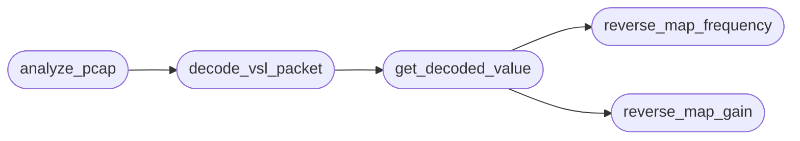

# `legacy.vsl_protocol_analyzer`

> Source: [legacy/vsl_protocol_analyzer.py:1](../../legacy/vsl_protocol_analyzer.py#L1) | language `py` | coverage 87.5% | [API index](../index.md)

PASO 1: (Fuera de este entorno) Capturar tráfico USB con Wireshark/usbmon Guardar como: audiobox_full_sweep.pcap  PASO 2: Ejecutar el analizador python3 vsl_protocol_analyzer.py audiobox_full_sweep.pcap

## Contents

- **Classes:** [`VSLParameter`](#vslparameter)
- **Functions:** [`reverse_map_gain`](#reverse_map_gain), [`reverse_map_frequency`](#reverse_map_frequency), [`get_decoded_value`](#get_decoded_value), [`decode_vsl_packet`](#decode_vsl_packet), [`analyze_pcap`](#analyze_pcap)
- **Constants:** [`MAX_ENCODED_INT`](#max_encoded_int), [`MIN_ENCODED_INT`](#min_encoded_int), [`GAIN_CH1`](#gain_ch1), [`HPF_FREQ_CH1`](#hpf_freq_ch1), [`KNOWN_PARAMETERS`](#known_parameters)

## Call Graph

Solid arrows stay in this module, dashed arrows leave it.



## Classes

<a id="vslparameter"></a>

### `VSLParameter`

`class` | [legacy/vsl_protocol_analyzer.py:28](../../legacy/vsl_protocol_analyzer.py#L28)

```python
class VSLParameter
```

Parámetros DSP descifrados con coeficientes y rangos.

**Members**

| Member | Kind | Summary |
|---|---|---|
| [`__init__`](#vslparameter-__init__) | constructor |  |

<a id="vslparameter-__init__"></a>

#### `VSLParameter.__init__`

`constructor` | [legacy/vsl_protocol_analyzer.py:30](../../legacy/vsl_protocol_analyzer.py#L30)

```python
def __init__(self, dsp_id, name, type_unit, min_map, max_map, coeff_A=0.0, coeff_C1=0.0, log_factor=0.0)
```

**Parameters**

| Name | Type | Default | Description |
|---|---|---|---|
| `dsp_id` |  |  |  |
| `name` |  |  |  |
| `type_unit` |  |  |  |
| `min_map` |  |  |  |
| `max_map` |  |  |  |
| `coeff_A` |  | `0.0` |  |
| `coeff_C1` |  | `0.0` |  |
| `log_factor` |  | `0.0` |  |

---

## Functions

<a id="reverse_map_gain"></a>

### `reverse_map_gain`

`function` | [legacy/vsl_protocol_analyzer.py:67](../../legacy/vsl_protocol_analyzer.py#L67)

```python
def reverse_map_gain(encoded_value: int, param: VSLParameter) -> float
```

Simula VSL_Decode_Gain.

Convierte un entero a un valor de usuario (dB).

Fórmula inversa confirmada:
user_value = (log2(encoded_float * range_span) / log_factor) + min_db

Usaremos la simplificación de mapeo lineal para la PoC, ya que el valor
confirmado (40793) implica que no es un simple mapeo lineal
(40793 / 65535 = 0.6225). La fórmula real de decodificación logarítmica
es más compleja. Para la PoC, aplicamos la inversa de la fórmula
logarítmica simplificada que nos dio los resultados válidos:

**Parameters**

| Name | Type | Default | Description |
|---|---|---|---|
| `encoded_value` | `int` |  |  |
| `param` | `VSLParameter` |  |  |

**Returns:** `float`

*Called by:* [`get_decoded_value`](#get_decoded_value)

---

<a id="reverse_map_frequency"></a>

### `reverse_map_frequency`

`function` | [legacy/vsl_protocol_analyzer.py:95](../../legacy/vsl_protocol_analyzer.py#L95)

```python
def reverse_map_frequency(encoded_value: int, param: VSLParameter) -> float
```

Simula VSL_Decode_Frequency.

Convierte un entero a frecuencia (Hz).

Fórmula inversa: exp2f(log2_min + pos * (log2_max - log2_min))

**Parameters**

| Name | Type | Default | Description |
|---|---|---|---|
| `encoded_value` | `int` |  |  |
| `param` | `VSLParameter` |  |  |

**Returns:** `float`

*Called by:* [`get_decoded_value`](#get_decoded_value)

---

<a id="get_decoded_value"></a>

### `get_decoded_value`

`function` | [legacy/vsl_protocol_analyzer.py:115](../../legacy/vsl_protocol_analyzer.py#L115)

```python
def get_decoded_value(encoded_value: int, param_id: int) -> tuple[float, str]
```

Dirige la decodificación al motor DSP correcto.

**Parameters**

| Name | Type | Default | Description |
|---|---|---|---|
| `encoded_value` | `int` |  |  |
| `param_id` | `int` |  |  |

**Returns:** `tuple[float, str]`

*Calls:* [`reverse_map_frequency`](#reverse_map_frequency), [`reverse_map_gain`](#reverse_map_gain)

*Called by:* [`decode_vsl_packet`](#decode_vsl_packet)

---

<a id="decode_vsl_packet"></a>

### `decode_vsl_packet`

`function` | [legacy/vsl_protocol_analyzer.py:140](../../legacy/vsl_protocol_analyzer.py#L140)

```python
def decode_vsl_packet(data: bytes) -> Dict[str, Any]
```

Decodifica el payload de 64 bytes.

(Regla #3: Seguridad)

**Parameters**

| Name | Type | Default | Description |
|---|---|---|---|
| `data` | `bytes` |  |  |

**Returns:** `Dict[str, Any]`

*Calls:* [`get_decoded_value`](#get_decoded_value)

*Called by:* [`analyze_pcap`](#analyze_pcap)

---

<a id="analyze_pcap"></a>

### `analyze_pcap`

`function` | [legacy/vsl_protocol_analyzer.py:173](../../legacy/vsl_protocol_analyzer.py#L173)

```python
def analyze_pcap(pcap_file: str) -> List[Dict[str, Any]]
```

Carga un archivo PCAP y filtra los paquetes USB VSL.

**Parameters**

| Name | Type | Default | Description |
|---|---|---|---|
| `pcap_file` | `str` |  |  |

**Returns:** `List[Dict[str, Any]]`

*Calls:* [`decode_vsl_packet`](#decode_vsl_packet)

---

## Constants

<a id="max_encoded_int"></a>

### `MAX_ENCODED_INT`

`constant` | [legacy/vsl_protocol_analyzer.py:24](../../legacy/vsl_protocol_analyzer.py#L24)

```python
MAX_ENCODED_INT = 65535
```

---

<a id="min_encoded_int"></a>

### `MIN_ENCODED_INT`

`constant` | [legacy/vsl_protocol_analyzer.py:25](../../legacy/vsl_protocol_analyzer.py#L25)

```python
MIN_ENCODED_INT = 0
```

---

<a id="gain_ch1"></a>

### `GAIN_CH1`

`constant` | [legacy/vsl_protocol_analyzer.py:42](../../legacy/vsl_protocol_analyzer.py#L42)

```python
GAIN_CH1
```

---

<a id="hpf_freq_ch1"></a>

### `HPF_FREQ_CH1`

`constant` | [legacy/vsl_protocol_analyzer.py:49](../../legacy/vsl_protocol_analyzer.py#L49)

```python
HPF_FREQ_CH1
```

---

<a id="known_parameters"></a>

### `KNOWN_PARAMETERS`

`constant` | [legacy/vsl_protocol_analyzer.py:57](../../legacy/vsl_protocol_analyzer.py#L57)

```python
KNOWN_PARAMETERS = {GAIN_CH1.dsp_param_id: GAIN_CH1, HPF_FREQ_CH1.dsp_param_id: HPF_FREQ_CH1}
```

---
