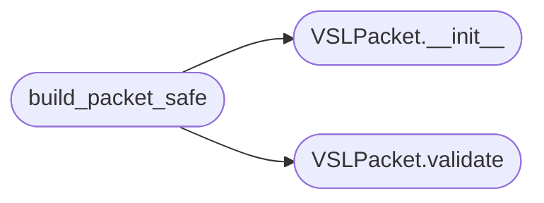

# `legacy.vsl_transport`

> Source: [legacy/vsl_transport.py:1](../../legacy/vsl_transport.py#L1) | language `py` | coverage 100.0% | [API index](../index.md)

VSL-DSP Transport Module Construcción y validación de paquetes HID.

## Contents

- **Classes:** [`VSLPacket`](#vslpacket)
- **Functions:** [`build_packet_safe`](#build_packet_safe)

## Call Graph

Solid arrows stay in this module, dashed arrows leave it.



## Classes

<a id="vslpacket"></a>

### `VSLPacket`

`class` | [legacy/vsl_transport.py:15](../../legacy/vsl_transport.py#L15)

```python
class VSLPacket
```

Representa un paquete HID VSL-DSP de 64 bytes.

Implementa construcción y validación con seguridad de tipos.

**Members**

| Member | Kind | Summary |
|---|---|---|
| [`__init__`](#vslpacket-__init__) | constructor | Construye un paquete VSL-DSP. |
| [`buffer`](#vslpacket-buffer) | property | Retorna el buffer como bytes inmutables. |
| [`hex_dump`](#vslpacket-hex_dump) | method | Genera un hex dump del paquete para debugging. |
| [`validate`](#vslpacket-validate) | method | Valida la integridad del paquete. |

<a id="vslpacket-__init__"></a>

#### `VSLPacket.__init__`

`constructor` | [legacy/vsl_transport.py:21](../../legacy/vsl_transport.py#L21)

```python
def __init__(self, param_id: int, encoded_value: int, report_id: Optional[int] = None)
```

Construye un paquete VSL-DSP.

**Parameters**

| Name | Type | Default | Description |
|---|---|---|---|
| `param_id` | `int` |  | ID del parámetro DSP (16-bit, ej: 0x1A01) |
| `encoded_value` | `int` |  | Valor codificado (16-bit, 0-65535) |
| `report_id` | `Optional[int]` | `None` | Report ID HID (8-bit, None usa configuración global) |

**Raises**

- `ValueError`: Si los valores están fuera de rango
- `RuntimeError`: Si VSL_REPORT_ID no está configurado y report_id es None

*Called by:* [`test_edge_cases`](legacy.vsl_poc_main.py.md#test_edge_cases), [`test_packet_construction`](legacy.vsl_poc_main.py.md#test_packet_construction), [`build_packet_safe`](#build_packet_safe)

<a id="vslpacket-buffer"></a>

#### `VSLPacket.buffer`

`property` | [legacy/vsl_transport.py:89](../../legacy/vsl_transport.py#L89)

Decorators: `@property`

```python
def buffer(self) -> bytes
```

Retorna el buffer como bytes inmutables.

**Returns:** `bytes`

*Called by:* [`M_PI`](voicecloak.src.vc_stream.c.md#m_pi)

<a id="vslpacket-hex_dump"></a>

#### `VSLPacket.hex_dump`

`method` | [legacy/vsl_transport.py:93](../../legacy/vsl_transport.py#L93)

```python
def hex_dump(self, num_bytes: int = 8) -> str
```

Genera un hex dump del paquete para debugging.

**Parameters**

| Name | Type | Default | Description |
|---|---|---|---|
| `num_bytes` | `int` | `8` | Número de bytes a mostrar (default: 8) |

**Returns:** `str` - String con formato hexadecimal

*Called by:* [`test_packet_construction`](legacy.vsl_poc_main.py.md#test_packet_construction)

<a id="vslpacket-validate"></a>

#### `VSLPacket.validate`

`method` | [legacy/vsl_transport.py:106](../../legacy/vsl_transport.py#L106)

```python
def validate(self) -> tuple[bool, str]
```

Valida la integridad del paquete.

**Returns:** `tuple[bool, str]` - (is_valid, message)

*Called by:* [`VSLDevice.send_packet`](legacy.vsl_hid_io.py.md#vsldevice-send_packet), [`test_packet_construction`](legacy.vsl_poc_main.py.md#test_packet_construction), [`build_packet_safe`](#build_packet_safe)

---

## Functions

<a id="build_packet_safe"></a>

### `build_packet_safe`

`function` | [legacy/vsl_transport.py:141](../../legacy/vsl_transport.py#L141)

```python
def build_packet_safe(param: VSLParameter, encoded_value: int) -> Optional[VSLPacket]
```

Construye un paquete con manejo de errores.

**Parameters**

| Name | Type | Default | Description |
|---|---|---|---|
| `param` | `VSLParameter` |  | Parámetro DSP |
| `encoded_value` | `int` |  | Valor codificado (0-65535) |

**Returns:** `Optional[VSLPacket]` - VSLPacket o None si hay error

*Calls:* [`VSLPacket.__init__`](#vslpacket-__init__), [`VSLPacket.validate`](#vslpacket-validate)

*Called by:* [`run_full_workflow`](legacy.vsl_poc_main.py.md#run_full_workflow)

---
