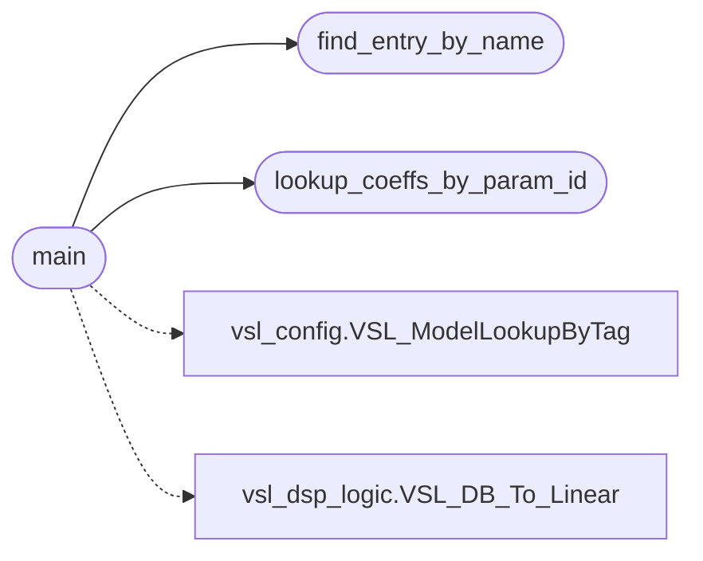

# `src/vsl_cli.c`

> Source: [src/vsl_cli.c:1](../../src/vsl_cli.c#L1) | language `c` | coverage 0.0% | [API index](../index.md)

## Contents

- **Structs:** [`ParamEntry`](#paramentry)
- **Functions:** [`lookup_coeffs_by_param_id`](#lookup_coeffs_by_param_id), [`find_entry_by_name`](#find_entry_by_name), [`main`](#main)
- **Macros:** [`MAX_CHANNELS`](#max_channels)

## Call Graph

Solid arrows stay in this module, dashed arrows leave it.



## Structs

<a id="paramentry"></a>

### `ParamEntry`

`struct` | [src/vsl_cli.c:16](../../src/vsl_cli.c#L16)

```c
typedef struct
```

---

## Functions

<a id="lookup_coeffs_by_param_id"></a>

### `lookup_coeffs_by_param_id`

`function` | [src/vsl_cli.c:116](../../src/vsl_cli.c#L116)

```c
static const VSL_Parameter * lookup_coeffs_by_param_id(uint16_t param_id)
```

**Parameters**

| Name | Type | Default | Description |
|---|---|---|---|
| `param_id` | `uint16_t` |  |  |

**Returns:** `VSL_Parameter *`

*Called by:* [`main`](#main)

---

<a id="find_entry_by_name"></a>

### `find_entry_by_name`

`function` | [src/vsl_cli.c:126](../../src/vsl_cli.c#L126)

```c
static const ParamEntry * find_entry_by_name(const char *name)
```

**Parameters**

| Name | Type | Default | Description |
|---|---|---|---|
| `name` | `char *` |  |  |

**Returns:** `ParamEntry *`

*Called by:* [`main`](#main)

---

<a id="main"></a>

### `main`

`function` | [src/vsl_cli.c:227](../../src/vsl_cli.c#L227)

```c
int main(int argc, char *argv[])
```

**Parameters**

| Name | Type | Default | Description |
|---|---|---|---|
| `argc` | `int` |  |  |
| `argv` | `char * []` |  |  |

**Returns:** `int`

*Calls:* [`find_entry_by_name`](#find_entry_by_name), [`lookup_coeffs_by_param_id`](#lookup_coeffs_by_param_id), [`VSL_ModelLookupByTag`](src.vsl_config.h.md#vsl_modellookupbytag), [`VSL_DB_To_Linear`](src.vsl_dsp_logic.h.md#vsl_db_to_linear)

---

## Macros

<a id="max_channels"></a>

### `MAX_CHANNELS`

`macro` | [src/vsl_cli.c:49](../../src/vsl_cli.c#L49)

```c
#define MAX_CHANNELS
```

---
