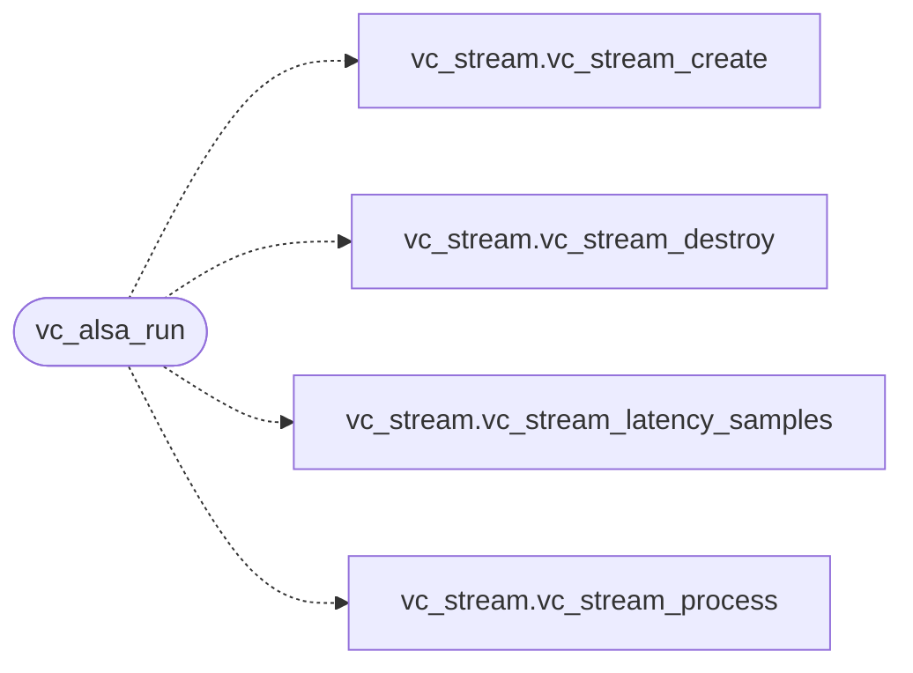

# `voicecloak/src/vc_alsa.c`

> Source: [voicecloak/src/vc_alsa.c:1](../../voicecloak/src/vc_alsa.c#L1) | language `c` | coverage 40.0% | [API index](../index.md)

## Contents

- **Structs:** [`vc_pcm_t`](#vc_pcm_t)
- **Functions:** [`vc_alsa_list`](#vc_alsa_list), [`vc_alsa_run`](#vc_alsa_run)
- **Macros:** [`_GNU_SOURCE`](#_gnu_source)

## Call Graph

Solid arrows stay in this module, dashed arrows leave it.



## Structs

<a id="vc_pcm_t"></a>

### `vc_pcm_t`

`struct` | [voicecloak/src/vc_alsa.c:13](../../voicecloak/src/vc_alsa.c#L13)

```c
typedef struct
```

---

## Functions

<a id="vc_alsa_list"></a>

### `vc_alsa_list`

`function` | [voicecloak/src/vc_alsa.c:163](../../voicecloak/src/vc_alsa.c#L163)

```c
int vc_alsa_list(void)
```

Print the available ALSA PCM devices to stdout.

**Returns:** `int` - 0 on success, -1 on error.

> **Inherited:** Documentation from [`vc_alsa_list`](#vc_alsa_list) (voicecloak/src/vc_alsa.h:46).

---

<a id="vc_alsa_run"></a>

### `vc_alsa_run`

`function` | [voicecloak/src/vc_alsa.c:189](../../voicecloak/src/vc_alsa.c#L189)

```c
int vc_alsa_run(const vc_alsa_cfg_t *cfg)
```

Open capture and playback, run the processing loop until *cfg->stop becomes non-zero or a fatal error occurs.

**Parameters**

| Name | Type | Default | Description |
|---|---|---|---|
| `cfg` | `vc_alsa_cfg_t *` |  |  |

**Returns:** `int` - 0 on clean stop, -1 on error.

> **Inherited:** Documentation from [`vc_alsa_run`](#vc_alsa_run) (voicecloak/src/vc_alsa.h:53).

*Calls:* [`vc_stream_create`](voicecloak.src.vc_stream.h.md#vc_stream_create), [`vc_stream_destroy`](voicecloak.src.vc_stream.h.md#vc_stream_destroy), [`vc_stream_latency_samples`](voicecloak.src.vc_stream.h.md#vc_stream_latency_samples), [`vc_stream_process`](voicecloak.src.vc_stream.h.md#vc_stream_process)

---

## Macros

<a id="_gnu_source"></a>

### `_GNU_SOURCE`

`macro` | [voicecloak/src/vc_alsa.c:1](../../voicecloak/src/vc_alsa.c#L1)

```c
#define _GNU_SOURCE
```

---
