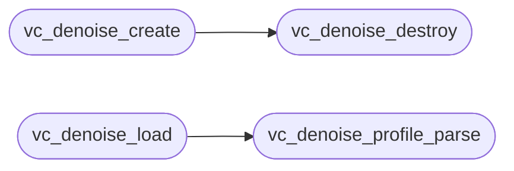

# `voicecloak/src/vc_denoise.c`

> Source: [voicecloak/src/vc_denoise.c:1](../../voicecloak/src/vc_denoise.c#L1) | language `c` | coverage 58.3% | [API index](../index.md)

## Contents

- **Structs:** [`vc_denoise_s`](#vc_denoise_s)
- **Functions:** [`vc_denoise_params_defaults`](#vc_denoise_params_defaults), [`vc_denoise_create`](#vc_denoise_create), [`vc_denoise_destroy`](#vc_denoise_destroy), [`vc_denoise_is_ready`](#vc_denoise_is_ready), [`vc_denoise_transform`](#vc_denoise_transform), [`vc_denoise_profile_parse`](#vc_denoise_profile_parse), [`vc_denoise_save`](#vc_denoise_save), [`vc_denoise_load`](#vc_denoise_load)
- **Macros:** [`VC_DENOISE_MAGIC`](#vc_denoise_magic), [`VC_DENOISE_VERSION`](#vc_denoise_version)

## Call Graph

Solid arrows stay in this module, dashed arrows leave it.



## Structs

<a id="vc_denoise_s"></a>

### `vc_denoise_s`

`struct` | [voicecloak/src/vc_denoise.c:12](../../voicecloak/src/vc_denoise.c#L12)

```c
struct vc_denoise_s
```

---

## Functions

<a id="vc_denoise_params_defaults"></a>

### `vc_denoise_params_defaults`

`function` | [voicecloak/src/vc_denoise.c:29](../../voicecloak/src/vc_denoise.c#L29)

```c
void vc_denoise_params_defaults(vc_denoise_params_t *params)
```

Fill parameters with the documented defaults. NULL-safe.

**Parameters**

| Name | Type | Default | Description |
|---|---|---|---|
| `params` | `vc_denoise_params_t *` |  |  |

> **Inherited:** Documentation from [`vc_denoise_params_defaults`](#vc_denoise_params_defaults) (voicecloak/src/vc_denoise.h:55).

---

<a id="vc_denoise_create"></a>

### `vc_denoise_create`

`function` | [voicecloak/src/vc_denoise.c:71](../../voicecloak/src/vc_denoise.c#L71)

```c
vc_denoise_t *vc_denoise_create(size_t nbins, const vc_denoise_params_t *params)
```

Create a noise reducer for @p nbins frequency bins.

**Parameters**

| Name | Type | Default | Description |
|---|---|---|---|
| `nbins` | `size_t` |  |  |
| `params` | `vc_denoise_params_t *` |  |  |

**Returns:** `vc_denoise_t *` - Context or NULL for invalid bins/parameters/allocation.

> **Inherited:** Documentation from [`vc_denoise_create`](#vc_denoise_create) (voicecloak/src/vc_denoise.h:61).

*Calls:* [`vc_denoise_destroy`](#vc_denoise_destroy)

---

<a id="vc_denoise_destroy"></a>

### `vc_denoise_destroy`

`function` | [voicecloak/src/vc_denoise.c:92](../../voicecloak/src/vc_denoise.c#L92)

```c
void vc_denoise_destroy(vc_denoise_t *denoise)
```

Release a noise reducer. NULL-safe.

**Parameters**

| Name | Type | Default | Description |
|---|---|---|---|
| `denoise` | `vc_denoise_t *` |  |  |

> **Inherited:** Documentation from [`vc_denoise_destroy`](#vc_denoise_destroy) (voicecloak/src/vc_denoise.h:65).

*Called by:* [`vc_denoise_create`](#vc_denoise_create)

---

<a id="vc_denoise_is_ready"></a>

### `vc_denoise_is_ready`

`function` | [voicecloak/src/vc_denoise.c:100](../../voicecloak/src/vc_denoise.c#L100)

```c
int vc_denoise_is_ready(const vc_denoise_t *denoise)
```

1 when a noise profile is available, 0 otherwise.

**Parameters**

| Name | Type | Default | Description |
|---|---|---|---|
| `denoise` | `vc_denoise_t *` |  |  |

**Returns:** `int`

> **Inherited:** Documentation from [`vc_denoise_is_ready`](#vc_denoise_is_ready) (voicecloak/src/vc_denoise.h:79).

---

<a id="vc_denoise_transform"></a>

### `vc_denoise_transform`

`function` | [voicecloak/src/vc_denoise.c:158](../../voicecloak/src/vc_denoise.c#L158)

```c
void vc_denoise_transform(float *mag, float *phase, size_t nbins, uint32_t sample_rate, size_t hop, void *user)
```

**Parameters**

| Name | Type | Default | Description |
|---|---|---|---|
| `mag` | `float *` |  |  |
| `phase` | `float *` |  |  |
| `nbins` | `size_t` |  |  |
| `sample_rate` | `uint32_t` |  |  |
| `hop` | `size_t` |  |  |
| `user` | `void *` |  |  |

---

<a id="vc_denoise_profile_parse"></a>

### `vc_denoise_profile_parse`

`function` | [voicecloak/src/vc_denoise.c:224](../../voicecloak/src/vc_denoise.c#L224)

```c
int vc_denoise_profile_parse(vc_denoise_t *denoise, const char *text, size_t length)
```

Parse a text noise profile (see spec for the format).

**Parameters**

| Name | Type | Default | Description |
|---|---|---|---|
| `denoise` | `vc_denoise_t *` |  |  |
| `text` | `char *` |  |  |
| `length` | `size_t` |  |  |

**Returns:** `int` - 0 on success; -1 on any malformed input (context unchanged).

> **Inherited:** Documentation from [`vc_denoise_profile_parse`](#vc_denoise_profile_parse) (voicecloak/src/vc_denoise.h:85).

*Called by:* [`vc_denoise_load`](#vc_denoise_load)

---

<a id="vc_denoise_save"></a>

### `vc_denoise_save`

`function` | [voicecloak/src/vc_denoise.c:266](../../voicecloak/src/vc_denoise.c#L266)

```c
int vc_denoise_save(const vc_denoise_t *denoise, const char *path)
```

Write the ready profile to @p path. @return 0 or -1.

**Parameters**

| Name | Type | Default | Description |
|---|---|---|---|
| `denoise` | `vc_denoise_t *` |  |  |
| `path` | `char *` |  |  |

**Returns:** `int`

> **Inherited:** Documentation from [`vc_denoise_save`](#vc_denoise_save) (voicecloak/src/vc_denoise.h:89).

---

<a id="vc_denoise_load"></a>

### `vc_denoise_load`

`function` | [voicecloak/src/vc_denoise.c:280](../../voicecloak/src/vc_denoise.c#L280)

```c
int vc_denoise_load(vc_denoise_t *denoise, const char *path)
```

Load a profile file (at most 2 MiB). @return 0 or -1.

**Parameters**

| Name | Type | Default | Description |
|---|---|---|---|
| `denoise` | `vc_denoise_t *` |  |  |
| `path` | `char *` |  |  |

**Returns:** `int`

> **Inherited:** Documentation from [`vc_denoise_load`](#vc_denoise_load) (voicecloak/src/vc_denoise.h:92).

*Calls:* [`vc_denoise_profile_parse`](#vc_denoise_profile_parse)

---

## Macros

<a id="vc_denoise_magic"></a>

### `VC_DENOISE_MAGIC`

`macro` | [voicecloak/src/vc_denoise.c:9](../../voicecloak/src/vc_denoise.c#L9)

```c
#define VC_DENOISE_MAGIC
```

---

<a id="vc_denoise_version"></a>

### `VC_DENOISE_VERSION`

`macro` | [voicecloak/src/vc_denoise.c:10](../../voicecloak/src/vc_denoise.c#L10)

```c
#define VC_DENOISE_VERSION
```

---
