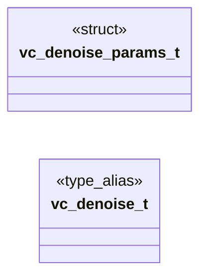

# `voicecloak/src/vc_denoise.h`

> Source: [voicecloak/src/vc_denoise.h:1](../../voicecloak/src/vc_denoise.h#L1) | language `h` | coverage 28.6% | [API index](../index.md)

## Contents

- **Structs:** [`vc_denoise_params_t`](#vc_denoise_params_t)
- **Type Aliases:** [`vc_denoise_t`](#vc_denoise_t)
- **Functions:** [`vc_denoise_params_defaults`](#vc_denoise_params_defaults), [`vc_denoise_create`](#vc_denoise_create), [`vc_denoise_destroy`](#vc_denoise_destroy), [`first`](#first), [`vc_denoise_is_ready`](#vc_denoise_is_ready), [`vc_denoise_profile_parse`](#vc_denoise_profile_parse), [`vc_denoise_save`](#vc_denoise_save), [`vc_denoise_load`](#vc_denoise_load)
- **Macros:** [`VC_DENOISE_DEFAULT_REDUCTION`](#vc_denoise_default_reduction), [`VC_DENOISE_DEFAULT_FLOOR_DB`](#vc_denoise_default_floor_db), [`VC_DENOISE_DEFAULT_SMOOTHING`](#vc_denoise_default_smoothing), [`VC_DENOISE_DEFAULT_GATE_SNR_DB`](#vc_denoise_default_gate_snr_db), [`VC_DENOISE_DEFAULT_GATE_RANGE_DB`](#vc_denoise_default_gate_range_db), [`VC_DENOISE_DEFAULT_LEARN_MS`](#vc_denoise_default_learn_ms), [`VC_DENOISE_MIN_REDUCTION`](#vc_denoise_min_reduction), [`VC_DENOISE_MAX_REDUCTION`](#vc_denoise_max_reduction), [`VC_DENOISE_MIN_FLOOR_DB`](#vc_denoise_min_floor_db), [`VC_DENOISE_MAX_SMOOTHING`](#vc_denoise_max_smoothing), [`VC_DENOISE_MAX_GATE_SNR_DB`](#vc_denoise_max_gate_snr_db), [`VC_DENOISE_MAX_GATE_RANGE_DB`](#vc_denoise_max_gate_range_db), [`VC_DENOISE_MIN_LEARN_MS`](#vc_denoise_min_learn_ms), [`VC_DENOISE_MAX_LEARN_MS`](#vc_denoise_max_learn_ms), [`VC_DENOISE_GATE_HYSTERESIS_DB`](#vc_denoise_gate_hysteresis_db), [`VC_DENOISE_GATE_RELEASE_MS`](#vc_denoise_gate_release_ms), [`VC_DENOISE_MAX_PROFILE_BYTES`](#vc_denoise_max_profile_bytes)
- **Variables:** [`loaded`](#loaded)

## Type Diagram



## Structs

<a id="vc_denoise_params_t"></a>

### `vc_denoise_params_t`

`struct` | [voicecloak/src/vc_denoise.h:43](../../voicecloak/src/vc_denoise.h#L43)

```c
typedef struct
```

Noise reduction settings. reduction: over-subtraction factor applied to the noise power. floor_db: lowest per-bin gain (limits musical noise). smoothing: per-bin gain smoothing across frames (0 = none). gate_snr_db: frames whose power is below the profile power plus this margin are treated as silence. gate_range_db: attenuation of silent frames (0 disables the gate). learn_ms: noise print length captured at start when no profile is loaded; output is muted while learning.

---

## Type Aliases

<a id="vc_denoise_t"></a>

### `vc_denoise_t`

`type_alias` | [voicecloak/src/vc_denoise.h:51](../../voicecloak/src/vc_denoise.h#L51)

```c
typedef struct vc_denoise_s vc_denoise_t;
```

---

## Functions

<a id="vc_denoise_params_defaults"></a>

### `vc_denoise_params_defaults`

`function` | [voicecloak/src/vc_denoise.h:55](../../voicecloak/src/vc_denoise.h#L55)

```c
void vc_denoise_params_defaults(vc_denoise_params_t *params);
```

Fill parameters with the documented defaults. NULL-safe.

**Parameters**

| Name | Type | Default | Description |
|---|---|---|---|
| `params` | `vc_denoise_params_t *` |  |  |

---

<a id="vc_denoise_create"></a>

### `vc_denoise_create`

`function` | [voicecloak/src/vc_denoise.h:61](../../voicecloak/src/vc_denoise.h#L61)

```c
vc_denoise_t *vc_denoise_create(size_t nbins, const vc_denoise_params_t *params);
```

Create a noise reducer for @p nbins frequency bins.

**Parameters**

| Name | Type | Default | Description |
|---|---|---|---|
| `nbins` | `size_t` |  |  |
| `params` | `vc_denoise_params_t *` |  |  |

**Returns:** `vc_denoise_t *` - Context or NULL for invalid bins/parameters/allocation.

---

<a id="vc_denoise_destroy"></a>

### `vc_denoise_destroy`

`function` | [voicecloak/src/vc_denoise.h:65](../../voicecloak/src/vc_denoise.h#L65)

```c
void vc_denoise_destroy(vc_denoise_t *denoise);
```

Release a noise reducer. NULL-safe.

**Parameters**

| Name | Type | Default | Description |
|---|---|---|---|
| `denoise` | `vc_denoise_t *` |  |  |

---

<a id="first"></a>

### `first`

`function` | [voicecloak/src/vc_denoise.h:70](../../voicecloak/src/vc_denoise.h#L70)

```c
* * Learns the noise print first (muting those frames), then applies * power spectral subtraction and the spectral gate to @p mag. Phases * are untouched. Frames with a bin count mismatch or non-finit
```

**Parameters**

| Name | Type | Default | Description |
|---|---|---|---|
| `frames` | `muting those` |  |  |

**Returns:** `* * Learns the noise print`

---

<a id="vc_denoise_is_ready"></a>

### `vc_denoise_is_ready`

`function` | [voicecloak/src/vc_denoise.h:79](../../voicecloak/src/vc_denoise.h#L79)

```c
int vc_denoise_is_ready(const vc_denoise_t *denoise);
```

1 when a noise profile is available, 0 otherwise.

**Parameters**

| Name | Type | Default | Description |
|---|---|---|---|
| `denoise` | `vc_denoise_t *` |  |  |

**Returns:** `int`

---

<a id="vc_denoise_profile_parse"></a>

### `vc_denoise_profile_parse`

`function` | [voicecloak/src/vc_denoise.h:85](../../voicecloak/src/vc_denoise.h#L85)

```c
int vc_denoise_profile_parse(vc_denoise_t *denoise, const char *text, size_t length);
```

Parse a text noise profile (see spec for the format).

**Parameters**

| Name | Type | Default | Description |
|---|---|---|---|
| `denoise` | `vc_denoise_t *` |  |  |
| `text` | `char *` |  |  |
| `length` | `size_t` |  |  |

**Returns:** `int` - 0 on success; -1 on any malformed input (context unchanged).

---

<a id="vc_denoise_save"></a>

### `vc_denoise_save`

`function` | [voicecloak/src/vc_denoise.h:89](../../voicecloak/src/vc_denoise.h#L89)

```c
int vc_denoise_save(const vc_denoise_t *denoise, const char *path);
```

Write the ready profile to @p path. @return 0 or -1.

**Parameters**

| Name | Type | Default | Description |
|---|---|---|---|
| `denoise` | `vc_denoise_t *` |  |  |
| `path` | `char *` |  |  |

**Returns:** `int`

---

<a id="vc_denoise_load"></a>

### `vc_denoise_load`

`function` | [voicecloak/src/vc_denoise.h:92](../../voicecloak/src/vc_denoise.h#L92)

```c
int vc_denoise_load(vc_denoise_t *denoise, const char *path);
```

Load a profile file (at most 2 MiB). @return 0 or -1.

**Parameters**

| Name | Type | Default | Description |
|---|---|---|---|
| `denoise` | `vc_denoise_t *` |  |  |
| `path` | `char *` |  |  |

**Returns:** `int`

---

## Macros

<a id="vc_denoise_default_reduction"></a>

### `VC_DENOISE_DEFAULT_REDUCTION`

`macro` | [voicecloak/src/vc_denoise.h:12](../../voicecloak/src/vc_denoise.h#L12)

```c
#define VC_DENOISE_DEFAULT_REDUCTION
```

---

<a id="vc_denoise_default_floor_db"></a>

### `VC_DENOISE_DEFAULT_FLOOR_DB`

`macro` | [voicecloak/src/vc_denoise.h:13](../../voicecloak/src/vc_denoise.h#L13)

```c
#define VC_DENOISE_DEFAULT_FLOOR_DB
```

---

<a id="vc_denoise_default_smoothing"></a>

### `VC_DENOISE_DEFAULT_SMOOTHING`

`macro` | [voicecloak/src/vc_denoise.h:14](../../voicecloak/src/vc_denoise.h#L14)

```c
#define VC_DENOISE_DEFAULT_SMOOTHING
```

---

<a id="vc_denoise_default_gate_snr_db"></a>

### `VC_DENOISE_DEFAULT_GATE_SNR_DB`

`macro` | [voicecloak/src/vc_denoise.h:15](../../voicecloak/src/vc_denoise.h#L15)

```c
#define VC_DENOISE_DEFAULT_GATE_SNR_DB
```

---

<a id="vc_denoise_default_gate_range_db"></a>

### `VC_DENOISE_DEFAULT_GATE_RANGE_DB`

`macro` | [voicecloak/src/vc_denoise.h:16](../../voicecloak/src/vc_denoise.h#L16)

```c
#define VC_DENOISE_DEFAULT_GATE_RANGE_DB
```

---

<a id="vc_denoise_default_learn_ms"></a>

### `VC_DENOISE_DEFAULT_LEARN_MS`

`macro` | [voicecloak/src/vc_denoise.h:17](../../voicecloak/src/vc_denoise.h#L17)

```c
#define VC_DENOISE_DEFAULT_LEARN_MS
```

---

<a id="vc_denoise_min_reduction"></a>

### `VC_DENOISE_MIN_REDUCTION`

`macro` | [voicecloak/src/vc_denoise.h:19](../../voicecloak/src/vc_denoise.h#L19)

```c
#define VC_DENOISE_MIN_REDUCTION
```

---

<a id="vc_denoise_max_reduction"></a>

### `VC_DENOISE_MAX_REDUCTION`

`macro` | [voicecloak/src/vc_denoise.h:20](../../voicecloak/src/vc_denoise.h#L20)

```c
#define VC_DENOISE_MAX_REDUCTION
```

---

<a id="vc_denoise_min_floor_db"></a>

### `VC_DENOISE_MIN_FLOOR_DB`

`macro` | [voicecloak/src/vc_denoise.h:21](../../voicecloak/src/vc_denoise.h#L21)

```c
#define VC_DENOISE_MIN_FLOOR_DB
```

---

<a id="vc_denoise_max_smoothing"></a>

### `VC_DENOISE_MAX_SMOOTHING`

`macro` | [voicecloak/src/vc_denoise.h:22](../../voicecloak/src/vc_denoise.h#L22)

```c
#define VC_DENOISE_MAX_SMOOTHING
```

---

<a id="vc_denoise_max_gate_snr_db"></a>

### `VC_DENOISE_MAX_GATE_SNR_DB`

`macro` | [voicecloak/src/vc_denoise.h:23](../../voicecloak/src/vc_denoise.h#L23)

```c
#define VC_DENOISE_MAX_GATE_SNR_DB
```

---

<a id="vc_denoise_max_gate_range_db"></a>

### `VC_DENOISE_MAX_GATE_RANGE_DB`

`macro` | [voicecloak/src/vc_denoise.h:24](../../voicecloak/src/vc_denoise.h#L24)

```c
#define VC_DENOISE_MAX_GATE_RANGE_DB
```

---

<a id="vc_denoise_min_learn_ms"></a>

### `VC_DENOISE_MIN_LEARN_MS`

`macro` | [voicecloak/src/vc_denoise.h:25](../../voicecloak/src/vc_denoise.h#L25)

```c
#define VC_DENOISE_MIN_LEARN_MS
```

---

<a id="vc_denoise_max_learn_ms"></a>

### `VC_DENOISE_MAX_LEARN_MS`

`macro` | [voicecloak/src/vc_denoise.h:26](../../voicecloak/src/vc_denoise.h#L26)

```c
#define VC_DENOISE_MAX_LEARN_MS
```

---

<a id="vc_denoise_gate_hysteresis_db"></a>

### `VC_DENOISE_GATE_HYSTERESIS_DB`

`macro` | [voicecloak/src/vc_denoise.h:27](../../voicecloak/src/vc_denoise.h#L27)

```c
#define VC_DENOISE_GATE_HYSTERESIS_DB
```

---

<a id="vc_denoise_gate_release_ms"></a>

### `VC_DENOISE_GATE_RELEASE_MS`

`macro` | [voicecloak/src/vc_denoise.h:28](../../voicecloak/src/vc_denoise.h#L28)

```c
#define VC_DENOISE_GATE_RELEASE_MS
```

---

<a id="vc_denoise_max_profile_bytes"></a>

### `VC_DENOISE_MAX_PROFILE_BYTES`

`macro` | [voicecloak/src/vc_denoise.h:29](../../voicecloak/src/vc_denoise.h#L29)

```c
#define VC_DENOISE_MAX_PROFILE_BYTES
```

---

## Variables

<a id="loaded"></a>

### `loaded`

`variable` `extern` | [voicecloak/src/vc_denoise.h:9](../../voicecloak/src/vc_denoise.h#L9)

```c
extern "C" { #endif #define VC_DENOISE_DEFAULT_REDUCTION 2.0f #define VC_DENOISE_DEFAULT_FLOOR_DB (-24.0f) #define VC_DENOISE_DEFAULT_SMOOTHING 0.5f #define VC_DENOISE_DEFAULT_GATE_SNR_DB 6.0f #define
```

ifdef __cplusplus

---
