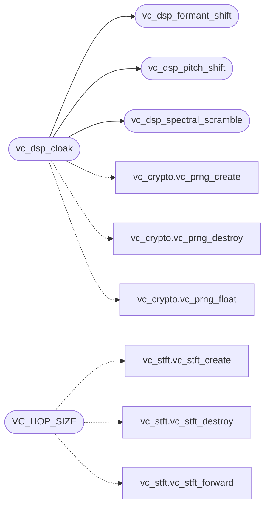

# `voicecloak/src/vc_dsp.c`

> Source: [voicecloak/src/vc_dsp.c:1](../../voicecloak/src/vc_dsp.c#L1) | language `c` | coverage 0.0% | [API index](../index.md)

## Contents

- **Functions:** [`vc_dsp_pitch_shift`](#vc_dsp_pitch_shift), [`vc_dsp_formant_shift`](#vc_dsp_formant_shift), [`vc_dsp_spectral_scramble`](#vc_dsp_spectral_scramble), [`vc_dsp_cloak`](#vc_dsp_cloak)
- **Macros:** [`VC_FFT_SIZE`](#vc_fft_size), [`VC_HOP_SIZE`](#vc_hop_size)

## Call Graph

Solid arrows stay in this module, dashed arrows leave it.



## Functions

<a id="vc_dsp_pitch_shift"></a>

### `vc_dsp_pitch_shift`

`function` | [voicecloak/src/vc_dsp.c:35](../../voicecloak/src/vc_dsp.c#L35)

```c
int vc_dsp_pitch_shift(const float *samples, size_t num_samples, uint32_t sample_rate, float semitones, float **out, size_t *out_len)
```

**Parameters**

| Name | Type | Default | Description |
|---|---|---|---|
| `samples` | `float *` |  |  |
| `num_samples` | `size_t` |  |  |
| `sample_rate` | `uint32_t` |  |  |
| `semitones` | `float` |  |  |
| `out` | `float **` |  |  |
| `out_len` | `size_t *` |  |  |

**Returns:** `int`

*Called by:* [`vc_dsp_cloak`](#vc_dsp_cloak)

---

<a id="vc_dsp_formant_shift"></a>

### `vc_dsp_formant_shift`

`function` | [voicecloak/src/vc_dsp.c:91](../../voicecloak/src/vc_dsp.c#L91)

```c
int vc_dsp_formant_shift(const float *samples, size_t num_samples, uint32_t sample_rate, float shift_factor, float **out, size_t *out_len)
```

**Parameters**

| Name | Type | Default | Description |
|---|---|---|---|
| `samples` | `float *` |  |  |
| `num_samples` | `size_t` |  |  |
| `sample_rate` | `uint32_t` |  |  |
| `shift_factor` | `float` |  |  |
| `out` | `float **` |  |  |
| `out_len` | `size_t *` |  |  |

**Returns:** `int`

*Called by:* [`vc_dsp_cloak`](#vc_dsp_cloak)

---

<a id="vc_dsp_spectral_scramble"></a>

### `vc_dsp_spectral_scramble`

`function` | [voicecloak/src/vc_dsp.c:161](../../voicecloak/src/vc_dsp.c#L161)

```c
int vc_dsp_spectral_scramble(const float *samples, size_t num_samples, uint32_t sample_rate, float intensity, float **out, size_t *out_len)
```

**Parameters**

| Name | Type | Default | Description |
|---|---|---|---|
| `samples` | `float *` |  |  |
| `num_samples` | `size_t` |  |  |
| `sample_rate` | `uint32_t` |  |  |
| `intensity` | `float` |  |  |
| `out` | `float **` |  |  |
| `out_len` | `size_t *` |  |  |

**Returns:** `int`

*Called by:* [`vc_dsp_cloak`](#vc_dsp_cloak)

---

<a id="vc_dsp_cloak"></a>

### `vc_dsp_cloak`

`function` | [voicecloak/src/vc_dsp.c:272](../../voicecloak/src/vc_dsp.c#L272)

```c
int vc_dsp_cloak(const float *samples, size_t num_samples, uint32_t sample_rate, const unsigned char *pitch_seed, const unsigned char *formant_seed, const unsigned char *spectral_seed, VcMode mode, float **out, size_t *out_len)
```

**Parameters**

| Name | Type | Default | Description |
|---|---|---|---|
| `samples` | `float *` |  |  |
| `num_samples` | `size_t` |  |  |
| `sample_rate` | `uint32_t` |  |  |
| `pitch_seed` | `unsigned char *` |  |  |
| `formant_seed` | `unsigned char *` |  |  |
| `spectral_seed` | `unsigned char *` |  |  |
| `mode` | `VcMode` |  |  |
| `out` | `float **` |  |  |
| `out_len` | `size_t *` |  |  |

**Returns:** `int`

*Calls:* [`vc_prng_create`](voicecloak.src.vc_crypto.h.md#vc_prng_create), [`vc_prng_destroy`](voicecloak.src.vc_crypto.h.md#vc_prng_destroy), [`vc_prng_float`](voicecloak.src.vc_crypto.h.md#vc_prng_float), [`vc_dsp_formant_shift`](#vc_dsp_formant_shift), [`vc_dsp_pitch_shift`](#vc_dsp_pitch_shift), [`vc_dsp_spectral_scramble`](#vc_dsp_spectral_scramble)

---

## Macros

<a id="vc_fft_size"></a>

### `VC_FFT_SIZE`

`macro` | [voicecloak/src/vc_dsp.c:9](../../voicecloak/src/vc_dsp.c#L9)

```c
#define VC_FFT_SIZE
```

---

<a id="vc_hop_size"></a>

### `VC_HOP_SIZE`

`macro` | [voicecloak/src/vc_dsp.c:10](../../voicecloak/src/vc_dsp.c#L10)

```c
#define VC_HOP_SIZE
```

*Calls:* [`vc_stft_create`](voicecloak.src.vc_stft.h.md#vc_stft_create), [`vc_stft_destroy`](voicecloak.src.vc_stft.h.md#vc_stft_destroy), [`vc_stft_forward`](voicecloak.src.vc_stft.h.md#vc_stft_forward)

---
