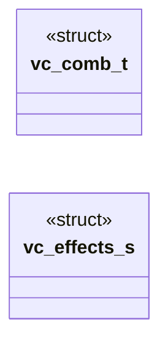
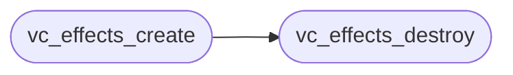

# `voicecloak/src/vc_effects.c`

> Source: [voicecloak/src/vc_effects.c:1](../../voicecloak/src/vc_effects.c#L1) | language `c` | coverage 20.0% | [API index](../index.md)

## Contents

- **Structs:** [`vc_comb_t`](#vc_comb_t), [`vc_effects_s`](#vc_effects_s)
- **Functions:** [`vc_effects_create`](#vc_effects_create), [`vc_effects_destroy`](#vc_effects_destroy), [`vc_effects_process`](#vc_effects_process)
- **Macros:** [`M_PI`](#m_pi), [`VC_EFFECT_MAX_DELAY_MS`](#vc_effect_max_delay_ms), [`VC_REVERB_MAX_COMB_DELAY_MS`](#vc_reverb_max_comb_delay_ms), [`VC_REVERB_MIN_DECAY_SECONDS`](#vc_reverb_min_decay_seconds), [`VC_REVERB_MAX_DECAY_SECONDS`](#vc_reverb_max_decay_seconds), [`VC_REVERB_MAX_FEEDBACK`](#vc_reverb_max_feedback), [`VC_METALLIC_MAX_DELAY_MS`](#vc_metallic_max_delay_ms), [`VC_METALLIC_MAX_FEEDBACK`](#vc_metallic_max_feedback), [`VC_RING_SQUARE_SHARPNESS`](#vc_ring_square_sharpness)

## Type Diagram



## Call Graph

Solid arrows stay in this module, dashed arrows leave it.



## Structs

<a id="vc_comb_t"></a>

### `vc_comb_t`

`struct` | [voicecloak/src/vc_effects.c:20](../../voicecloak/src/vc_effects.c#L20)

```c
typedef struct
```

---

<a id="vc_effects_s"></a>

### `vc_effects_s`

`struct` | [voicecloak/src/vc_effects.c:27](../../voicecloak/src/vc_effects.c#L27)

```c
struct vc_effects_s
```

---

## Functions

<a id="vc_effects_create"></a>

### `vc_effects_create`

`function` | [voicecloak/src/vc_effects.c:129](../../voicecloak/src/vc_effects.c#L129)

```c
vc_effects_t *vc_effects_create(uint32_t sample_rate, const vc_effects_params_t *params)
```

Create one stateful, sample-domain effect context.

**Parameters**

| Name | Type | Default | Description |
|---|---|---|---|
| `sample_rate` | `uint32_t` |  |  |
| `params` | `vc_effects_params_t *` |  |  |

**Returns:** `vc_effects_t *` - Context or NULL for invalid sample rate/parameters/allocation.

> **Inherited:** Documentation from [`vc_effects_create`](#vc_effects_create) (voicecloak/src/vc_effects.h:60).

*Calls:* [`vc_effects_destroy`](#vc_effects_destroy)

---

<a id="vc_effects_destroy"></a>

### `vc_effects_destroy`

`function` | [voicecloak/src/vc_effects.c:173](../../voicecloak/src/vc_effects.c#L173)

```c
void vc_effects_destroy(vc_effects_t *effects)
```

Release effect state and delay lines. NULL-safe.

**Parameters**

| Name | Type | Default | Description |
|---|---|---|---|
| `effects` | `vc_effects_t *` |  |  |

> **Inherited:** Documentation from [`vc_effects_destroy`](#vc_effects_destroy) (voicecloak/src/vc_effects.h:64).

*Called by:* [`vc_effects_create`](#vc_effects_create)

---

<a id="vc_effects_process"></a>

### `vc_effects_process`

`function` | [voicecloak/src/vc_effects.c:309](../../voicecloak/src/vc_effects.c#L309)

```c
int vc_effects_process(vc_effects_t *effects, float *samples, size_t count)
```

Process mono samples in place, preserving state between blocks.

**Parameters**

| Name | Type | Default | Description |
|---|---|---|---|
| `effects` | `vc_effects_t *` |  |  |
| `samples` | `float *` |  |  |
| `count` | `size_t` |  |  |

**Returns:** `int` - 0 on success; nonzero on invalid input. Invalid blocks are silenced fail-closed.

> **Inherited:** Documentation from [`vc_effects_process`](#vc_effects_process) (voicecloak/src/vc_effects.h:71).

---

## Macros

<a id="m_pi"></a>

### `M_PI`

`macro` | [voicecloak/src/vc_effects.c:8](../../voicecloak/src/vc_effects.c#L8)

```c
#define M_PI
```

---

<a id="vc_effect_max_delay_ms"></a>

### `VC_EFFECT_MAX_DELAY_MS`

`macro` | [voicecloak/src/vc_effects.c:11](../../voicecloak/src/vc_effects.c#L11)

```c
#define VC_EFFECT_MAX_DELAY_MS
```

---

<a id="vc_reverb_max_comb_delay_ms"></a>

### `VC_REVERB_MAX_COMB_DELAY_MS`

`macro` | [voicecloak/src/vc_effects.c:12](../../voicecloak/src/vc_effects.c#L12)

```c
#define VC_REVERB_MAX_COMB_DELAY_MS
```

---

<a id="vc_reverb_min_decay_seconds"></a>

### `VC_REVERB_MIN_DECAY_SECONDS`

`macro` | [voicecloak/src/vc_effects.c:13](../../voicecloak/src/vc_effects.c#L13)

```c
#define VC_REVERB_MIN_DECAY_SECONDS
```

---

<a id="vc_reverb_max_decay_seconds"></a>

### `VC_REVERB_MAX_DECAY_SECONDS`

`macro` | [voicecloak/src/vc_effects.c:14](../../voicecloak/src/vc_effects.c#L14)

```c
#define VC_REVERB_MAX_DECAY_SECONDS
```

---

<a id="vc_reverb_max_feedback"></a>

### `VC_REVERB_MAX_FEEDBACK`

`macro` | [voicecloak/src/vc_effects.c:15](../../voicecloak/src/vc_effects.c#L15)

```c
#define VC_REVERB_MAX_FEEDBACK
```

---

<a id="vc_metallic_max_delay_ms"></a>

### `VC_METALLIC_MAX_DELAY_MS`

`macro` | [voicecloak/src/vc_effects.c:16](../../voicecloak/src/vc_effects.c#L16)

```c
#define VC_METALLIC_MAX_DELAY_MS
```

---

<a id="vc_metallic_max_feedback"></a>

### `VC_METALLIC_MAX_FEEDBACK`

`macro` | [voicecloak/src/vc_effects.c:17](../../voicecloak/src/vc_effects.c#L17)

```c
#define VC_METALLIC_MAX_FEEDBACK
```

---

<a id="vc_ring_square_sharpness"></a>

### `VC_RING_SQUARE_SHARPNESS`

`macro` | [voicecloak/src/vc_effects.c:18](../../voicecloak/src/vc_effects.c#L18)

```c
#define VC_RING_SQUARE_SHARPNESS
```

---
