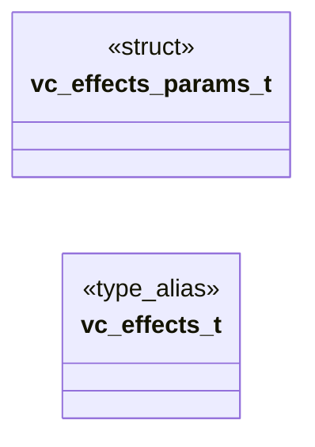

# `voicecloak/src/vc_effects.h`

> Source: [voicecloak/src/vc_effects.h:1](../../voicecloak/src/vc_effects.h#L1) | language `h` | coverage 50.0% | [API index](../index.md)

## Contents

- **Structs:** [`vc_effects_params_t`](#vc_effects_params_t)
- **Type Aliases:** [`vc_effects_t`](#vc_effects_t)
- **Functions:** [`vc_effects_create`](#vc_effects_create), [`vc_effects_destroy`](#vc_effects_destroy), [`vc_effects_process`](#vc_effects_process)
- **Macros:** [`VC_REVERB_COMB_COUNT`](#vc_reverb_comb_count), [`VC_PHASER_STAGE_COUNT`](#vc_phaser_stage_count)
- **Variables:** [`vc_effect_kind_t`](#vc_effect_kind_t)

## Type Diagram



## Structs

<a id="vc_effects_params_t"></a>

### `vc_effects_params_t`

`struct` | [voicecloak/src/vc_effects.h:38](../../voicecloak/src/vc_effects.h#L38)

```c
typedef struct
```

Effect selection and values (supplied by the preset table). RING_MOD reads ring_amount/rate_hz/waveform. METALLIC is a short feedback comb (delay_ms, feedback, wet mix amount) followed by the same optional ring modulation (ring_amount 0 disables it).

---

## Type Aliases

<a id="vc_effects_t"></a>

### `vc_effects_t`

`type_alias` | [voicecloak/src/vc_effects.h:53](../../voicecloak/src/vc_effects.h#L53)

```c
typedef struct vc_effects_s vc_effects_t;
```

---

## Functions

<a id="vc_effects_create"></a>

### `vc_effects_create`

`function` | [voicecloak/src/vc_effects.h:60](../../voicecloak/src/vc_effects.h#L60)

```c
vc_effects_t *vc_effects_create(uint32_t sample_rate, const vc_effects_params_t *params);
```

Create one stateful, sample-domain effect context.

**Parameters**

| Name | Type | Default | Description |
|---|---|---|---|
| `sample_rate` | `uint32_t` |  |  |
| `params` | `vc_effects_params_t *` |  |  |

**Returns:** `vc_effects_t *` - Context or NULL for invalid sample rate/parameters/allocation.

---

<a id="vc_effects_destroy"></a>

### `vc_effects_destroy`

`function` | [voicecloak/src/vc_effects.h:64](../../voicecloak/src/vc_effects.h#L64)

```c
void vc_effects_destroy(vc_effects_t *effects);
```

Release effect state and delay lines. NULL-safe.

**Parameters**

| Name | Type | Default | Description |
|---|---|---|---|
| `effects` | `vc_effects_t *` |  |  |

---

<a id="vc_effects_process"></a>

### `vc_effects_process`

`function` | [voicecloak/src/vc_effects.h:71](../../voicecloak/src/vc_effects.h#L71)

```c
int vc_effects_process(vc_effects_t *effects, float *samples, size_t count);
```

Process mono samples in place, preserving state between blocks.

**Parameters**

| Name | Type | Default | Description |
|---|---|---|---|
| `effects` | `vc_effects_t *` |  |  |
| `samples` | `float *` |  |  |
| `count` | `size_t` |  |  |

**Returns:** `int` - 0 on success; nonzero on invalid input. Invalid blocks are silenced fail-closed.

---

## Macros

<a id="vc_reverb_comb_count"></a>

### `VC_REVERB_COMB_COUNT`

`macro` | [voicecloak/src/vc_effects.h:12](../../voicecloak/src/vc_effects.h#L12)

```c
#define VC_REVERB_COMB_COUNT
```

---

<a id="vc_phaser_stage_count"></a>

### `VC_PHASER_STAGE_COUNT`

`macro` | [voicecloak/src/vc_effects.h:13](../../voicecloak/src/vc_effects.h#L13)

```c
#define VC_PHASER_STAGE_COUNT
```

---

## Variables

<a id="vc_effect_kind_t"></a>

### `vc_effect_kind_t`

`variable` `extern` | [voicecloak/src/vc_effects.h:9](../../voicecloak/src/vc_effects.h#L9)

```c
extern "C" { #endif #define VC_REVERB_COMB_COUNT 4U #define VC_PHASER_STAGE_COUNT 6U typedef enum { VC_EFFECT_NONE = 0, VC_EFFECT_RING_MOD, VC_EFFECT_UNDERWATER, VC_EFFECT_PHASER, VC_EFFECT_SPACE, VC_
```

ifdef __cplusplus

---
