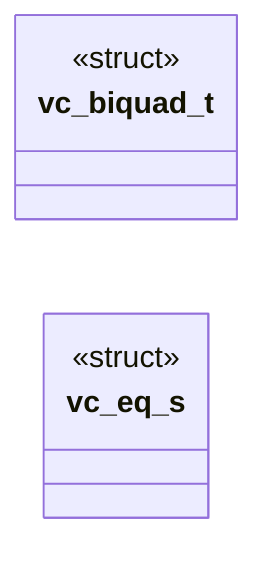

# `voicecloak/src/vc_eq.c`

> Source: [voicecloak/src/vc_eq.c:1](../../voicecloak/src/vc_eq.c#L1) | language `c` | coverage 37.5% | [API index](../index.md)

## Contents

- **Structs:** [`vc_biquad_t`](#vc_biquad_t), [`vc_eq_s`](#vc_eq_s)
- **Functions:** [`vc_eq_create`](#vc_eq_create), [`vc_eq_destroy`](#vc_eq_destroy), [`vc_eq_process`](#vc_eq_process)
- **Macros:** [`M_PI`](#m_pi), [`VC_EQ_BUTTERWORTH_Q`](#vc_eq_butterworth_q)

## Type Diagram



## Structs

<a id="vc_biquad_t"></a>

### `vc_biquad_t`

`struct` | [voicecloak/src/vc_eq.c:13](../../voicecloak/src/vc_eq.c#L13)

```c
typedef struct
```

---

<a id="vc_eq_s"></a>

### `vc_eq_s`

`struct` | [voicecloak/src/vc_eq.c:19](../../voicecloak/src/vc_eq.c#L19)

```c
struct vc_eq_s
```

---

## Functions

<a id="vc_eq_create"></a>

### `vc_eq_create`

`function` | [voicecloak/src/vc_eq.c:67](../../voicecloak/src/vc_eq.c#L67)

```c
vc_eq_t *vc_eq_create(uint32_t sample_rate, const vc_eq_params_t *params)
```

Create a high-pass + presence peaking equalizer.

**Parameters**

| Name | Type | Default | Description |
|---|---|---|---|
| `sample_rate` | `uint32_t` |  |  |
| `params` | `vc_eq_params_t *` |  |  |

**Returns:** `vc_eq_t *` - Context or NULL for invalid sample rate/parameters/allocation.

> **Inherited:** Documentation from [`vc_eq_create`](#vc_eq_create) (voicecloak/src/vc_eq.h:36).

---

<a id="vc_eq_destroy"></a>

### `vc_eq_destroy`

`function` | [voicecloak/src/vc_eq.c:81](../../voicecloak/src/vc_eq.c#L81)

```c
void vc_eq_destroy(vc_eq_t *eq)
```

Release equalizer state. NULL-safe.

**Parameters**

| Name | Type | Default | Description |
|---|---|---|---|
| `eq` | `vc_eq_t *` |  |  |

> **Inherited:** Documentation from [`vc_eq_destroy`](#vc_eq_destroy) (voicecloak/src/vc_eq.h:39).

---

<a id="vc_eq_process"></a>

### `vc_eq_process`

`function` | [voicecloak/src/vc_eq.c:99](../../voicecloak/src/vc_eq.c#L99)

```c
int vc_eq_process(vc_eq_t *eq, float *samples, size_t count)
```

Equalize mono samples in place, keeping filter state.

**Parameters**

| Name | Type | Default | Description |
|---|---|---|---|
| `eq` | `vc_eq_t *` |  |  |
| `samples` | `float *` |  |  |
| `count` | `size_t` |  |  |

**Returns:** `int` - 0 on success; nonzero on invalid arguments/data. Invalid blocks are silenced and the filter state is reset.

> **Inherited:** Documentation from [`vc_eq_process`](#vc_eq_process) (voicecloak/src/vc_eq.h:46).

---

## Macros

<a id="m_pi"></a>

### `M_PI`

`macro` | [voicecloak/src/vc_eq.c:8](../../voicecloak/src/vc_eq.c#L8)

```c
#define M_PI
```

---

<a id="vc_eq_butterworth_q"></a>

### `VC_EQ_BUTTERWORTH_Q`

`macro` | [voicecloak/src/vc_eq.c:11](../../voicecloak/src/vc_eq.c#L11)

```c
#define VC_EQ_BUTTERWORTH_Q
```

---
