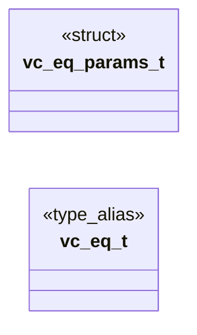

# `voicecloak/src/vc_eq.h`

> Source: [voicecloak/src/vc_eq.h:1](../../voicecloak/src/vc_eq.h#L1) | language `h` | coverage 44.4% | [API index](../index.md)

## Contents

- **Structs:** [`vc_eq_params_t`](#vc_eq_params_t)
- **Type Aliases:** [`vc_eq_t`](#vc_eq_t)
- **Functions:** [`vc_eq_create`](#vc_eq_create), [`vc_eq_destroy`](#vc_eq_destroy), [`vc_eq_process`](#vc_eq_process)
- **Macros:** [`VC_EQ_MAX_GAIN_DB`](#vc_eq_max_gain_db), [`VC_EQ_MIN_Q`](#vc_eq_min_q), [`VC_EQ_MAX_Q`](#vc_eq_max_q)
- **Variables:** [`section`](#section)

## Type Diagram



## Structs

<a id="vc_eq_params_t"></a>

### `vc_eq_params_t`

`struct` | [voicecloak/src/vc_eq.h:23](../../voicecloak/src/vc_eq.h#L23)

```c
typedef struct
```

Voice equalizer settings (supplied by the preset table). highpass_hz 0 bypasses the high-pass section; presence_gain_db 0 bypasses the presence peak (presence_hz and presence_q are then ignored). Coefficients follow the RBJ Audio EQ Cookbook.

---

## Type Aliases

<a id="vc_eq_t"></a>

### `vc_eq_t`

`type_alias` | [voicecloak/src/vc_eq.h:29](../../voicecloak/src/vc_eq.h#L29)

```c
typedef struct vc_eq_s vc_eq_t;
```

---

## Functions

<a id="vc_eq_create"></a>

### `vc_eq_create`

`function` | [voicecloak/src/vc_eq.h:36](../../voicecloak/src/vc_eq.h#L36)

```c
vc_eq_t *vc_eq_create(uint32_t sample_rate, const vc_eq_params_t *params);
```

Create a high-pass + presence peaking equalizer.

**Parameters**

| Name | Type | Default | Description |
|---|---|---|---|
| `sample_rate` | `uint32_t` |  |  |
| `params` | `vc_eq_params_t *` |  |  |

**Returns:** `vc_eq_t *` - Context or NULL for invalid sample rate/parameters/allocation.

---

<a id="vc_eq_destroy"></a>

### `vc_eq_destroy`

`function` | [voicecloak/src/vc_eq.h:39](../../voicecloak/src/vc_eq.h#L39)

```c
void vc_eq_destroy(vc_eq_t *eq);
```

Release equalizer state. NULL-safe.

**Parameters**

| Name | Type | Default | Description |
|---|---|---|---|
| `eq` | `vc_eq_t *` |  |  |

---

<a id="vc_eq_process"></a>

### `vc_eq_process`

`function` | [voicecloak/src/vc_eq.h:46](../../voicecloak/src/vc_eq.h#L46)

```c
int vc_eq_process(vc_eq_t *eq, float *samples, size_t count);
```

Equalize mono samples in place, keeping filter state.

**Parameters**

| Name | Type | Default | Description |
|---|---|---|---|
| `eq` | `vc_eq_t *` |  |  |
| `samples` | `float *` |  |  |
| `count` | `size_t` |  |  |

**Returns:** `int` - 0 on success; nonzero on invalid arguments/data. Invalid blocks are silenced and the filter state is reset.

---

## Macros

<a id="vc_eq_max_gain_db"></a>

### `VC_EQ_MAX_GAIN_DB`

`macro` | [voicecloak/src/vc_eq.h:12](../../voicecloak/src/vc_eq.h#L12)

```c
#define VC_EQ_MAX_GAIN_DB
```

---

<a id="vc_eq_min_q"></a>

### `VC_EQ_MIN_Q`

`macro` | [voicecloak/src/vc_eq.h:13](../../voicecloak/src/vc_eq.h#L13)

```c
#define VC_EQ_MIN_Q
```

---

<a id="vc_eq_max_q"></a>

### `VC_EQ_MAX_Q`

`macro` | [voicecloak/src/vc_eq.h:14](../../voicecloak/src/vc_eq.h#L14)

```c
#define VC_EQ_MAX_Q
```

---

## Variables

<a id="section"></a>

### `section`

`variable` `extern` | [voicecloak/src/vc_eq.h:9](../../voicecloak/src/vc_eq.h#L9)

```c
extern "C" { #endif #define VC_EQ_MAX_GAIN_DB 12.0f #define VC_EQ_MIN_Q 0.1f #define VC_EQ_MAX_Q 10.0f /** * @brief Voice equalizer settings (supplied by the preset table). * * highpass_hz 0 bypasses
```

ifdef __cplusplus

---
