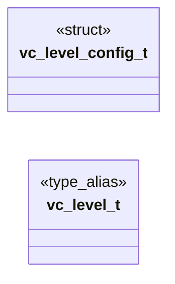

# `voicecloak/src/vc_level.h`

> Source: [voicecloak/src/vc_level.h:1](../../voicecloak/src/vc_level.h#L1) | language `h` | coverage 40.0% | [API index](../index.md)

## Contents

- **Structs:** [`vc_level_config_t`](#vc_level_config_t)
- **Type Aliases:** [`vc_level_t`](#vc_level_t)
- **Functions:** [`vc_level_config_defaults`](#vc_level_config_defaults), [`vc_level_create`](#vc_level_create), [`vc_level_destroy`](#vc_level_destroy), [`vc_level_process`](#vc_level_process), [`vc_level_current_gain_db`](#vc_level_current_gain_db)
- **Macros:** [`VC_LEVEL_DEFAULT_TARGET_DBFS`](#vc_level_default_target_dbfs), [`VC_LEVEL_DEFAULT_MAX_GAIN_DB`](#vc_level_default_max_gain_db), [`VC_LEVEL_DEFAULT_CEILING_DBFS`](#vc_level_default_ceiling_dbfs), [`VC_LEVEL_DEFAULT_ATTACK_MS`](#vc_level_default_attack_ms), [`VC_LEVEL_DEFAULT_RELEASE_MS`](#vc_level_default_release_ms), [`VC_LEVEL_DEFAULT_LIMITER_RELEASE_MS`](#vc_level_default_limiter_release_ms), [`VC_LEVEL_DEFAULT_SATURATION_DRIVE`](#vc_level_default_saturation_drive)
- **Variables:** [`saturation`](#saturation)

## Type Diagram



## Structs

<a id="vc_level_config_t"></a>

### `vc_level_config_t`

`struct` | [voicecloak/src/vc_level.h:26](../../voicecloak/src/vc_level.h#L26)

```c
typedef struct
```

Level-stage configuration. saturation_drive 0 bypasses the soft saturation; a drive d in (0, 8] maps each post-AGC sample x to tanh(d x) / tanh(d) before the limiter.

---

## Type Aliases

<a id="vc_level_t"></a>

### `vc_level_t`

`type_alias` | [voicecloak/src/vc_level.h:36](../../voicecloak/src/vc_level.h#L36)

```c
typedef struct vc_level_s vc_level_t;
```

---

## Functions

<a id="vc_level_config_defaults"></a>

### `vc_level_config_defaults`

`function` | [voicecloak/src/vc_level.h:40](../../voicecloak/src/vc_level.h#L40)

```c
void vc_level_config_defaults(vc_level_config_t *config);
```

Fill configuration with documented VoiceCloak defaults.

**Parameters**

| Name | Type | Default | Description |
|---|---|---|---|
| `config` | `vc_level_config_t *` |  |  |

---

<a id="vc_level_create"></a>

### `vc_level_create`

`function` | [voicecloak/src/vc_level.h:46](../../voicecloak/src/vc_level.h#L46)

```c
vc_level_t *vc_level_create(uint32_t sample_rate, const vc_level_config_t *config);
```

Create smoothed RMS gain control and peak limiter state.

**Parameters**

| Name | Type | Default | Description |
|---|---|---|---|
| `sample_rate` | `uint32_t` |  |  |
| `config` | `vc_level_config_t *` |  |  |

**Returns:** `vc_level_t *` - Context or NULL if sample rate/configuration is invalid.

---

<a id="vc_level_destroy"></a>

### `vc_level_destroy`

`function` | [voicecloak/src/vc_level.h:50](../../voicecloak/src/vc_level.h#L50)

```c
void vc_level_destroy(vc_level_t *level);
```

Release level-control state. NULL-safe.

**Parameters**

| Name | Type | Default | Description |
|---|---|---|---|
| `level` | `vc_level_t *` |  |  |

---

<a id="vc_level_process"></a>

### `vc_level_process`

`function` | [voicecloak/src/vc_level.h:58](../../voicecloak/src/vc_level.h#L58)

```c
int vc_level_process(vc_level_t *level, float *samples, size_t count);
```

Apply smoothed RMS gain, soft saturation, and peak limiting in place.

**Parameters**

| Name | Type | Default | Description |
|---|---|---|---|
| `level` | `vc_level_t *` |  |  |
| `samples` | `float *` |  |  |
| `count` | `size_t` |  |  |

**Returns:** `int` - 0 on success; nonzero on invalid arguments/data. Invalid blocks are silenced fail-closed.

---

<a id="vc_level_current_gain_db"></a>

### `vc_level_current_gain_db`

`function` | [voicecloak/src/vc_level.h:61](../../voicecloak/src/vc_level.h#L61)

```c
float vc_level_current_gain_db(const vc_level_t *level);
```

Return the current AGC gain in dB, or 0 for a NULL context.

**Parameters**

| Name | Type | Default | Description |
|---|---|---|---|
| `level` | `vc_level_t *` |  |  |

**Returns:** `float`

---

## Macros

<a id="vc_level_default_target_dbfs"></a>

### `VC_LEVEL_DEFAULT_TARGET_DBFS`

`macro` | [voicecloak/src/vc_level.h:12](../../voicecloak/src/vc_level.h#L12)

```c
#define VC_LEVEL_DEFAULT_TARGET_DBFS
```

---

<a id="vc_level_default_max_gain_db"></a>

### `VC_LEVEL_DEFAULT_MAX_GAIN_DB`

`macro` | [voicecloak/src/vc_level.h:13](../../voicecloak/src/vc_level.h#L13)

```c
#define VC_LEVEL_DEFAULT_MAX_GAIN_DB
```

---

<a id="vc_level_default_ceiling_dbfs"></a>

### `VC_LEVEL_DEFAULT_CEILING_DBFS`

`macro` | [voicecloak/src/vc_level.h:14](../../voicecloak/src/vc_level.h#L14)

```c
#define VC_LEVEL_DEFAULT_CEILING_DBFS
```

---

<a id="vc_level_default_attack_ms"></a>

### `VC_LEVEL_DEFAULT_ATTACK_MS`

`macro` | [voicecloak/src/vc_level.h:15](../../voicecloak/src/vc_level.h#L15)

```c
#define VC_LEVEL_DEFAULT_ATTACK_MS
```

---

<a id="vc_level_default_release_ms"></a>

### `VC_LEVEL_DEFAULT_RELEASE_MS`

`macro` | [voicecloak/src/vc_level.h:16](../../voicecloak/src/vc_level.h#L16)

```c
#define VC_LEVEL_DEFAULT_RELEASE_MS
```

---

<a id="vc_level_default_limiter_release_ms"></a>

### `VC_LEVEL_DEFAULT_LIMITER_RELEASE_MS`

`macro` | [voicecloak/src/vc_level.h:17](../../voicecloak/src/vc_level.h#L17)

```c
#define VC_LEVEL_DEFAULT_LIMITER_RELEASE_MS
```

---

<a id="vc_level_default_saturation_drive"></a>

### `VC_LEVEL_DEFAULT_SATURATION_DRIVE`

`macro` | [voicecloak/src/vc_level.h:18](../../voicecloak/src/vc_level.h#L18)

```c
#define VC_LEVEL_DEFAULT_SATURATION_DRIVE
```

---

## Variables

<a id="saturation"></a>

### `saturation`

`variable` `extern` | [voicecloak/src/vc_level.h:9](../../voicecloak/src/vc_level.h#L9)

```c
extern "C" { #endif #define VC_LEVEL_DEFAULT_TARGET_DBFS (-18.0f) #define VC_LEVEL_DEFAULT_MAX_GAIN_DB 12.0f #define VC_LEVEL_DEFAULT_CEILING_DBFS (-1.0f) #define VC_LEVEL_DEFAULT_ATTACK_MS 10.0f #def
```

ifdef __cplusplus

---
