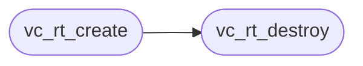

# `voicecloak/src/vc_rt.c`

> Source: [voicecloak/src/vc_rt.c:1](../../voicecloak/src/vc_rt.c#L1) | language `c` | coverage 55.6% | [API index](../index.md)

## Contents

- **Structs:** [`vc_rt_ctx_s`](#vc_rt_ctx_s)
- **Functions:** [`vc_rt_create`](#vc_rt_create), [`vc_rt_destroy`](#vc_rt_destroy), [`vc_rt_reset`](#vc_rt_reset), [`vc_rt_semitones_to_ratio`](#vc_rt_semitones_to_ratio), [`target`](#target), [`vc_rt_transform`](#vc_rt_transform)
- **Macros:** [`M_PI`](#m_pi)

## Call Graph

Solid arrows stay in this module, dashed arrows leave it.



## Structs

<a id="vc_rt_ctx_s"></a>

### `vc_rt_ctx_s`

`struct` | [voicecloak/src/vc_rt.c:10](../../voicecloak/src/vc_rt.c#L10)

```c
struct vc_rt_ctx_s
```

---

## Functions

<a id="vc_rt_create"></a>

### `vc_rt_create`

`function` | [voicecloak/src/vc_rt.c:31](../../voicecloak/src/vc_rt.c#L31)

```c
vc_rt_ctx_t *vc_rt_create(size_t nbins, vc_rt_params_t params)
```

Create a transform context sized for @p nbins frequency bins.

**Parameters**

| Name | Type | Default | Description |
|---|---|---|---|
| `nbins` | `size_t` |  |  |
| `params` | `vc_rt_params_t` |  |  |

**Returns:** `vc_rt_ctx_t *` - Context or NULL on allocation failure / invalid bins or params.

> **Inherited:** Documentation from [`vc_rt_create`](#vc_rt_create) (voicecloak/src/vc_rt.h:43).

*Calls:* [`vc_rt_destroy`](#vc_rt_destroy)

---

<a id="vc_rt_destroy"></a>

### `vc_rt_destroy`

`function` | [voicecloak/src/vc_rt.c:70](../../voicecloak/src/vc_rt.c#L70)

```c
void vc_rt_destroy(vc_rt_ctx_t *c)
```

Release a transform context. NULL-safe.

**Parameters**

| Name | Type | Default | Description |
|---|---|---|---|
| `c` | `vc_rt_ctx_t *` |  |  |

> **Inherited:** Documentation from [`vc_rt_destroy`](#vc_rt_destroy) (voicecloak/src/vc_rt.h:46).

*Called by:* [`vc_rt_create`](#vc_rt_create)

---

<a id="vc_rt_reset"></a>

### `vc_rt_reset`

`function` | [voicecloak/src/vc_rt.c:88](../../voicecloak/src/vc_rt.c#L88)

```c
void vc_rt_reset(vc_rt_ctx_t *c)
```

Reset cross-frame phase state (e.g. on stream restart).

**Parameters**

| Name | Type | Default | Description |
|---|---|---|---|
| `c` | `vc_rt_ctx_t *` |  |  |

> **Inherited:** Documentation from [`vc_rt_reset`](#vc_rt_reset) (voicecloak/src/vc_rt.h:49).

---

<a id="vc_rt_semitones_to_ratio"></a>

### `vc_rt_semitones_to_ratio`

`function` | [voicecloak/src/vc_rt.c:95](../../voicecloak/src/vc_rt.c#L95)

```c
float vc_rt_semitones_to_ratio(float semitones)
```

Convert a semitone shift to a pitch ratio (2^(semitones/12)).

**Parameters**

| Name | Type | Default | Description |
|---|---|---|---|
| `semitones` | `float` |  |  |

**Returns:** `float`

> **Inherited:** Documentation from [`vc_rt_semitones_to_ratio`](#vc_rt_semitones_to_ratio) (voicecloak/src/vc_rt.h:67).

---

<a id="target"></a>

### `target`

`function` | [voicecloak/src/vc_rt.c:139](../../voicecloak/src/vc_rt.c#L139)

```c
* peak region are recorded per target (tgt_src/tgt_pk) so the final * stage can identity-lock no...
```

**Parameters**

| Name | Type | Default | Description |
|---|---|---|---|
| `tgt_pk` | `tgt_src/` |  |  |

**Returns:** `* peak region are recorded per`

---

<a id="vc_rt_transform"></a>

### `vc_rt_transform`

`function` | [voicecloak/src/vc_rt.c:214](../../voicecloak/src/vc_rt.c#L214)

```c
void vc_rt_transform(float *mag, float *phase, size_t nbins, uint32_t sample_rate, size_t hop, void *user)
```

Per-frame transform, compatible with vc_spectral_fn.

**Parameters**

| Name | Type | Default | Description |
|---|---|---|---|
| `mag` | `float *` |  |  |
| `phase` | `float *` |  |  |
| `nbins` | `size_t` |  |  |
| `sample_rate` | `uint32_t` |  |  |
| `hop` | `size_t` |  |  |
| `user` | `void *` |  | Must be a vc_rt_ctx_t* created with matching nbins. Applies frequency-domain pitch shift (constant rate), formant envelope scaling, spectral scrambling, and optional robotization, then rewrites mag/phase to the synthesis spectrum. Accepted ranges: pitch ratio [0.25, 4], formant factor [0.3, 3], scramble intensity [0, 1], robotize 0 or 1. |

> **Inherited:** Documentation from [`vc_rt_transform`](#vc_rt_transform) (voicecloak/src/vc_rt.h:61).

---

## Macros

<a id="m_pi"></a>

### `M_PI`

`macro` | [voicecloak/src/vc_rt.c:7](../../voicecloak/src/vc_rt.c#L7)

```c
#define M_PI
```

---
