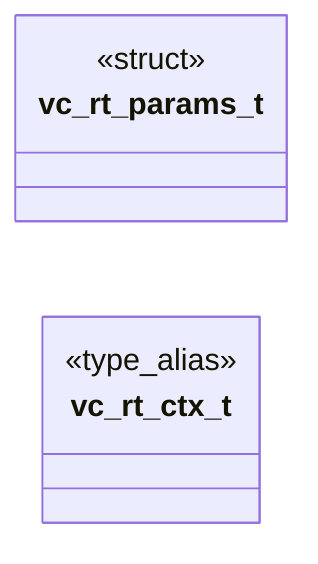

# `voicecloak/src/vc_rt.h`

> Source: [voicecloak/src/vc_rt.h:1](../../voicecloak/src/vc_rt.h#L1) | language `h` | coverage 50.0% | [API index](../index.md)

## Contents

- **Structs:** [`vc_rt_params_t`](#vc_rt_params_t)
- **Type Aliases:** [`vc_rt_ctx_t`](#vc_rt_ctx_t)
- **Functions:** [`vc_rt_create`](#vc_rt_create), [`vc_rt_destroy`](#vc_rt_destroy), [`vc_rt_reset`](#vc_rt_reset), [`vc_rt_transform`](#vc_rt_transform), [`vc_rt_semitones_to_ratio`](#vc_rt_semitones_to_ratio), [`vc_rt_derive`](#vc_rt_derive)
- **Macros:** [`VC_RT_MIN_SEMITONES`](#vc_rt_min_semitones), [`VC_RT_MAX_SEMITONES`](#vc_rt_max_semitones), [`VC_RT_MIN_PITCH_RATIO`](#vc_rt_min_pitch_ratio), [`VC_RT_MAX_PITCH_RATIO`](#vc_rt_max_pitch_ratio), [`VC_RT_MIN_FORMANT_FACTOR`](#vc_rt_min_formant_factor), [`VC_RT_MAX_FORMANT_FACTOR`](#vc_rt_max_formant_factor), [`VC_RT_MAX_SCRAMBLE_INTENSITY`](#vc_rt_max_scramble_intensity)
- **Variables:** [`shift`](#shift)

## Type Diagram



## Structs

<a id="vc_rt_params_t"></a>

### `vc_rt_params_t`

`struct` | [voicecloak/src/vc_rt.h:27](../../voicecloak/src/vc_rt.h#L27)

```c
typedef struct
```

Real-time cloak parameters (already resolved to scalars). pitch_ratio 1.0 = no shift; formant_factor 1.0 = no shift; scramble_intensity 0.0 = none; robotize 0 = off, 1 = every synthesis frame is rewritten with a centered zero phase, which locks the output pitch to sample_rate / hop and erases the input pitch contour.

---

## Type Aliases

<a id="vc_rt_ctx_t"></a>

### `vc_rt_ctx_t`

`type_alias` | [voicecloak/src/vc_rt.h:37](../../voicecloak/src/vc_rt.h#L37)

```c
typedef struct vc_rt_ctx_s vc_rt_ctx_t;
```

Phase-vocoder transform context (per-bin state across frames).

---

## Functions

<a id="vc_rt_create"></a>

### `vc_rt_create`

`function` | [voicecloak/src/vc_rt.h:43](../../voicecloak/src/vc_rt.h#L43)

```c
vc_rt_ctx_t *vc_rt_create(size_t nbins, vc_rt_params_t params);
```

Create a transform context sized for @p nbins frequency bins.

**Parameters**

| Name | Type | Default | Description |
|---|---|---|---|
| `nbins` | `size_t` |  |  |
| `params` | `vc_rt_params_t` |  |  |

**Returns:** `vc_rt_ctx_t *` - Context or NULL on allocation failure / invalid bins or params.

---

<a id="vc_rt_destroy"></a>

### `vc_rt_destroy`

`function` | [voicecloak/src/vc_rt.h:46](../../voicecloak/src/vc_rt.h#L46)

```c
void vc_rt_destroy(vc_rt_ctx_t *c);
```

Release a transform context. NULL-safe.

**Parameters**

| Name | Type | Default | Description |
|---|---|---|---|
| `c` | `vc_rt_ctx_t *` |  |  |

---

<a id="vc_rt_reset"></a>

### `vc_rt_reset`

`function` | [voicecloak/src/vc_rt.h:49](../../voicecloak/src/vc_rt.h#L49)

```c
void vc_rt_reset(vc_rt_ctx_t *c);
```

Reset cross-frame phase state (e.g. on stream restart).

**Parameters**

| Name | Type | Default | Description |
|---|---|---|---|
| `c` | `vc_rt_ctx_t *` |  |  |

---

<a id="vc_rt_transform"></a>

### `vc_rt_transform`

`function` | [voicecloak/src/vc_rt.h:61](../../voicecloak/src/vc_rt.h#L61)

```c
void vc_rt_transform(float *mag, float *phase, size_t nbins, uint32_t sample_rate, size_t hop, void *user);
```

Per-frame transform, compatible with vc_spectral_fn.

**Parameters**

| Name | Type | Default | Description |
|---|---|---|---|
| `mag` | `float *` |  |  |
| `phase` | `float *` |  |  |
| `nbins` | `size_t` |  |  |
| `sample_rate` | `uint32_t` |  |  |
| `hop` | `size_t` |  |  |
| `user` | `void *` |  | Must be a vc_rt_ctx_t* created with matching nbins. Applies frequency-domain pitch shift (constant rate), formant envelope scaling, spectral scrambling, and optional robotization, then rewrites mag/phase to the synthesis spectrum. Accepted ranges: pitch ratio [0.25, 4], formant factor [0.3, 3], scramble intensity [0, 1], robotize 0 or 1. |

---

<a id="vc_rt_semitones_to_ratio"></a>

### `vc_rt_semitones_to_ratio`

`function` | [voicecloak/src/vc_rt.h:67](../../voicecloak/src/vc_rt.h#L67)

```c
float vc_rt_semitones_to_ratio(float semitones);
```

Convert a semitone shift to a pitch ratio (2^(semitones/12)).

**Parameters**

| Name | Type | Default | Description |
|---|---|---|---|
| `semitones` | `float` |  |  |

**Returns:** `float`

*Called by:* [`vc_rt_derive`](voicecloak.src.vc_rt_seed.c.md#vc_rt_derive)

---

<a id="vc_rt_derive"></a>

### `vc_rt_derive`

`function` | [voicecloak/src/vc_rt.h:78](../../voicecloak/src/vc_rt.h#L78)

```c
int vc_rt_derive(const unsigned char *pitch_seed, const unsigned char *formant_seed, const unsigned char *spectral_seed, int witness_mode, vc_rt_params_t *out);
```

Derive cloak parameters from three 32-byte PRNG seeds.

**Parameters**

| Name | Type | Default | Description |
|---|---|---|---|
| `pitch_seed` | `unsigned char *` |  | 32-byte seed. |
| `formant_seed` | `unsigned char *` |  | 32-byte seed. |
| `spectral_seed` | `unsigned char *` |  | 32-byte seed. |
| `witness_mode` | `int` |  | Non-zero for the aggressive witness ranges. |
| `out` | `vc_rt_params_t *` |  | [out] resolved parameters. |

**Returns:** `int` - 0 on success, -1 on error. Ranges mirror vc_dsp_cloak.

---

## Macros

<a id="vc_rt_min_semitones"></a>

### `VC_RT_MIN_SEMITONES`

`macro` | [voicecloak/src/vc_rt.h:7](../../voicecloak/src/vc_rt.h#L7)

```c
#define VC_RT_MIN_SEMITONES
```

---

<a id="vc_rt_max_semitones"></a>

### `VC_RT_MAX_SEMITONES`

`macro` | [voicecloak/src/vc_rt.h:8](../../voicecloak/src/vc_rt.h#L8)

```c
#define VC_RT_MAX_SEMITONES
```

---

<a id="vc_rt_min_pitch_ratio"></a>

### `VC_RT_MIN_PITCH_RATIO`

`macro` | [voicecloak/src/vc_rt.h:9](../../voicecloak/src/vc_rt.h#L9)

```c
#define VC_RT_MIN_PITCH_RATIO
```

---

<a id="vc_rt_max_pitch_ratio"></a>

### `VC_RT_MAX_PITCH_RATIO`

`macro` | [voicecloak/src/vc_rt.h:10](../../voicecloak/src/vc_rt.h#L10)

```c
#define VC_RT_MAX_PITCH_RATIO
```

---

<a id="vc_rt_min_formant_factor"></a>

### `VC_RT_MIN_FORMANT_FACTOR`

`macro` | [voicecloak/src/vc_rt.h:11](../../voicecloak/src/vc_rt.h#L11)

```c
#define VC_RT_MIN_FORMANT_FACTOR
```

---

<a id="vc_rt_max_formant_factor"></a>

### `VC_RT_MAX_FORMANT_FACTOR`

`macro` | [voicecloak/src/vc_rt.h:12](../../voicecloak/src/vc_rt.h#L12)

```c
#define VC_RT_MAX_FORMANT_FACTOR
```

---

<a id="vc_rt_max_scramble_intensity"></a>

### `VC_RT_MAX_SCRAMBLE_INTENSITY`

`macro` | [voicecloak/src/vc_rt.h:13](../../voicecloak/src/vc_rt.h#L13)

```c
#define VC_RT_MAX_SCRAMBLE_INTENSITY
```

---

## Variables

<a id="shift"></a>

### `shift`

`variable` `extern` | [voicecloak/src/vc_rt.h:16](../../voicecloak/src/vc_rt.h#L16)

```c
extern "C" { #endif /** * @brief Real-time cloak parameters (already resolved to scalars). * * pitch_ratio 1.0 = no shift;
```

ifdef __cplusplus

---
