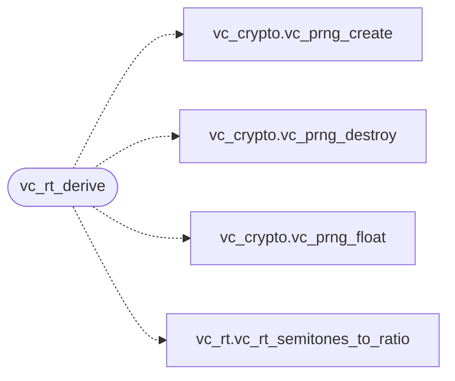

# `voicecloak/src/vc_rt_seed.c`

> Source: [voicecloak/src/vc_rt_seed.c:1](../../voicecloak/src/vc_rt_seed.c#L1) | language `c` | coverage 50.0% | [API index](../index.md)

## Contents

- **Functions:** [`vc_rt_derive`](#vc_rt_derive)

## Call Graph

Solid arrows stay in this module, dashed arrows leave it.



## Functions

<a id="vc_rt_derive"></a>

### `vc_rt_derive`

`function` | [voicecloak/src/vc_rt_seed.c:5](../../voicecloak/src/vc_rt_seed.c#L5)

```c
int vc_rt_derive(const unsigned char *pitch_seed, const unsigned char *formant_seed, const unsigned char *spectral_seed, int witness_mode, vc_rt_params_t *out)
```

Derive cloak parameters from three 32-byte PRNG seeds.

**Parameters**

| Name | Type | Default | Description |
|---|---|---|---|
| `pitch_seed` | `unsigned char *` |  | 32-byte seed. |
| `formant_seed` | `unsigned char *` |  | 32-byte seed. |
| `spectral_seed` | `unsigned char *` |  | 32-byte seed. |
| `witness_mode` | `int` |  | Non-zero for the aggressive witness ranges. |
| `out` | `vc_rt_params_t *` |  | [out] resolved parameters. |

**Returns:** `int` - 0 on success, -1 on error. Ranges mirror vc_dsp_cloak.

> **Inherited:** Documentation from [`vc_rt_derive`](#vc_rt_derive) (voicecloak/src/vc_rt.h:78).

*Calls:* [`vc_prng_create`](voicecloak.src.vc_crypto.h.md#vc_prng_create), [`vc_prng_destroy`](voicecloak.src.vc_crypto.h.md#vc_prng_destroy), [`vc_prng_float`](voicecloak.src.vc_crypto.h.md#vc_prng_float), [`vc_rt_semitones_to_ratio`](voicecloak.src.vc_rt.h.md#vc_rt_semitones_to_ratio)

---
