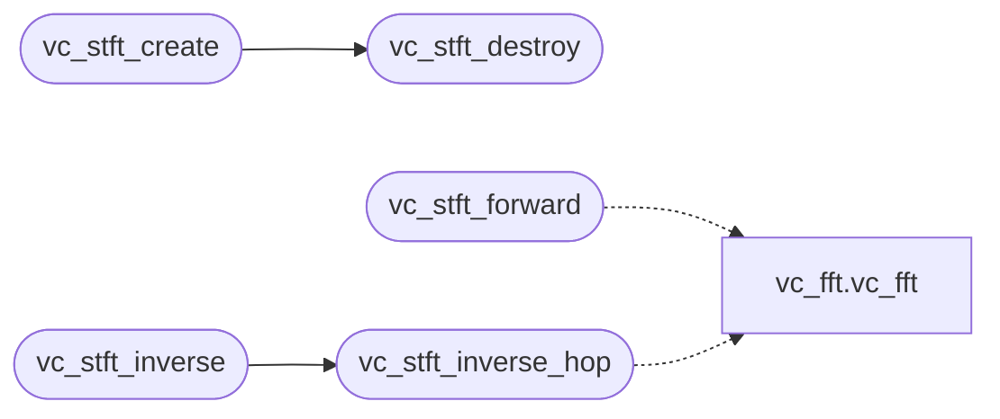

# `voicecloak/src/vc_stft.c`

> Source: [voicecloak/src/vc_stft.c:1](../../voicecloak/src/vc_stft.c#L1) | language `c` | coverage 66.7% | [API index](../index.md)

## Contents

- **Structs:** [`vc_stft_s`](#vc_stft_s)
- **Functions:** [`vc_stft_create`](#vc_stft_create), [`vc_stft_destroy`](#vc_stft_destroy), [`vc_stft_num_bins`](#vc_stft_num_bins), [`vc_stft_forward`](#vc_stft_forward), [`vc_stft_inverse`](#vc_stft_inverse), [`vc_stft_inverse_hop`](#vc_stft_inverse_hop)
- **Macros:** [`M_PI`](#m_pi)

## Call Graph

Solid arrows stay in this module, dashed arrows leave it.



## Structs

<a id="vc_stft_s"></a>

### `vc_stft_s`

`struct` | [voicecloak/src/vc_stft.c:11](../../voicecloak/src/vc_stft.c#L11)

```c
struct vc_stft_s
```

---

## Functions

<a id="vc_stft_create"></a>

### `vc_stft_create`

`function` | [voicecloak/src/vc_stft.c:21](../../voicecloak/src/vc_stft.c#L21)

```c
vc_stft_t *vc_stft_create(size_t fft_size, size_t hop_size)
```

Allocate STFT context.

**Parameters**

| Name | Type | Default | Description |
|---|---|---|---|
| `fft_size` | `size_t` |  | FFT size (power of 2, e.g. 2048). |
| `hop_size` | `size_t` |  | Hop size in samples (e.g. fft_size / 4). |

**Returns:** `vc_stft_t *` - Context pointer or NULL on failure.

> **Inherited:** Documentation from [`vc_stft_create`](#vc_stft_create) (voicecloak/src/vc_stft.h:25).

*Calls:* [`vc_stft_destroy`](#vc_stft_destroy)

---

<a id="vc_stft_destroy"></a>

### `vc_stft_destroy`

`function` | [voicecloak/src/vc_stft.c:58](../../voicecloak/src/vc_stft.c#L58)

```c
void vc_stft_destroy(vc_stft_t *st)
```

Release STFT context.

**Parameters**

| Name | Type | Default | Description |
|---|---|---|---|
| `st` | `vc_stft_t *` |  |  |

> **Inherited:** Documentation from [`vc_stft_destroy`](#vc_stft_destroy) (voicecloak/src/vc_stft.h:30).

*Called by:* [`vc_stft_create`](#vc_stft_create)

---

<a id="vc_stft_num_bins"></a>

### `vc_stft_num_bins`

`function` | [voicecloak/src/vc_stft.c:67](../../voicecloak/src/vc_stft.c#L67)

```c
size_t vc_stft_num_bins(const vc_stft_t *st)
```

Number of frequency bins (fft_size/2 + 1).

**Parameters**

| Name | Type | Default | Description |
|---|---|---|---|
| `st` | `vc_stft_t *` |  |  |

**Returns:** `size_t`

> **Inherited:** Documentation from [`vc_stft_num_bins`](#vc_stft_num_bins) (voicecloak/src/vc_stft.h:75).

---

<a id="vc_stft_forward"></a>

### `vc_stft_forward`

`function` | [voicecloak/src/vc_stft.c:71](../../voicecloak/src/vc_stft.c#L71)

```c
int vc_stft_forward(vc_stft_t *st, const float *samples, size_t num_samples, float **mag, float **phase, size_t *num_frames_out)
```

Forward STFT: decompose a mono float buffer into complex frames.

**Parameters**

| Name | Type | Default | Description |
|---|---|---|---|
| `st` | `vc_stft_t *` |  | STFT context. |
| `samples` | `float *` |  | Input float samples, length = num_samples. |
| `num_samples` | `size_t` |  | Number of input samples. |
| `mag` | `float **` |  | Output: magnitude per bin per frame (row-major, num_frames * (fft_size/2+1)). |
| `phase` | `float **` |  | Output: phase per bin per frame (row-major, same layout as mag). |
| `num_frames_out` | `size_t *` |  | Output: number of frames produced. |

**Returns:** `int` - 0 on success, -1 on error.

> **Inherited:** Documentation from [`vc_stft_forward`](#vc_stft_forward) (voicecloak/src/vc_stft.h:42).

*Calls:* [`vc_fft`](voicecloak.src.vc_fft.c.md#vc_fft)

---

<a id="vc_stft_inverse"></a>

### `vc_stft_inverse`

`function` | [voicecloak/src/vc_stft.c:119](../../voicecloak/src/vc_stft.c#L119)

```c
int vc_stft_inverse(vc_stft_t *st, const float *mag, const float *phase, size_t num_frames, float *samples_out, size_t num_samples_out)
```

Inverse STFT: reconstruct signal from modified magnitude/phase.

**Parameters**

| Name | Type | Default | Description |
|---|---|---|---|
| `st` | `vc_stft_t *` |  | STFT context. |
| `mag` | `float *` |  | Input magnitude (row-major, num_frames * nbins). |
| `phase` | `float *` |  | Input phase (row-major, same layout). |
| `num_frames` | `size_t` |  | Number of frames. |
| `samples_out` | `float *` |  | Output: reconstructed float samples (caller must pre-allocate). |
| `num_samples_out` | `size_t` |  | Number of samples to reconstruct. |

**Returns:** `int` - 0 on success, -1 on error.

> **Inherited:** Documentation from [`vc_stft_inverse`](#vc_stft_inverse) (voicecloak/src/vc_stft.h:57).

*Calls:* [`vc_stft_inverse_hop`](#vc_stft_inverse_hop)

---

<a id="vc_stft_inverse_hop"></a>

### `vc_stft_inverse_hop`

`function` | [voicecloak/src/vc_stft.c:127](../../voicecloak/src/vc_stft.c#L127)

```c
int vc_stft_inverse_hop(vc_stft_t *st, const float *mag, const float *phase, size_t num_frames, float *samples_out, size_t num_samples_out, size_t synth_hop)
```

Inverse STFT with custom synthesis hop (for pitch shifting).

**Parameters**

| Name | Type | Default | Description |
|---|---|---|---|
| `st` | `vc_stft_t *` |  |  |
| `mag` | `float *` |  |  |
| `phase` | `float *` |  |  |
| `num_frames` | `size_t` |  |  |
| `samples_out` | `float *` |  |  |
| `num_samples_out` | `size_t` |  |  |
| `synth_hop` | `size_t` |  | Synthesis hop size in samples (may differ from analysis hop). |

**Returns:** `int`

> **Inherited:** Documentation from [`vc_stft_inverse_hop`](#vc_stft_inverse_hop) (voicecloak/src/vc_stft.h:66).

*Calls:* [`vc_fft`](voicecloak.src.vc_fft.c.md#vc_fft)

*Called by:* [`vc_stft_inverse`](#vc_stft_inverse)

---

## Macros

<a id="m_pi"></a>

### `M_PI`

`macro` | [voicecloak/src/vc_stft.c:8](../../voicecloak/src/vc_stft.c#L8)

```c
#define M_PI
```

---
