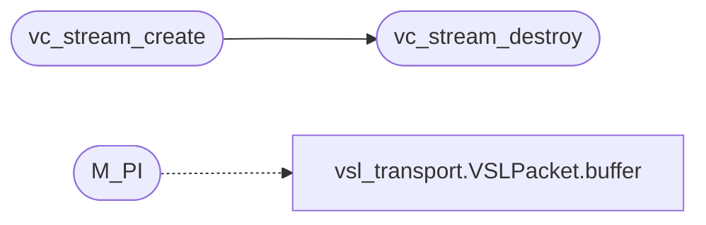

# `voicecloak/src/vc_stream.c`

> Source: [voicecloak/src/vc_stream.c:1](../../voicecloak/src/vc_stream.c#L1) | language `c` | coverage 70.0% | [API index](../index.md)

## Contents

- **Structs:** [`vc_stream_s`](#vc_stream_s)
- **Functions:** [`vc_stream_create`](#vc_stream_create), [`vc_stream_destroy`](#vc_stream_destroy), [`vc_stream_latency_samples`](#vc_stream_latency_samples), [`vc_stream_process`](#vc_stream_process), [`vc_spectral_chain_init`](#vc_spectral_chain_init), [`vc_spectral_chain_add`](#vc_spectral_chain_add), [`vc_spectral_chain_run`](#vc_spectral_chain_run)
- **Macros:** [`M_PI`](#m_pi)

## Call Graph

Solid arrows stay in this module, dashed arrows leave it.



## Structs

<a id="vc_stream_s"></a>

### `vc_stream_s`

`struct` | [voicecloak/src/vc_stream.c:11](../../voicecloak/src/vc_stream.c#L11)

```c
struct vc_stream_s
```

---

## Functions

<a id="vc_stream_create"></a>

### `vc_stream_create`

`function` | [voicecloak/src/vc_stream.c:35](../../voicecloak/src/vc_stream.c#L35)

```c
vc_stream_t *vc_stream_create(size_t fft_size, size_t hop_size, uint32_t sample_rate)
```

Create a streaming engine.

**Parameters**

| Name | Type | Default | Description |
|---|---|---|---|
| `fft_size` | `size_t` |  | Power of two. |
| `hop_size` | `size_t` |  | Must divide fft_size; fft_size/hop_size in {2,4}. |
| `sample_rate` | `uint32_t` |  | Stream sample rate in Hz (> 0). |

**Returns:** `vc_stream_t *` - Context or NULL on invalid arguments / allocation failure.

> **Inherited:** Documentation from [`vc_stream_create`](#vc_stream_create) (voicecloak/src/vc_stream.h:77).

*Calls:* [`vc_stream_destroy`](#vc_stream_destroy)

---

<a id="vc_stream_destroy"></a>

### `vc_stream_destroy`

`function` | [voicecloak/src/vc_stream.c:94](../../voicecloak/src/vc_stream.c#L94)

```c
void vc_stream_destroy(vc_stream_t *st)
```

Release a streaming engine. NULL-safe.

**Parameters**

| Name | Type | Default | Description |
|---|---|---|---|
| `st` | `vc_stream_t *` |  |  |

> **Inherited:** Documentation from [`vc_stream_destroy`](#vc_stream_destroy) (voicecloak/src/vc_stream.h:81).

*Called by:* [`vc_stream_create`](#vc_stream_create)

---

<a id="vc_stream_latency_samples"></a>

### `vc_stream_latency_samples`

`function` | [voicecloak/src/vc_stream.c:107](../../voicecloak/src/vc_stream.c#L107)

```c
size_t vc_stream_latency_samples(const vc_stream_t *st)
```

Algorithmic latency in samples (one FFT frame).

**Parameters**

| Name | Type | Default | Description |
|---|---|---|---|
| `st` | `vc_stream_t *` |  |  |

**Returns:** `size_t`

> **Inherited:** Documentation from [`vc_stream_latency_samples`](#vc_stream_latency_samples) (voicecloak/src/vc_stream.h:84).

---

<a id="vc_stream_process"></a>

### `vc_stream_process`

`function` | [voicecloak/src/vc_stream.c:159](../../voicecloak/src/vc_stream.c#L159)

```c
int vc_stream_process(vc_stream_t *st, const float *in, float *out, size_t n, vc_spectral_fn fn, void *user)
```

Process a block, producing exactly @p n output samples.

**Parameters**

| Name | Type | Default | Description |
|---|---|---|---|
| `st` | `vc_stream_t *` |  | Engine. |
| `in` | `float *` |  | Input samples (length n). |
| `out` | `float *` |  | Output samples (length n). May alias @p in. |
| `n` | `size_t` |  | Number of samples. |
| `fn` | `vc_spectral_fn` |  | Spectral transform, or NULL for identity passthrough. |
| `user` | `void *` |  | Context passed to @p fn. |

**Returns:** `int` - 0 on success, -1 on invalid arguments.

> **Inherited:** Documentation from [`vc_stream_process`](#vc_stream_process) (voicecloak/src/vc_stream.h:96).

---

<a id="vc_spectral_chain_init"></a>

### `vc_spectral_chain_init`

`function` | [voicecloak/src/vc_stream.c:178](../../voicecloak/src/vc_stream.c#L178)

```c
void vc_spectral_chain_init(vc_spectral_chain_t *chain)
```

Empty a chain. NULL-safe.

**Parameters**

| Name | Type | Default | Description |
|---|---|---|---|
| `chain` | `vc_spectral_chain_t *` |  |  |

> **Inherited:** Documentation from [`vc_spectral_chain_init`](#vc_spectral_chain_init) (voicecloak/src/vc_stream.h:54).

---

<a id="vc_spectral_chain_add"></a>

### `vc_spectral_chain_add`

`function` | [voicecloak/src/vc_stream.c:182](../../voicecloak/src/vc_stream.c#L182)

```c
int vc_spectral_chain_add(vc_spectral_chain_t *chain, vc_spectral_fn fn, void *user)
```

Append a stage.

**Parameters**

| Name | Type | Default | Description |
|---|---|---|---|
| `chain` | `vc_spectral_chain_t *` |  |  |
| `fn` | `vc_spectral_fn` |  |  |
| `user` | `void *` |  |  |

**Returns:** `int` - 0 on success; -1 for NULL chain/fn or a full chain (unchanged).

> **Inherited:** Documentation from [`vc_spectral_chain_add`](#vc_spectral_chain_add) (voicecloak/src/vc_stream.h:60).

---

<a id="vc_spectral_chain_run"></a>

### `vc_spectral_chain_run`

`function` | [voicecloak/src/vc_stream.c:191](../../voicecloak/src/vc_stream.c#L191)

```c
void vc_spectral_chain_run(float *mag, float *phase, size_t nbins, uint32_t sample_rate, size_t hop, void *user)
```

vc_spectral_fn that runs every stage of the chain in @p user. A NULL chain leaves the spectrum untouched.

**Parameters**

| Name | Type | Default | Description |
|---|---|---|---|
| `mag` | `float *` |  |  |
| `phase` | `float *` |  |  |
| `nbins` | `size_t` |  |  |
| `sample_rate` | `uint32_t` |  |  |
| `hop` | `size_t` |  |  |
| `user` | `void *` |  |  |

> **Inherited:** Documentation from [`vc_spectral_chain_run`](#vc_spectral_chain_run) (voicecloak/src/vc_stream.h:67).

---

## Macros

<a id="m_pi"></a>

### `M_PI`

`macro` | [voicecloak/src/vc_stream.c:8](../../voicecloak/src/vc_stream.c#L8)

```c
#define M_PI
```

*Calls:* [`VSLPacket.buffer`](legacy.vsl_transport.py.md#vslpacket-buffer)

---
