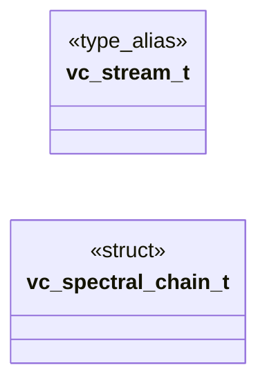

# `voicecloak/src/vc_stream.h`

> Source: [voicecloak/src/vc_stream.h:1](../../voicecloak/src/vc_stream.h#L1) | language `h` | coverage 75.0% | [API index](../index.md)

## Contents

- **Structs:** [`vc_spectral_chain_t`](#vc_spectral_chain_t)
- **Type Aliases:** [`vc_stream_t`](#vc_stream_t)
- **Functions:** [`frames`](#frames), [`vc_spectral_chain_init`](#vc_spectral_chain_init), [`vc_spectral_chain_add`](#vc_spectral_chain_add), [`vc_spectral_chain_run`](#vc_spectral_chain_run), [`vc_stream_create`](#vc_stream_create), [`vc_stream_destroy`](#vc_stream_destroy), [`vc_stream_latency_samples`](#vc_stream_latency_samples), [`vc_stream_process`](#vc_stream_process)
- **Macros:** [`VC_SPECTRAL_CHAIN_MAX`](#vc_spectral_chain_max)
- **Variables:** [`hop`](#hop)

## Type Diagram



## Structs

<a id="vc_spectral_chain_t"></a>

### `vc_spectral_chain_t`

`struct` | [voicecloak/src/vc_stream.h:47](../../voicecloak/src/vc_stream.h#L47)

```c
typedef struct
```

Ordered list of spectral stages run as one vc_spectral_fn. Each stage keeps its own state in its user pointer; the chain only sequences them on the same magnitude/phase buffers.

---

## Type Aliases

<a id="vc_stream_t"></a>

### `vc_stream_t`

`type_alias` | [voicecloak/src/vc_stream.h:20](../../voicecloak/src/vc_stream.h#L20)

```c
typedef struct vc_stream_s vc_stream_t;
```

Streaming STFT overlap-add engine for real-time processing. Unlike the offline vc_stft, this engine keeps constant sample rate: it emits exactly as many output samples as input samples consumed, which is mandatory for a live audio stream. Analysis hop equals synthesis hop; a per-frame spectral callback modifies magnitude and phase in place. Latency is one FFT frame.

---

## Functions

<a id="frames"></a>

### `frames`

`function` | [voicecloak/src/vc_stream.h:32](../../voicecloak/src/vc_stream.h#L32)

```c
* that must persist across frames (phase-vocoder accumulators) lives * in @p user, not in the engine. */ typedef void (*vc_spectral_fn)(float *mag, float *phase, size_t nbins, uint32_t sample_rate, si
```

**Parameters**

| Name | Type | Default | Description |
|---|---|---|---|
| `accumulators` | `phase-vocoder` |  |  |

**Returns:** `* that must persist across`

---

<a id="vc_spectral_chain_init"></a>

### `vc_spectral_chain_init`

`function` | [voicecloak/src/vc_stream.h:54](../../voicecloak/src/vc_stream.h#L54)

```c
void vc_spectral_chain_init(vc_spectral_chain_t *chain);
```

Empty a chain. NULL-safe.

**Parameters**

| Name | Type | Default | Description |
|---|---|---|---|
| `chain` | `vc_spectral_chain_t *` |  |  |

---

<a id="vc_spectral_chain_add"></a>

### `vc_spectral_chain_add`

`function` | [voicecloak/src/vc_stream.h:60](../../voicecloak/src/vc_stream.h#L60)

```c
int vc_spectral_chain_add(vc_spectral_chain_t *chain, vc_spectral_fn fn, void *user);
```

Append a stage.

**Parameters**

| Name | Type | Default | Description |
|---|---|---|---|
| `chain` | `vc_spectral_chain_t *` |  |  |
| `fn` | `vc_spectral_fn` |  |  |
| `user` | `void *` |  |  |

**Returns:** `int` - 0 on success; -1 for NULL chain/fn or a full chain (unchanged).

---

<a id="vc_spectral_chain_run"></a>

### `vc_spectral_chain_run`

`function` | [voicecloak/src/vc_stream.h:67](../../voicecloak/src/vc_stream.h#L67)

```c
void vc_spectral_chain_run(float *mag, float *phase, size_t nbins, uint32_t sample_rate, size_t hop, void *user);
```

vc_spectral_fn that runs every stage of the chain in @p user. A NULL chain leaves the spectrum untouched.

**Parameters**

| Name | Type | Default | Description |
|---|---|---|---|
| `mag` | `float *` |  |  |
| `phase` | `float *` |  |  |
| `nbins` | `size_t` |  |  |
| `sample_rate` | `uint32_t` |  |  |
| `hop` | `size_t` |  |  |
| `user` | `void *` |  |  |

---

<a id="vc_stream_create"></a>

### `vc_stream_create`

`function` | [voicecloak/src/vc_stream.h:77](../../voicecloak/src/vc_stream.h#L77)

```c
vc_stream_t *vc_stream_create(size_t fft_size, size_t hop_size, uint32_t sample_rate);
```

Create a streaming engine.

**Parameters**

| Name | Type | Default | Description |
|---|---|---|---|
| `fft_size` | `size_t` |  | Power of two. |
| `hop_size` | `size_t` |  | Must divide fft_size; fft_size/hop_size in {2,4}. |
| `sample_rate` | `uint32_t` |  | Stream sample rate in Hz (> 0). |

**Returns:** `vc_stream_t *` - Context or NULL on invalid arguments / allocation failure.

*Called by:* [`vc_alsa_run`](voicecloak.src.vc_alsa.c.md#vc_alsa_run)

---

<a id="vc_stream_destroy"></a>

### `vc_stream_destroy`

`function` | [voicecloak/src/vc_stream.h:81](../../voicecloak/src/vc_stream.h#L81)

```c
void vc_stream_destroy(vc_stream_t *st);
```

Release a streaming engine. NULL-safe.

**Parameters**

| Name | Type | Default | Description |
|---|---|---|---|
| `st` | `vc_stream_t *` |  |  |

*Called by:* [`vc_alsa_run`](voicecloak.src.vc_alsa.c.md#vc_alsa_run)

---

<a id="vc_stream_latency_samples"></a>

### `vc_stream_latency_samples`

`function` | [voicecloak/src/vc_stream.h:84](../../voicecloak/src/vc_stream.h#L84)

```c
size_t vc_stream_latency_samples(const vc_stream_t *st);
```

Algorithmic latency in samples (one FFT frame).

**Parameters**

| Name | Type | Default | Description |
|---|---|---|---|
| `st` | `vc_stream_t *` |  |  |

**Returns:** `size_t`

*Called by:* [`vc_alsa_run`](voicecloak.src.vc_alsa.c.md#vc_alsa_run)

---

<a id="vc_stream_process"></a>

### `vc_stream_process`

`function` | [voicecloak/src/vc_stream.h:96](../../voicecloak/src/vc_stream.h#L96)

```c
int vc_stream_process(vc_stream_t *st, const float *in, float *out, size_t n, vc_spectral_fn fn, void *user);
```

Process a block, producing exactly @p n output samples.

**Parameters**

| Name | Type | Default | Description |
|---|---|---|---|
| `st` | `vc_stream_t *` |  | Engine. |
| `in` | `float *` |  | Input samples (length n). |
| `out` | `float *` |  | Output samples (length n). May alias @p in. |
| `n` | `size_t` |  | Number of samples. |
| `fn` | `vc_spectral_fn` |  | Spectral transform, or NULL for identity passthrough. |
| `user` | `void *` |  | Context passed to @p fn. |

**Returns:** `int` - 0 on success, -1 on invalid arguments.

*Called by:* [`vc_alsa_run`](voicecloak.src.vc_alsa.c.md#vc_alsa_run)

---

## Macros

<a id="vc_spectral_chain_max"></a>

### `VC_SPECTRAL_CHAIN_MAX`

`macro` | [voicecloak/src/vc_stream.h:39](../../voicecloak/src/vc_stream.h#L39)

```c
#define VC_SPECTRAL_CHAIN_MAX
```

---

## Variables

<a id="hop"></a>

### `hop`

`variable` `extern` | [voicecloak/src/vc_stream.h:8](../../voicecloak/src/vc_stream.h#L8)

```c
extern "C" { #endif /** * @brief Streaming STFT overlap-add engine for real-time processing. * * Unlike the offline vc_stft, this engine keeps constant sample rate: * it emits exactly as many output s
```

ifdef __cplusplus

---
