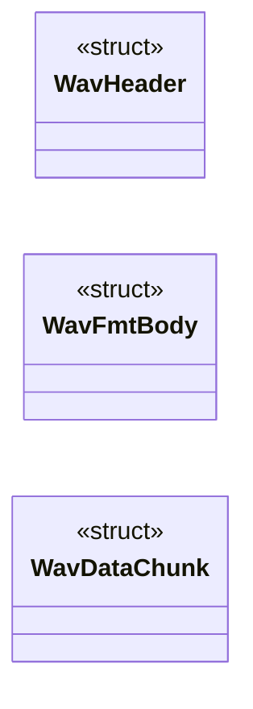

# `voicecloak/src/vc_wav.c`

> Source: [voicecloak/src/vc_wav.c:1](../../voicecloak/src/vc_wav.c#L1) | language `c` | coverage 50.0% | [API index](../index.md)

## Contents

- **Structs:** [`WavHeader`](#wavheader), [`WavFmtBody`](#wavfmtbody), [`WavDataChunk`](#wavdatachunk)
- **Functions:** [`vc_wav_read`](#vc_wav_read), [`vc_wav_write`](#vc_wav_write)

## Type Diagram



## Structs

<a id="wavheader"></a>

### `WavHeader`

`struct` | [voicecloak/src/vc_wav.c:9](../../voicecloak/src/vc_wav.c#L9)

```c
typedef struct
```

pragma pack(push, 1)

---

<a id="wavfmtbody"></a>

### `WavFmtBody`

`struct` | [voicecloak/src/vc_wav.c:15](../../voicecloak/src/vc_wav.c#L15)

```c
typedef struct
```

---

<a id="wavdatachunk"></a>

### `WavDataChunk`

`struct` | [voicecloak/src/vc_wav.c:24](../../voicecloak/src/vc_wav.c#L24)

```c
typedef struct
```

---

## Functions

<a id="vc_wav_read"></a>

### `vc_wav_read`

`function` | [voicecloak/src/vc_wav.c:93](../../voicecloak/src/vc_wav.c#L93)

```c
int vc_wav_read(const char *path, float **samples_out, size_t *num_samples_out, uint32_t *sample_rate_out)
```

Read a mono PCM WAV file into a float buffer [-1.0, 1.0].

**Parameters**

| Name | Type | Default | Description |
|---|---|---|---|
| `path` | `char *` |  | File path. |
| `samples_out` | `float **` |  | Output: allocated float array. |
| `num_samples_out` | `size_t *` |  | Output: number of samples. |
| `sample_rate_out` | `uint32_t *` |  | Output: sample rate (Hz). |

**Returns:** `int` - 0 on success, -1 on error.

> **Inherited:** Documentation from [`vc_wav_read`](#vc_wav_read) (voicecloak/src/vc_wav.h:19).

---

<a id="vc_wav_write"></a>

### `vc_wav_write`

`function` | [voicecloak/src/vc_wav.c:169](../../voicecloak/src/vc_wav.c#L169)

```c
int vc_wav_write(const char *path, const float *samples, size_t num_samples, uint32_t sample_rate)
```

Write a mono float buffer to a 16-bit PCM WAV file.

**Parameters**

| Name | Type | Default | Description |
|---|---|---|---|
| `path` | `char *` |  | File path. |
| `samples` | `float *` |  | Float samples in [-1.0, 1.0]. |
| `num_samples` | `size_t` |  | Number of samples. |
| `sample_rate` | `uint32_t` |  | Sample rate (Hz). |

**Returns:** `int` - 0 on success, -1 on error.

> **Inherited:** Documentation from [`vc_wav_write`](#vc_wav_write) (voicecloak/src/vc_wav.h:31).

---
