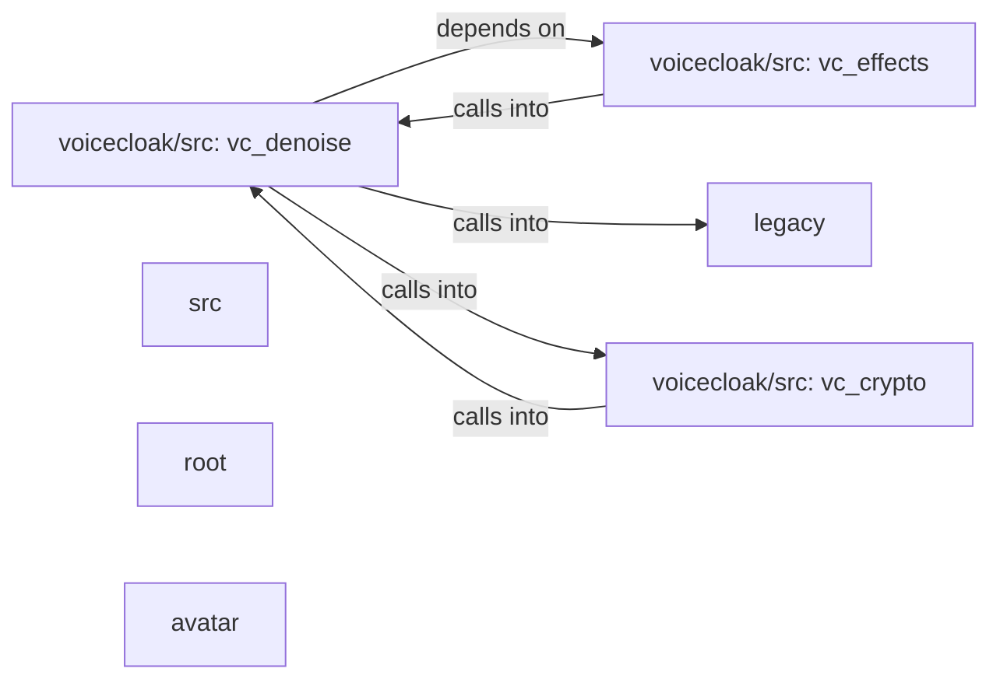

## Details

Static architecture map of 69 files (c, h, py, sh) in 7 components: voicecloak/src: vc_denoise, voicecloak/src: vc_effects, legacy, voicecloak/src: vc_crypto, src, root, avatar. Structure is extracted statically without LLM calls; component prose may be enriched locally.

### voicecloak/src: vc_denoise (1)

voicecloak/src: vc_denoise groups 14 files (c, h) around VC_FFT_H, FFT, VC_RT_H, VC_RT_MIN_SEMITONES, VC_RT_MAX_SEMITONES. vc_alsa_cfg_t: @brief Configuration for a real-time ALSA processing session.

**Related Classes/Methods**:

- <a href="../voicecloak/src/vc_fft.h#L2-L17">voicecloak/src/vc_fft.h::VC_FFT_H</a>
- <a href="../voicecloak/src/vc_fft.h#L18-L26">voicecloak/src/vc_fft.h::FFT</a>
- <a href="../voicecloak/src/vc_rt.h#L2-L6">voicecloak/src/vc_rt.h::VC_RT_H</a>
- <a href="../voicecloak/src/vc_rt.h">voicecloak/src/vc_rt.h::VC_RT_MIN_SEMITONES</a>
- <a href="../voicecloak/src/vc_rt.h">voicecloak/src/vc_rt.h::VC_RT_MAX_SEMITONES</a>
- <a href="../voicecloak/src/vc_rt.h">voicecloak/src/vc_rt.h::VC_RT_MIN_PITCH_RATIO</a>
- <a href="../voicecloak/src/vc_rt.h">voicecloak/src/vc_rt.h::VC_RT_MAX_PITCH_RATIO</a>
- <a href="../voicecloak/src/vc_rt.h">voicecloak/src/vc_rt.h::VC_RT_MIN_FORMANT_FACTOR</a>

### voicecloak/src: vc_effects (2)

voicecloak/src: vc_effects groups 13 files (c, h) around VC_AUDIO_CONFIG_H, VC_AUDIO_MIN_SAMPLE_RATE, VC_AUDIO_MAX_SAMPLE_RATE, VC_AUDIO_MAX_INTERNAL_SAMPLE, VC_LEVEL_MIN_TARGET_DBFS. @brief Accepted sample-rate interval for live effect engines.

**Related Classes/Methods**:

- <a href="../voicecloak/src/vc_audio_config.h#L2-L4">voicecloak/src/vc_audio_config.h::VC_AUDIO_CONFIG_H</a>
- <a href="../voicecloak/src/vc_audio_config.h">voicecloak/src/vc_audio_config.h::VC_AUDIO_MIN_SAMPLE_RATE</a>
- <a href="../voicecloak/src/vc_audio_config.h#L6-L8">voicecloak/src/vc_audio_config.h::VC_AUDIO_MAX_SAMPLE_RATE</a>
- <a href="../voicecloak/src/vc_audio_config.h#L9-L10">voicecloak/src/vc_audio_config.h::VC_AUDIO_MAX_INTERNAL_SAMPLE</a>
- <a href="../voicecloak/src/vc_audio_config.h">voicecloak/src/vc_audio_config.h::VC_LEVEL_MIN_TARGET_DBFS</a>
- <a href="../voicecloak/src/vc_audio_config.h">voicecloak/src/vc_audio_config.h::VC_LEVEL_MAX_TARGET_DBFS</a>
- <a href="../voicecloak/src/vc_audio_config.h">voicecloak/src/vc_audio_config.h::VC_LEVEL_MIN_CEILING_DBFS</a>
- <a href="../voicecloak/src/vc_audio_config.h">voicecloak/src/vc_audio_config.h::VC_LEVEL_MAX_CEILING_DBFS</a>

### legacy (3)

legacy groups 11 files (c, h, py) around VSL_CONFIG_H, VSL_VENDOR_ID, VSL_PRODUCT_ID, VSL_REPORT_ID, VSL_SCALE_FACTOR.

**Related Classes/Methods**:

- <a href="../legacy/vsl_config.h#L4-L10">legacy/vsl_config.h::VSL_CONFIG_H</a>
- <a href="../legacy/vsl_config.h">legacy/vsl_config.h::VSL_VENDOR_ID</a>
- <a href="../legacy/vsl_config.h">legacy/vsl_config.h::VSL_PRODUCT_ID</a>
- <a href="../legacy/vsl_config.h#L13-L19">legacy/vsl_config.h::VSL_REPORT_ID</a>
- <a href="../legacy/vsl_config.h#L20-L22">legacy/vsl_config.h::VSL_SCALE_FACTOR</a>
- <a href="../legacy/vsl_config.h#L23-L24">legacy/vsl_config.h::VSL_MAX_ENCODED_INT</a>
- <a href="../legacy/vsl_config.h">legacy/vsl_config.h::VSL_PACKET_SIZE</a>
- <a href="../legacy/vsl_config.h#L26-L28">legacy/vsl_config.h::VSL_PAYLOAD_SIZE</a>

### voicecloak/src: vc_crypto (4)

voicecloak/src: vc_crypto groups 10 files (c, h) around VC_CRYPTO_H, VC_CRYPTO_SEED_BYTES, VC_CRYPTO_KEY_BYTES, VC_PITCH_SEED_BYTES, VC_FORMANT_SEED_BYTES. vc_prng_s: int i; for (i = 0; i < 3; ++i) { unsigned int outlen = 32; unsigned char...

**Related Classes/Methods**:

- <a href="../voicecloak/src/vc_crypto.h#L2-L10">voicecloak/src/vc_crypto.h::VC_CRYPTO_H</a>
- <a href="../voicecloak/src/vc_crypto.h">voicecloak/src/vc_crypto.h::VC_CRYPTO_SEED_BYTES</a>
- <a href="../voicecloak/src/vc_crypto.h">voicecloak/src/vc_crypto.h::VC_CRYPTO_KEY_BYTES</a>
- <a href="../voicecloak/src/vc_crypto.h">voicecloak/src/vc_crypto.h::VC_PITCH_SEED_BYTES</a>
- <a href="../voicecloak/src/vc_crypto.h">voicecloak/src/vc_crypto.h::VC_FORMANT_SEED_BYTES</a>
- <a href="../voicecloak/src/vc_crypto.h">voicecloak/src/vc_crypto.h::VC_SPECTRAL_SEED_BYTES</a>
- <a href="../voicecloak/src/vc_crypto.h#L16-L23">voicecloak/src/vc_crypto.h::VC_TOTAL_SEED_BYTES</a>
- <a href="../voicecloak/src/vc_crypto.h#L24-L34">voicecloak/src/vc_crypto.h::vc_crypto_keygen</a>

### src (5)

src groups 6 files (c, h) around VSL_DSP_LOGIC_H, VSL_INV_LN2, VSL_MAX_ENCODED_FLOAT, VSL_DB_NEG_INF, VSL_DB_FLOOR_LINEAR. pid: ifdef __cplusplus

**Related Classes/Methods**:

- <a href="../src/vsl_dsp_logic.h#L2-L7">src/vsl_dsp_logic.h::VSL_DSP_LOGIC_H</a>
- <a href="../src/vsl_dsp_logic.h">src/vsl_dsp_logic.h::VSL_INV_LN2</a>
- <a href="../src/vsl_dsp_logic.h#L9-L18">src/vsl_dsp_logic.h::VSL_MAX_ENCODED_FLOAT</a>
- <a href="../src/vsl_dsp_logic.h">src/vsl_dsp_logic.h::VSL_DB_NEG_INF</a>
- <a href="../src/vsl_dsp_logic.h#L20-L21">src/vsl_dsp_logic.h::VSL_DB_FLOOR_LINEAR</a>
- <a href="../src/vsl_dsp_logic.h#L22-L43">src/vsl_dsp_logic.h::VSL_Parameter</a>
- <a href="../src/vsl_dsp_logic.h#L44-L52">src/vsl_dsp_logic.h::VSL_Encode_Gain</a>
- <a href="../src/vsl_dsp_logic.h#L53-L61">src/vsl_dsp_logic.h::VSL_Decode_Gain</a>

### root (6)

root groups 4 files (c, h) around AUDIOBOX_VSL_H, audiobox_model_pid_t, AUDIOBOX_VENDOR_ID, AUDIOBOX_VERSION_STRING, audiobox_model_info_t. audiobox_model_info_t: @brief Pair of product ID and canonical human readable model name.

**Related Classes/Methods**:

- <a href="../audiobox_vsl.h#L21-L25">audiobox_vsl.h::AUDIOBOX_VSL_H</a>
- <a href="../audiobox_vsl.h#L26-L31">audiobox_vsl.h::audiobox_model_pid_t</a>
- <a href="../audiobox_vsl.h#L32-L54">audiobox_vsl.h::AUDIOBOX_VENDOR_ID</a>
- <a href="../audiobox_vsl.h#L55-L63">audiobox_vsl.h::AUDIOBOX_VERSION_STRING</a>
- <a href="../audiobox_vsl.h#L64-L106">audiobox_vsl.h::audiobox_model_info_t</a>
- <a href="../audiobox_vsl.h#L107-L130">audiobox_vsl.h::audiobox_lookup_model</a>
- <a href="../audiobox_vsl.h#L131-L140">audiobox_vsl.h::audiobox_is_primary_interface</a>
- <a href="../audiobox_vsl.h#L141-L149">audiobox_vsl.h::usb_mixer_interface</a>

### avatar (7)

avatar groups 4 files (c, h) around AVATAR_LOGIC_H, avatar_state_t, avatar_cfg_t, avatar_smooth_t, avatar_rms_f32. avatar_cfg_t: @brief Tunable classifier thresholds.

**Related Classes/Methods**:

- <a href="../avatar/avatar_logic.h#L2-L7">avatar/avatar_logic.h::AVATAR_LOGIC_H</a>
- <a href="../avatar/avatar_logic.h#L8-L22">avatar/avatar_logic.h::avatar_state_t</a>
- <a href="../avatar/avatar_logic.h#L23-L32">avatar/avatar_logic.h::avatar_cfg_t</a>
- <a href="../avatar/avatar_logic.h#L33-L44">avatar/avatar_logic.h::avatar_smooth_t</a>
- <a href="../avatar/avatar_logic.h#L45-L51">avatar/avatar_logic.h::avatar_rms_f32</a>
- <a href="../avatar/avatar_logic.h#L52-L59">avatar/avatar_logic.h::avatar_rms_to_dbfs</a>
- <a href="../avatar/avatar_logic.h#L60-L67">avatar/avatar_logic.h::avatar_zcr_f32</a>
- <a href="../avatar/avatar_logic.h#L68-L77">avatar/avatar_logic.h::avatar_hf_ratio_f32</a>
